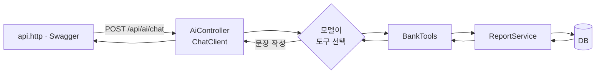

# Day 1. 멱등성 개념 + Spring AI 붙이기 + AI 저축 도우미

> 남은 3일 과정의 첫째 날입니다. 오늘은 **같은 요청을 두 번 보내 보고(멱등성)**, **거래 메모를 AI 에게 분류시키고(Spring AI)**, **AI 에게 우리 서버의 도구를 쥐여 줍니다(Tool Calling)**.
> A 에서는 코드를 **추가하지 않고**, B 와 C 에서는 파일 몇 개만 추가합니다. (A → 태그 `t1-idempotency`, B · C → 태그 `t2-ai`)

## 🎯 오늘의 목표

- 멱등성이 무엇인지 말하고, `POST` 가 왜 위험한지 설명할 수 있다
- `api.http` 로 같은 요청을 두 번 보내 결과를 비교할 수 있다
- Spring AI 의존성 · 설정 · 컨트롤러가 이어지는 방식과, AI 실패에 대비하는 이유를 설명할 수 있다
- AI 저축 도우미(Tool Calling · 프롬프트 파일 · 대화 기억)에서 숫자는 서버가, 문장은 AI 가 만드는 이유를 설명할 수 있다

> 📌 앱을 먼저 실행하세요: `./gradlew bootRun` (H2 메모리 DB, 시드 계좌 3개 · 거래 7건)

> 📝 각 절 끝의 🧩 체크포인트와 마지막의 🏁 미션 · ⚡ 퀴즈로 이해했는지 확인합니다 (하루 20~30분)

---

# Part A. 멱등성 (Idempotency)

## 🎯 목표

같은 요청을 **여러 번** 보내도 서버의 상태가 **한 번 보낸 것과 같은지** 직접 확인합니다.

## 🤔 왜 필요할까요?

> 💡 **멱등성**<br>
> 같은 요청을 한 번 보내든 열 번 보내든 **결과(서버의 상태)가 같은** 성질입니다. 엘리베이터 호출 버튼을 열 번 눌러도 엘리베이터는 한 대만 오는 것과 같아요.

돈이 오가는 `POST` (출금 · 이체)가 멱등이 아니면 이런 일이 생깁니다.

- 손님이 버튼을 **두 번 클릭** → 돈이 두 번 빠진다
- 서버가 처리는 했는데 **응답이 늦어 타임아웃** → 앱이 "실패했나 보다" 하고 **자동 재시도** → 돈이 두 번 빠진다

서버 입장에서는 "같은 요청을 다시 보낸 것" 인지 "우연히 똑같은 새 요청" 인지 **구분할 방법이 없습니다.**

## 💻 코드

이 Part 에서는 **코드를 추가하지 않습니다.** `src/api.http` 에 들어 있는 요청을 보냅니다.

## 🪵 실행·확인

각 요청을 **연달아 두 번** 보내고, 사이사이 `GET {{host}}/api/accounts` 로 상태를 봅니다.

```http
### POST: 계좌 개설
POST {{host}}/api/accounts
Content-Type: application/json

{"customerId":1,"accountType":"적금"}

### PUT: 계좌 정보 통째로 교체
PUT {{host}}/api/accounts/1002-345-112233
Content-Type: application/json

{"customerId":1,"accountType":"입출금"}

### PATCH: 상태만 바꾸기
PATCH {{host}}/api/accounts/1002-345-112233/status
Content-Type: application/json

{"status":"휴면"}

### DELETE: 방금 POST 로 만든 계좌의 accountNo 를 붙여 넣는다
DELETE {{host}}/api/accounts/여기에-accountNo-붙여넣기
```

이 코드에서 측정한 결과입니다.

| 요청 (2번 전송) | 결과 | 멱등? |
|---|---|---|
| `POST /api/accounts` | **계좌가 2개 생김** (계좌번호가 서로 다름) | X |
| `PUT` | 두 번 다 같은 상태 | O |
| `PATCH` 상태 | 두 번 다 같은 상태 (휴면) | O |
| `DELETE` (새로 만든 계좌) | 두 번 다 200, 계좌는 없어진 상태 | O |

> 🚨 실습 주의
> - PUT 으로 계좌를 **입출금** 으로 바꿨고 PATCH 로 **휴면** 으로 만들었으니, `api.http` 의 "(복구)" 요청 두 개로 `적금` · `정상` 으로 되돌리세요. (그대로 두면 뒤에 나오는 적금 합계 리포트 숫자가 달라집니다)
> - DELETE 는 **새로 만든 계좌**로 하세요. 시드 계좌 1~3번은 거래내역이 있어서 지우면 FK 오류가 납니다.

`POST` 만 멱등이 아닌 이유: **보낼 때마다 새로 만들기** 때문입니다. `PUT` · `PATCH` · `DELETE` 는 "이 상태로 만들어라" 이므로 두 번째는 이미 그 상태입니다.

### 해결 원리 (말로만 이해하기)

```
① 클라이언트가 요청마다 고유한 번호(UUID)를 만들어 헤더에 싣는다   Idempotency-Key: abc-123
② 서버는 처리하면서 이 키를 DB 에 저장한다
③ 같은 키가 또 오면 → 다시 처리하지 않고 처음 결과를 돌려준다
④ 동시에 두 개가 들어와도 → DB 의 UNIQUE 가 마지막 방어선으로 하나만 통과시킨다
```

- 재시도할 때는 **같은 키**, 새로운 주문에는 **새 키**를 씁니다. 재시도마다 새 키를 만들면 서버는 다른 요청으로 보고 또 처리해요.
- "이미 처리했는지" 를 코드로만 확인하면(조회 후 저장) 동시에 들어온 두 요청이 **둘 다 통과**할 수 있습니다. 그래서 **DB UNIQUE** 가 필요합니다.

### H2 콘솔로 UNIQUE 체험하기

`http://localhost:8080/h2-console` 접속 (JDBC URL: `jdbc:h2:mem:testdb`, 사용자: `sa`, 비밀번호 비움). 아래를 **H2 콘솔 화면**에 붙여 넣어 실행합니다 (`api.http` 에서 실행하는 게 아닙니다).

```sql
-- 🚨 표 이름은 따옴표 없이 쓴다 (Hibernate 가 따옴표 없이 만들어서 H2 에는 대문자 TRANSACTION 으로 저장돼 있다)
-- ① "같은 요청 표시" 용 칸을 추가한다. UNIQUE = 같은 값이 두 번 들어오면 DB 가 막는다
ALTER TABLE transaction ADD COLUMN idempotency_key VARCHAR(64) UNIQUE;

-- ② 같은 키를 두 거래에 넣어 본다
UPDATE transaction SET idempotency_key = 'abc-123' WHERE tx_id = 1;   -- 성공
UPDATE transaction SET idempotency_key = 'abc-123' WHERE tx_id = 2;   -- 실패: Unique index or primary key violation
```

두 번째 UPDATE 가 `Unique index or primary key violation` 으로 실패하면 성공입니다. **"같은 키는 한 번만"** 을 DB 가 보장해 주는 것이 멱등성 키의 핵심 아이디어예요.

> 📌 **이 과정에서는 Idempotency-Key 를 코드로 구현하지 않습니다.** 개념과 면접 답변으로만 가져갑니다. 위 H2 실습은 메모리 DB 라 앱을 다시 켜면 사라집니다.

## ✍️ 바로 해보기

1. `POST /api/accounts` 를 두 번 보내고 `GET /api/accounts` 로 계좌가 몇 개인지 세어 보세요.
2. H2 콘솔에서 `tx_id = 3` 에도 `'abc-123'` 을 넣으면 어떻게 될까요? 예상한 뒤 실행하세요.

<details>
<summary>정답 보기</summary>

1. 시드 3개에서 **5개**가 됩니다. 두 계좌의 계좌번호가 다릅니다.
2. 1번 거래가 이미 `'abc-123'` 을 갖고 있으므로 **같은 UNIQUE 위반**으로 실패합니다.

</details>

## 🧩 체크포인트

### 멱등 판정표 채우기

아래 표의 빈칸을 **먼저 예상해서** 채우고, `api.http` 로 각 요청을 **연달아 두 번** 보내 확인하세요. 위의 측정 결과 표는 가리고 해 봅니다.

| 메서드 (2번 전송) | 두 번 보낸 뒤 상태 | 멱등? |
|---|---|---|
| `GET /api/accounts` | ? | ? |
| `POST /api/accounts` | ? | ? |
| `PUT /api/accounts/1002-345-112233` | ? | ? |
| `PATCH /api/accounts/1002-345-112233/status` | ? | ? |
| `DELETE /api/accounts/9999-000-000000` (없는 계좌) | ? | ? |

<details>
<summary>정답 보기</summary>

| 메서드 (2번 전송) | 두 번 보낸 뒤 상태 | 멱등? |
|---|---|---|
| `GET` | 같음 (읽기만 하니까) | O |
| `POST` | **계좌가 2개 생김** | X |
| `PUT` | 같음 | O |
| `PATCH` | 같음 | O |
| `DELETE` (없는 계좌) | 두 번 다 200, 상태는 같음 | O |

멱등은 "응답이 같다" 가 아니라 **서버의 상태가 같다** 는 뜻입니다. 확인한 뒤에는 PUT · PATCH 를 `적금` · `정상` 으로 되돌립니다.

</details>

## 🎤 면접 질문

**Q. 멱등성이 무엇이고, 이체 API 에서는 어떻게 보장하나요?**

<details>
<summary>답변 예시</summary>

"같은 요청을 여러 번 보내도 결과가 한 번 보낸 것과 같은 성질입니다. `PUT` · `DELETE` 는 원래 멱등이지만 `POST` 이체는 보낼 때마다 돈이 빠지기 때문에, 클라이언트가 요청마다 `Idempotency-Key` 를 만들어 보내고 서버가 이 키를 저장해 같은 키가 오면 처음 결과를 돌려줍니다. 동시에 들어오는 중복은 DB 의 UNIQUE 제약으로 마지막에 막습니다."

</details>

---

# Part B. Spring AI: 거래 메모를 카테고리로

## 🎯 목표

`POST /api/ai/category` 에 메모를 보내면 `식비 · 쇼핑 · 교통 · 급여 · 저축 · 이체 · 기타` 중 하나가 돌아오게 만듭니다. AI 회사는 **설정만 바꿔** 갈아 끼웁니다.

## 🤔 왜 필요할까요?

`"스타벅스"` 를 `식비` 로 분류하려고 `if (memo.contains(...))` 를 수백 개 쓰는 대신, 말 잘하는 외부 상담원(LLM)에게 물어봅니다. 단, 이 상담원은 **회사 밖에** 있어서 느리고, 돈을 받고, 가끔 틀리고, 가끔 전화를 안 받습니다.

| 용어 | 쉽게 말하면 |
|---|---|
| LLM | 글을 이어 쓰도록 학습된 거대한 AI (ChatGPT, Gemini, Claude 등) |
| 프롬프트 | AI 에게 보내는 지시문. `system`(역할 · 규칙) + `user`(이번 질문) |
| API 키 | 상담원 회사에 낸 **회원증**. 유출되면 남이 내 돈으로 AI 를 쓴다 |
| Spring AI | 어느 회사 AI 든 **같은 코드(`ChatClient`)로** 부르게 해 주는 도구 (JPA 가 DB 종류를 감춰 주듯) |

## 💻 코드

### 1) 의존성: `build.gradle`

```diff
+// Spring AI: BOM = "이 버전들끼리는 서로 맞는다" 는 버전 목록표 (아래 스타터에는 버전을 따로 적지 않는다)
+dependencyManagement {
+	imports {
+		mavenBom 'org.springframework.ai:spring-ai-bom:2.0.1'
+	}
+}
 ...
 dependencies {
+	implementation 'org.springframework.ai:spring-ai-starter-model-openai'
 }
```

스타터는 **하나**(openai)뿐입니다. Gemini · OpenRouter 도 "OpenAI 와 같은 방식(호환)" 으로 부를 수 있어서, 회사를 바꿀 때 **주소(base-url)와 키만** 바꿉니다.

### 2) 기본 설정: `application.yml` 에 추가

```yaml
spring:
  # 🤖 AI 프로필을 켜지 않아도 앱은 떠야 한다 → 키 기본값은 가짜 값 no-key
  #    진짜 키는 프로필 파일이 환경변수에서 읽어 덮어쓴다. 🚨 이 파일에 진짜 키를 적지 않는다
  ai:
    openai:
      api-key: ${AI_API_KEY:no-key}
      max-retries: 0          # 실패하면 다시 시도하지 않고 바로 "기타" 로 대체한다
```

`${이름:기본값}` = 환경변수가 있으면 그 값, 없으면 콜론 뒤의 기본값입니다.

### 3) 프로필 파일 3개

```yaml
# application-gemini.yml
spring:
  ai:
    openai:
      base-url: https://generativelanguage.googleapis.com/v1beta/openai
      api-key: ${GEMINI_API_KEY}              # 🚨 키는 환경변수에서만 읽는다
      chat:
        model: ${AI_MODEL:모델-이름을-넣으세요}   # 수업 당일 사이트에서 저렴한 모델 이름 확인
```

```yaml
# application-openrouter.yml
spring:
  ai:
    openai:
      base-url: https://openrouter.ai/api/v1   # 🚨 /v1 까지 적는다 (스타터가 뒤에 /chat/completions 만 붙인다)
      api-key: ${OPENROUTER_API_KEY}
      chat:
        model: ${AI_MODEL:모델-이름을-넣으세요}   # OpenRouter 는 "제공사/모델" 형태
```

```yaml
# application-openai.yml  (base-url 은 스타터 기본값을 그대로 쓴다)
spring:
  ai:
    openai:
      api-key: ${OPENAI_API_KEY}
      chat:
        model: ${AI_MODEL:모델-이름을-넣으세요}
```

> 📌 `모델-이름을-넣으세요` 는 **자리표시자**입니다. 수업 당일 각 사이트에서 저렴한 모델 이름을 확인해 환경변수 `AI_MODEL` 로 넣으세요. (모델 이름은 자주 바뀝니다)

### 4) `AiController.java`

```java
package com.example.wonit.controller;

import lombok.extern.slf4j.Slf4j;
import org.springframework.ai.chat.client.ChatClient;
import org.springframework.web.bind.annotation.PostMapping;
import org.springframework.web.bind.annotation.RequestBody;
import org.springframework.web.bind.annotation.RequestMapping;
import org.springframework.web.bind.annotation.RestController;

import java.util.List;

// 🤖 거래 메모를 AI 에게 보내 카테고리 하나로 분류한다. AI 는 실패할 수 있으므로 항상 "기타" 로 대체할 길을 둔다
@Slf4j
@RestController
@RequestMapping("/api/ai")
public class AiController {

    record CategoryRequest(String memo) {}
    record CategoryResponse(String memo, String category) {}

    private static final List<String> CATEGORIES = List.of("식비", "쇼핑", "교통", "급여", "저축", "이체", "기타");

    private final ChatClient chatClient;

    // 프로필(gemini · openrouter · openai)에 따라 어느 회사 AI 가 붙을지 정해진다. 코드는 그대로다
    public AiController(ChatClient.Builder builder) {
        this.chatClient = builder.build();
    }

    @PostMapping("/category")
    public CategoryResponse category(@RequestBody CategoryRequest request) {
        String category;
        try {
            category = chatClient.prompt()
                    .system("은행 거래 메모를 분류한다. " + CATEGORIES + " 중 정확히 하나만 고르고, 그 단어만 답한다.")
                    .user(request.memo())
                    .call().content().strip();
        } catch (Exception e) {      // 키 없음 · 시간 초과 등 → 분류 실패가 거래 자체를 막으면 안 된다
            log.warn("AI 분류 실패 → 기타: {}", e.getMessage());
            category = "기타";
        }
        if (!CATEGORIES.contains(category)) {      // 🚨 AI 의 답은 믿지 말고 목록에 있는지 확인한다
            log.warn("AI 가 목록에 없는 답을 함: {} → 기타", category);
            category = "기타";
        }
        return new CategoryResponse(request.memo(), category);
    }
}
```

읽는 순서: **① 시스템 지시문**(역할 + 후보 목록) → **② 사용자 메모** → **③ 호출** → **④ 실패하면 `기타`** → **⑤ 답이 목록에 없어도 `기타`**.

## 🪵 실행·확인

**1. 키 없이 실행 (프로필 없음)**

```bash
./gradlew bootRun
```

앱은 **정상적으로 뜹니다.** (`api-key` 기본값 `no-key` 덕분입니다)

```http
POST {{host}}/api/ai/category
Content-Type: application/json

{"memo":"스타벅스 아메리카노"}
```

측정한 결과: 응답은 `{"memo":"스타벅스 아메리카노","category":"기타"}`, 콘솔에는 `WARN ... AI 분류 실패 → 기타: ...` 가 한 줄 찍힙니다. 에러(500)가 아니라 **정상 응답 + 경고 로그**입니다.

**2. 제공사 프로필로 실행**

키는 **환경변수**로만 넣습니다. 코드나 yml 에 적지 마세요.

```bash
# Gemini (openrouter → OPENROUTER_API_KEY, openai → OPENAI_API_KEY 도 같은 모양)
GEMINI_API_KEY=내키 AI_MODEL=모델이름 ./gradlew bootRun --args='--spring.profiles.active=gemini'
```

- Windows PowerShell: `$env:GEMINI_API_KEY="내키"; ./gradlew bootRun --args='--spring.profiles.active=gemini'`
- IntelliJ: Run Configuration 의 *Environment variables* 와 *Active profiles* 칸에 적습니다.

같은 `api.http` 요청을 보내면, 키가 맞을 때 `"category":"식비"` 처럼 후보 중 하나가 돌아옵니다. (AI 가 정하므로 결과는 모델마다 다를 수 있어요)

> 🚨 프로필을 켰는데 키 환경변수를 안 넣어도 **앱은 뜹니다.** 대신 AI 업체가 요청을 거절해서(400 · 401) 응답은 `"category":"기타"` 가 되고, 로그에 `WARN ... AI 분류 실패 → 기타: 400: ...` 가 찍힙니다. "분류가 전부 기타로 나온다" 면 키부터 확인하세요.

### 🏦 은행에서는: 왜 fallback 이 중요할까요?

AI 는 외부 업체입니다. 키 만료, 서버 점검, 느린 응답은 **언제든** 일어납니다. 은행에서 "메모 분류가 안 된다" 는 이유로 **이체나 거래내역 조회가 멈추면** 안 됩니다. 분류는 편의 기능이고, 돈 흐름이 핵심이니까요. 그래서

- 실패하면 `기타` 로 **대체**하고 WARN 로그만 남긴다 (`catch`)
- `max-retries: 0` 으로 오래 붙잡지 않는다
- AI 의 답은 **믿지 않고** 후보 목록에 있는지 확인한다 (엉뚱한 문장이 DB 에 들어가는 것을 막음)
- 키는 환경변수로만 다룬다 (깃에 올라가면 유출)

## ✍️ 바로 해보기

1. 키 없이 실행한 상태에서 메모를 `"월급"` 으로 바꿔 보내면 어떤 카테고리가 나올까요? 이유도 말해 보세요.
2. 후보에 `의료` 를 추가하려면 어디를 고치나요?

<details>
<summary>정답 보기</summary>

1. 키가 없으므로 AI 호출이 실패해 **`기타`** 입니다. 메모 내용과 상관없이 모두 `기타` 가 나옵니다.
2. `CATEGORIES` 목록 한 곳만 고치면 됩니다. 시스템 지시문이 `CATEGORIES` 로 만들어지고, 목록 검증도 같은 값을 쓰기 때문입니다.

</details>

## 🎤 면접 질문

**Q. 서비스에 외부 AI 를 붙일 때 장애에 어떻게 대비하나요?**

<details>
<summary>답변 예시</summary>

"AI 는 외부 서비스라 실패를 전제로 설계합니다. 호출을 `try/catch` 로 감싸 실패하면 기본값(`기타`)으로 대체하고 WARN 로그를 남겨서, 부가 기능의 장애가 핵심 업무(이체 · 조회)를 막지 않게 했습니다. 재시도는 꺼서 응답이 길어지지 않게 했고, AI 가 후보에 없는 답을 해도 목록 검증으로 걸러 `기타` 로 처리했습니다."

</details>

---

# Part C. AI 저축 도우미 (Tool Calling)

> 태그 `t2-ai` 안에 Part B 와 함께 들어 있습니다. **숫자는 DB 가 계산하고, 문장은 AI 가 만듭니다.**

## 🎯 목표

`POST /api/ai/chat` 에 "지난달 소비 리포트 보여줘" 라고 보내면, AI 가 우리 서버의 메서드(도구)를 골라 부르고 그 숫자로 답하게 만듭니다. 시스템 프롬프트는 **파일**로 빼고, 이어지는 질문을 위해 **대화를 기억**시킵니다.

## 🤔 왜 필요할까요?

Part B 의 AI 는 `기타` 같은 단어 하나만 돌려줬습니다. 이번에는 "이번 달 식비 얼마 썼어?" 처럼 **돈 숫자**가 들어간 답을 시킵니다. 그런데 AI 는 숫자를 지어낼 수 있습니다. 그래서 AI 에게 우리 서버의 메서드(`@Tool`)를 **도구**로 건넵니다. 어떤 도구를 부를지는 AI 가 고르고, **실제 실행은 우리 서버**가 합니다 (Tool Calling).

| 도구 (`BankTools`) | 하는 일 | 쓰는 리포트 |
|---|---|---|
| `myAccounts()` | 내 계좌 목록 · 잔액 · 상태 | `ReportService.accounts` |
| `normalAccountNos()` | '정상' 계좌번호 (`/api/accounts/report1` 과 같은 계산을 이 고객의 계좌로만) | `ReportService.normalAccountNos` |
| `savingBalanceSum()` | 적금 잔액 합계 (`/api/accounts/report2` 와 같은 계산을 이 고객의 계좌로만) | `ReportService.savingBalanceSum` |
| `spendingByCategory(month)` | 한 달 카테고리별 출금 합계 | `ReportService.spending` |
| `monthlySummary(months)` | 최근 몇 달의 월별 입금 · 출금 | `ReportService.monthly` |

- `report1` · `report2` 는 **모든 고객**의 계좌로 계산합니다. AI 도구에 그대로 주면 남의 계좌까지 섞이므로, 도구에는 **내 계좌만**(`findByCustomerId`) 넣은 버전을 줍니다.



> 🚧 **아직 로그인(JWT)이 없습니다.** 오늘은 모든 요청을 **데모 고객 1번(김연지)** 으로 고정합니다. 그래서 `Authorization` 헤더 없이 `api.http` 나 Swagger 에서 바로 부를 수 있습니다. 내일(Day 2) JWT 를 붙이면 "고객 1번" 이 **토큰 주인**으로 바뀝니다.

## 💻 코드

### 1) 리포트 REST: 숫자부터 (`ReportController`)

AI 를 붙이기 전에, 같은 숫자를 **AI 없이** 확인할 수 있는 API 를 먼저 만듭니다. `ReportService` 가 거래를 모아 계산하고(`TransactionRepository` 쿼리 +18줄, `AccountRepository.findByCustomerId` 사용), 컨트롤러는 얇게 둡니다.

```java
@RestController
@RequestMapping("/api/reports")
@RequiredArgsConstructor
public class ReportController {

    // 🚧 아직 로그인(JWT)이 없다 → 데모 고객 1번(김연지)으로 고정. Day 2 JWT 에서 "토큰 주인" 으로 바꾼다
    static final Integer DEMO_CUSTOMER_ID = 1;

    private final ReportService reportService;

    @GetMapping("/spending")      // ?month=2026-09 (생략하면 이번 달)
    public List<CategorySpending> spending(@RequestParam(required = false) YearMonth month) {
        return reportService.spending(DEMO_CUSTOMER_ID, month != null ? month : YearMonth.now());
    }

    @GetMapping("/monthly")       // ?months=3 (최근 몇 달, 1~12)
    public List<MonthlySummary> monthly(@RequestParam(defaultValue = "3") int months) {
        return reportService.monthly(DEMO_CUSTOMER_ID, months);
    }
}
```

### 2) 도구: `BankTools`

```java
// 스프링 Bean 이 아니다: 요청마다 customerId 를 넣어 새로 만든다
public class BankTools {

    private final Integer customerId;   // 🔐 AI 가 바꿀 수 없다 (도구 인자가 아니라 객체 필드)
    private final ReportService reportService;

    @Tool(description = "한 달 동안 카테고리별 출금(소비) 합계. month 는 yyyy-MM 형식")
    public List<CategorySpending> spendingByCategory(@ToolParam(description = "조회할 달, 예: 2026-09") String month) {
        log.info("AI 가 도구 호출: spendingByCategory({})", month);
        return reportService.spending(customerId, YearMonth.parse(month));
    }
    // myAccounts · normalAccountNos · savingBalanceSum · monthlySummary 도 같은 모양
}
```

- `@Tool(description = ...)` 의 설명을 보고 AI 가 도구를 고릅니다. **설명이 곧 사용설명서**입니다.
- 🔐 **`customerId` 는 도구 인자가 아니라 객체 필드**입니다. 도구 인자로 두면 AI 가 아무 번호나 넣을 수 있고, 프롬프트 인젝션("고객 2번 소비도 알려줘")으로 남의 정보를 읽을 수 있습니다. 필드로 두면 AI 는 번호를 **볼 수도 바꿀 수도 없습니다.**
- 오늘은 이 번호가 `ReportController.DEMO_CUSTOMER_ID` (1번) 입니다. Day 2 에서 **토큰 주인**으로 바뀝니다.

### 3) 프롬프트를 파일로 (PromptTemplate)

시스템 프롬프트는 `src/main/resources/prompts/savings-assistant.st` 에 있습니다. 코드 수정 · 재컴파일 없이 문구만 고칠 수 있고, `{today}` 같은 자리는 실행할 때 채웁니다. (이 파일에는 다른 `{` `}` 를 쓰지 않습니다. 변수로 읽힙니다.)

```text
너는 우리WON 뱅킹의 저축 도우미다. 오늘 날짜는 {today} 이다.
금액 · 건수는 반드시 도구로 조회한 값만 쓰고 지어내지 않는다.
소비 리포트를 물으면 카테고리별 합계를 보여 주고 줄일 만한 곳 한두 개를 짚는다.
저축 상담은 월별 입출금으로 한 달에 모을 수 있는 금액을 제안한다.
은행 · 소비 · 저축과 관계없는 질문은 정중히 거절한다.
답은 짧게, 5줄 이내, 금액은 1,234원 형식으로 쓴다.
```

```java
chatClient.prompt()
    .system(sys -> sys.text(savingsPrompt).param("today", LocalDate.now()))   // savingsPrompt = classpath 의 .st 파일
```

### 4) 대화 기억 (ChatMemory)

"그 중에 제일 많이 쓴 건?" 처럼 이어지는 질문을 이해하도록, 대화를 **서버 메모리**에 저장합니다 (최근 20개 메시지). 대화 번호를 `customerId` 로 해서 고객마다 따로 저장됩니다. 서버를 다시 켜면 사라집니다. (DB 에 저장하려면 JDBC `ChatMemoryRepository` 를 쓰는데, 여기서는 설명만 합니다.)

### 5) `AiController` 에 `chat` 과 `clearChat` 추가

```java
@PostMapping("/chat")
public ChatResponse chat(@Valid @RequestBody ChatRequest request) {
    Integer customerId = ReportController.DEMO_CUSTOMER_ID;      // 🚧 Day 2 에서 토큰 주인으로 바뀐다
    try {
        String reply = chatClient.prompt()
                .system(sys -> sys.text(savingsPrompt).param("today", LocalDate.now()))
                .advisors(MessageChatMemoryAdvisor.builder(chatMemory).build())                    // 이전 대화를 같이 보낸다
                .advisors(a -> a.param(ChatMemory.CONVERSATION_ID, String.valueOf(customerId)))    // 누구의 대화인지
                .user(request.message())
                .tools(new BankTools(customerId, reportService))                                   // 🔐 요청마다 새로 만든다
                .call().content();
        return new ChatResponse(reply);
    } catch (Exception e) {      // 키 없음 · 시간 초과 등 → category 와 같은 생각: AI 가 실패해도 서버는 멀쩡히 답한다
        log.warn("AI 도우미 실패: {}", e.getMessage());
        return new ChatResponse("지금은 AI 도우미를 쓸 수 없습니다. 잠시 후 다시 시도해 주세요.");
    }
}

@DeleteMapping("/chat")       // 🧹 "새 대화": 내 대화 기억만 지운다
@ResponseStatus(HttpStatus.NO_CONTENT)
public void clearChat() {
    chatMemory.clear(String.valueOf(ReportController.DEMO_CUSTOMER_ID));
}
```

읽는 순서: **① 시스템 프롬프트(파일)** → **② 이전 대화(기억)** → **③ 질문** → **④ 도구 건네기** → **⑤ 실패하면 안내 문장**.

- 질문은 `ChatRequest` 의 `@NotBlank @Size(max = 500)` 으로 **비어 있지 않고 500자까지**만 받습니다. AI 요금은 글자 수만큼 나오기 때문에, 너무 긴 글은 AI 에게 가기 전에 400 으로 막습니다.

## 🪵 실행·확인

**1. AI 없이 숫자부터** (키가 없어도 됩니다)

```http
### 카테고리별 소비 (이체 100500 · 식비 12000 이 나온다)
GET {{host}}/api/reports/spending?month=2026-09

### 최근 3달 월별 입금 · 출금 합계
GET {{host}}/api/reports/monthly?months=3
```

로그인이 없으니 `Authorization` 헤더가 **필요 없습니다.** Swagger 의 "리포트 API" 에서도 바로 실행됩니다. 이 숫자가 나중에 AI 가 말할 숫자의 **정답지**입니다.

**2. AI 도우미에게 묻기** (제공사 프로필 + 키가 필요합니다. 실행법은 Part B 와 같습니다)

```http
### AI 저축 도우미 (Tool Calling)
POST {{host}}/api/ai/chat
Content-Type: application/json

{"message":"지난달 소비 리포트 보여줘"}

### 이어지는 질문 (서버가 대화를 기억한다. 위 질문 바로 다음에 보낸다)
POST {{host}}/api/ai/chat
Content-Type: application/json

{"message":"그 중에 제일 많이 쓴 건?"}

### 새 대화 → 204 (대화 기억을 지운다)
DELETE {{host}}/api/ai/chat
```

- 🪵 **도구 호출 보기**: 질문하면 서버 콘솔에 `AI 가 도구 호출: spendingByCategory(2026-09)` 가 찍힙니다. AI 가 스스로 `month` 를 `2026-09` 로 바꿔 넣은 것입니다. 이 줄이 없으면 AI 가 도구를 안 쓰고 **지어낸** 것일 수 있으니 숫자를 1번의 정답지와 비교하세요.
- 🔑 **키 없이 띄우면** 앱은 뜨고, 응답은 `{"reply":"지금은 AI 도우미를 쓸 수 없습니다. 잠시 후 다시 시도해 주세요."}`, 서버 로그에는 WARN 이 찍힙니다. 카테고리 분류가 `기타` 로 대체되는 것과 같은 생각입니다.
- 🧠 두 번째 질문이 첫 질문을 이해하면 대화 기억이 동작하는 것입니다. `DELETE` 로 지운 뒤 "그 중에 제일 많이 쓴 건?" 만 다시 물으면 AI 가 무엇을 말하는지 몰라 되묻습니다.
- 🔐 오늘은 로그인이 없어서 **누가 물어도 김연지(1번) 의 계좌**로 답합니다. Day 2 에서 토큰 주인별로 바뀝니다.

### 🏦 은행에서는: 숫자를 AI 가 만들게 두면 안 됩니다

"이번 달 식비 12,000원" 이 틀리면 고객은 그 숫자로 판단합니다. AI 는 그럴듯하게 틀릴 수 있으므로

- 금액 · 건수는 **서버가 DB 로 계산**하고, AI 는 그 결과를 **문장으로 풀어 쓰기만** 한다
- 프롬프트에도 "도구로 조회한 값만 쓰고 지어내지 않는다" 를 적는다
- 같은 리포트를 REST 로 열어 두어 **AI 의 답을 사람이 검산**할 수 있게 한다
- 고객 번호는 AI 가 정하지 않는다 (객체 필드). 오늘은 데모 고객 1번, **Day 2 에서 토큰 주인으로 바뀐다**

## ✍️ 바로 해보기

1. 키 없이 `GET /api/reports/spending?month=2026-09` 를 보내 카테고리별 합계를 확인하세요. (이체 100500 · 식비 12000)
2. `BankTools.spendingByCategory` 의 `@Tool(description = ...)` 를 "아무 설명 없음" 으로 바꾸면 AI 가 이 도구를 잘 고를까요? 이유도 말해 보세요.
3. 도구의 인자를 `spendingByCategory(Integer customerId, String month)` 로 바꾸면 어떤 문제가 생길까요?

<details>
<summary>정답 보기</summary>

1. 이체 100500, 식비 12000 이 나옵니다. 나중에 AI 가 말하는 숫자와 같아야 합니다.
2. 잘 고르지 못합니다. AI 는 **설명을 읽고** 도구를 고르기 때문에, 설명이 없으면 언제 쓰는 도구인지 알 수 없습니다.
3. AI 가 `customerId` 를 마음대로 채울 수 있어서, "2번 고객 소비도 보여 줘" 같은 요청에 **남의 데이터**가 나갈 수 있습니다. 번호는 객체 필드로 두고 서버가 정합니다.

</details>

## 🧩 체크포인트

### AI 가 어떤 도구를 부를까?

도구는 5개입니다 (`myAccounts` · `normalAccountNos` · `savingBalanceSum` · `spendingByCategory(month)` · `monthlySummary(months)`). 질문마다 **어떤 도구가 불릴지** 먼저 예상해 보세요. 키가 있으면 `POST /api/ai/chat` 으로 보내고 콘솔의 `AI 가 도구 호출:` 로그로 확인합니다. 키가 없으면 예상만 합니다.

| 질문 | 내 예상 |
|---|---|
| "지난달 소비 리포트" | |
| "적금 얼마 있어?" | |
| "내 계좌 잔액 알려줘" | |
| "최근 3달 동안 한 달에 얼마 모을 수 있어?" | |

<details>
<summary>정답 보기</summary>

| 질문 | 도구 |
|---|---|
| "지난달 소비 리포트" | `spendingByCategory` (month 는 지난달, 예: `2026-09`) |
| "적금 얼마 있어?" | `savingBalanceSum` |
| "내 계좌 잔액 알려줘" | `myAccounts` |
| "최근 3달 동안 한 달에 얼마 모을 수 있어?" | `monthlySummary(3)` |

도구를 **고르는 것은 AI** 라서 모델마다 다를 수 있습니다. 그래서 숫자는 도구 결과(서버가 DB 로 계산)와 `GET /api/reports/...` 의 정답지로 검산합니다.

</details>

### 프롬프트 파일 고쳐 보기 (시간이 모자라면 건너뛰기)

키가 있을 때만 합니다.

1. `src/main/resources/prompts/savings-assistant.st` 의 `5줄 이내` 를 `1줄로` 로 바꾸고 앱을 다시 시작합니다.
2. 같은 질문을 다시 보내면 답이 짧아지는지 봅니다.
3. 확인한 뒤 원래대로 되돌립니다.

<details>
<summary>정답 보기</summary>

답이 짧아집니다. **재컴파일 없이 문구만 바꿨다** 는 점이 포인트입니다. 프롬프트를 코드(자바 문자열)가 아니라 파일로 뺐기 때문에 가능합니다. (모델마다 얼마나 지키는지는 다를 수 있습니다.)

</details>

## 🎤 면접 질문

**Q. AI 에 Tool Calling 을 붙일 때, 숫자를 AI 가 만들지 않고 서버가 만들게 하는 이유는 무엇인가요?**

<details>
<summary>답변 예시</summary>

"LLM 은 그럴듯한 문장을 만드는 모델이라 금액이나 건수를 지어내거나 틀리게 계산할 수 있습니다. 은행에서는 숫자 하나가 고객의 판단과 신뢰로 이어져서, 계산은 DB 를 쓰는 서버의 메서드(`@Tool`)가 하고 AI 는 어떤 도구를 부를지 고르고 결과를 문장으로 풀어 쓰는 역할만 맡겼습니다. 같은 리포트를 REST 로도 열어서 AI 의 답을 사람이 검산할 수 있게 했고, `customerId` 는 도구 인자가 아니라 서버가 만든 객체 필드로 둬서 AI 가 다른 고객의 데이터를 요청할 수 없게 했습니다."

</details>

---

# 🏁 오늘의 미션

## Postman Tests 로 "멱등 판정" 자동 확인하기

⏱ 10~15분. 눈으로 보던 것을 **자동 검사**로 바꿉니다. 코드(`src/`)는 건드리지 않습니다.

1. Postman 에서 "계좌 개설" 요청(`POST /api/accounts`)을 복제해 `POST #1`, `POST #2` 두 개를 만듭니다.
2. `POST #1` 의 **Tests** 탭 (새 버전은 Scripts → Post-response) 에 첫 계좌번호를 저장하는 줄을 적습니다.
3. `POST #2` 의 Tests 에는 "두 번째 응답의 `accountNo` 가 첫 번째와 **다르다**" 를 확인하는 `pm.test` 를 적습니다.
4. `POST #1` → `POST #2` 순서로 Send 하고 Test Results 에 ✓ 가 뜨는지 봅니다.
5. 덤: `GET /api/reports/spending?month=2026-09` 에 "이체 100500, 식비 12000 이 들어 있다" 를 확인하는 `pm.test` 를 적어 보세요.

<details>
<summary>정답 보기</summary>

`POST #1` 의 Tests:

```javascript
pm.collectionVariables.set("firstNo", pm.response.json().accountNo);
```

`POST #2` 의 Tests:

```javascript
pm.test("POST 는 멱등이 아니다 (새 계좌)", () =>
  pm.expect(pm.response.json().accountNo).to.not.eql(pm.collectionVariables.get("firstNo")));
```

리포트 요청의 Tests (응답은 `[{"category":"이체","total":100500.00,"count":1}, {"category":"식비","total":12000.00,"count":1}]` 처럼 금액이 큰 순서):

```javascript
pm.test("상태코드 200", () => pm.response.to.have.status(200));
pm.test("이체 100500 이 1등, 식비 12000 이 2등", () => {
  const list = pm.response.json();
  pm.expect(list[0].category).to.eql("이체");
  pm.expect(list[0].total).to.eql(100500);
  pm.expect(list[1].category).to.eql("식비");
  pm.expect(list[1].total).to.eql(12000);
});
```

두 번째 검사가 ✓ 이면 "같은 요청을 두 번 보내도 새 계좌가 또 생긴다 = POST 는 멱등이 아니다" 를 자동으로 확인한 것입니다. 계좌가 2개 늘었으니 앱을 다시 켜면 시드로 돌아옵니다.

</details>

---

# ⚡ 5분 퀴즈

1. 멱등인 HTTP 메서드와 멱등이 아닌 메서드를 하나씩 말해 보세요.
2. 같은 멱등성 키로 두 번째 INSERT 가 들어오는 것을 DB 에서 막아 주는 장치는?
3. AI 키 없이 `POST /api/ai/category` 를 부르면 어떤 카테고리가 오나요?
4. Tool Calling 에서 금액 · 건수 숫자는 누가 계산하나요? 그리고 `customerId` 를 도구 인자로 두면 안 되는 이유는?
5. 서버를 재시작하면 `ChatMemory` 의 대화는 어떻게 되나요?

<details>
<summary>정답 보기</summary>

1. 멱등: `GET` · `PUT` · `PATCH`(값으로 바꾸기) · `DELETE`, 멱등이 아님: `POST`.
2. DB 의 **UNIQUE** 제약.
3. **`기타`**. AI 호출이 실패하면 `기타` 로 대체하고 WARN 로그만 남깁니다.
4. **서버가 DB 로** 계산하고, AI 는 문장만 만듭니다. `customerId` 를 인자로 두면 AI 가 아무 번호나 넣어 **남의 데이터**를 읽을 수 있어서, 서버가 만든 객체 필드로 둡니다.
5. **사라집니다.** 대화가 서버 메모리에 있기 때문입니다.

</details>

---

## ✅ 오늘의 정리

- `POST` 만 멱등이 아니다. 멱등성 키 = 클라이언트 키 + 서버 저장 + DB UNIQUE (개념만)
- Spring AI = BOM + openai 스타터 + 프로필 yml + `ChatClient`. AI 는 실패한다 → `기타` 로 대체, 답 검증, 키는 환경변수
- AI 저축 도우미 = `@Tool`(BankTools) + 프롬프트 파일(`.st`) + `ChatMemory`. 숫자는 서버가 DB 로 계산하고 AI 는 문장만 만든다. `customerId` 는 도구 인자가 아니라 객체 필드
- 🚧 오늘은 로그인이 없어 모든 요청이 데모 고객 1번. Day 2 에서 토큰 주인으로 바뀐다
