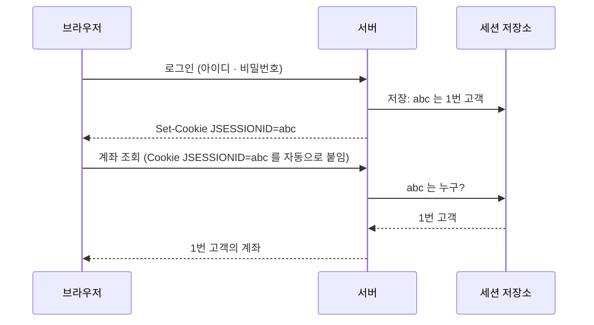
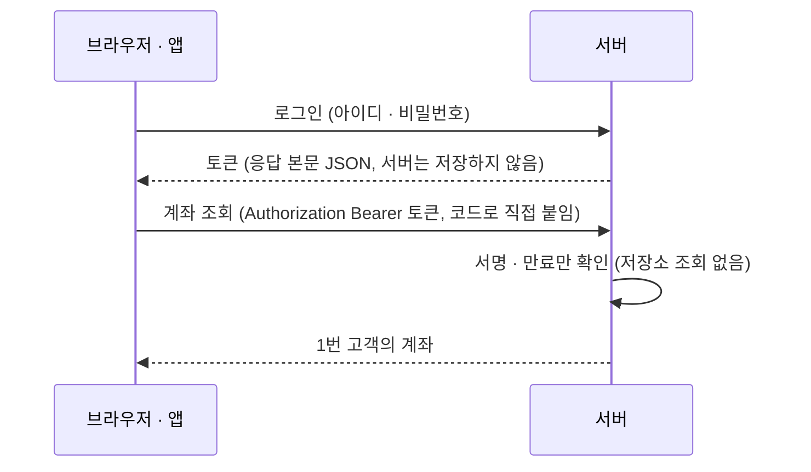

# Day 2. JWT · 요청 추적 · Actuator

> Day 1 의 계좌 API 에 **① 회원가입 · 로그인(JWT)**, **② 요청 번호표(traceId)**, **③ 건강검진 창구(Actuator)** 를 붙입니다. 코드는 `src/` 에 들어 있는 그대로 읽어 봅니다.

> 📝 각 절 끝의 🧩 체크포인트와 마지막의 🏁 미션 · ⚡ 퀴즈로 이해했는지 확인합니다 (하루 20~30분)

---

# Part A. JWT 로그인

## 🎯 목표

- 쿠키 · 세션과 JWT 의 차이를 설명하고, JWT 가 왜 서버가 로그인 상태를 저장하지 않아도 되는지 설명한다.
- 새 아이디로 **회원가입**하고(비밀번호는 BCrypt 해시로만 저장), 같은 아이디가 또 가입되지 않는 것을 확인한다.
- `SecurityConfig` · `AuthController` 의 각 줄을 설명하고, `yeonji` 로 로그인해 **내 계좌만** 조회한다.

## 🍪 먼저, 쿠키와 세션

JWT 를 보기 전에, 웹에서 "로그인 상태" 를 어떻게 기억하는지부터 봅니다.

HTTP 는 **기억이 없습니다.** 요청 하나하나가 서로 모르는 사람입니다. 방금 로그인했어도 다음 요청이 오면 서버는 "누구세요?" 가 됩니다. 그래서 "이 요청은 아까 그 사람이 보냈다" 를 알려 줄 **표식**이 필요합니다.

### 쿠키 : 브라우저가 대신 들고 다니는 쪽지

- 서버가 응답에 `Set-Cookie: 이름=값` 을 실어 보내면, 브라우저가 저장해 둡니다.
- 그 뒤 **같은 사이트로 가는 모든 요청에 `Cookie: 이름=값` 헤더를 브라우저가 자동으로** 붙입니다. 코드를 짜지 않아도 됩니다.

### 세션 : 쪽지에는 번호만, 내용은 서버가

서버가 `JSESSIONID=abc → 1번 고객` 을 **자기 메모리**에 적어 두고, 쿠키에는 번호 `abc` 만 담아 줍니다.

> 💡 **물품보관소 번호표** : 짐(로그인 정보)은 보관소(서버)가 갖고 있고, 손님은 번호표(세션 ID)만 들고 다닙니다. 서버가 꺼지면 보관소가 비어서 번호표가 소용없어집니다.



우리 서버가 쓰는 **JWT** 는 반대입니다. 서버는 아무것도 저장하지 않고, 손님이 **토큰을 직접** 헤더에 붙여 보냅니다.



| 비교 | 세션 (쿠키) | JWT (우리 방식) |
|---|---|---|
| 상태를 저장하는 곳 | **서버** (메모리 · 세션 저장소) | **손님**(토큰). 서버는 저장하지 않음 |
| 서버가 여러 대 | 세션을 서버끼리 공유해야 함 | 같은 비밀키만 있으면 어느 서버든 검증 |
| 강제 로그아웃 | 서버가 세션을 지우면 **바로** | 만료 전에는 취소하기 어려움 (그래서 만료를 짧게) |
| 자동 전송 | 브라우저가 쿠키를 **자동** 전송 → **CSRF 방어가 필요** | 코드가 헤더에 직접 붙임 → 자동 전송 없음 |
| 모바일 앱 | 쿠키 관리가 번거로움 | 헤더에 붙이기만 하면 됨 |

> 🚨 **CSRF** : 쿠키는 자동으로 붙기 때문에, 악성 사이트가 내 브라우저로 은행 주소에 요청을 보내게 만들면 **내 쿠키가 함께 실려 갑니다.** 쿠키 세션을 쓰는 앱은 CSRF 토큰 같은 방어가 필요합니다. 우리 API 는 토큰을 `Authorization` 헤더에 **직접** 붙이고 쿠키를 쓰지 않아서 `SecurityConfig` 에서 이렇게 끕니다.
>
> ```java
> .csrf(AbstractHttpConfigurer::disable)      // 쿠키 세션을 안 쓰고 토큰을 쓰므로 CSRF 는 끈다
> ```

### ✍️ 직접 쳐 보기 : 쿠키 주고 · 읽고 · 지우기 (10분)

`HelloController` 맨 아래에 메서드 두 개를 잠깐 넣어 봅니다. `/hello/**` 는 토큰 없이 열려 있어서 브라우저 주소창만으로 됩니다. **실습이 끝나면 넣은 코드는 지웁니다** (태그 코드에는 들어 있지 않습니다).

```java
// 맨 위 import 에 추가
import jakarta.servlet.http.Cookie;
import jakarta.servlet.http.HttpServletResponse;
```

```java
    // 🍪 쿠키 실습: localhost:8080/hello/cookie 를 두 번 열어 보자
    @GetMapping("/cookie")
    public String cookie(@CookieValue(name = "snack", required = false) String snack,
                         HttpServletResponse response) {
        if (snack == null) {                                     // 처음 온 손님
            Cookie cookie = new Cookie("snack", "choco");
            cookie.setPath("/");                                  // 이 사이트의 모든 주소로 들고 오게
            response.addCookie(cookie);                           // 응답에 Set-Cookie: snack=choco 를 싣는다
            return "쿠키가 없어서 하나 줬습니다. 새로고침해 보세요";
        }
        return "브라우저가 쿠키를 들고 왔습니다: snack=" + snack;   // 다음부터는 브라우저가 알아서 보낸다
    }

    // 🍪 쿠키 지우기: 서버는 브라우저의 쿠키를 직접 못 지운다 → "수명 0" 짜리로 덮어쓰게 한다
    @GetMapping("/cookie/delete")
    public String deleteCookie(HttpServletResponse response) {
        Cookie cookie = new Cookie("snack", "");
        cookie.setPath("/");          // 🚨 만들 때와 path 가 같아야 같은 쿠키로 본다 (빼면 안 지워진다)
        cookie.setMaxAge(0);          // 수명 0 → 브라우저가 바로 지운다
        response.addCookie(cookie);
        return "쿠키를 지웠습니다. /hello/cookie 를 다시 열어 보세요";
    }
```

서버를 다시 켜고, 브라우저에서 개발자 도구(F12)를 연 채로 차례대로 해 봅니다.

| 순서 | 주소 · 할 일 | 화면 | 개발자 도구에서 볼 것 |
|---|---|---|---|
| 1 | `localhost:8080/hello/cookie` | 쿠키가 없어서 하나 줬습니다 | Network → 응답 헤더 `Set-Cookie: snack=choco; Path=/` |
| 2 | 새로고침 | 브라우저가 쿠키를 들고 왔습니다: snack=choco | Network → 요청 헤더 `Cookie: snack=choco` |
| 3 | Application → Cookies 에서 값을 `candy` 로 고치고 새로고침 | …snack=**candy** | 서버는 고친 값을 그대로 믿는다 |
| 4 | `localhost:8080/hello/cookie/delete` | 쿠키를 지웠습니다 | 응답 헤더 `Set-Cookie: snack=; Expires=…1970…` → Cookies 목록에서 사라짐 |
| 5 | `localhost:8080/hello/cookie` | 다시 1번 문구 | 처음 온 손님으로 돌아감 |

- 서버는 **한 번 주기만** 했는데, 그 뒤로는 **브라우저가 알아서** 들고 옵니다. 이것이 쿠키입니다.
- 3번이 중요합니다. **쿠키는 손님이 마음대로 고칠 수 있습니다.** 그래서 쿠키에 `grade=VIP` 같은 값을 넣고 믿으면 안 됩니다. 세션은 쿠키에 **번호표만** 넣고 내용은 서버가 갖고, JWT 는 내용을 넣되 **서명**해서 고치면 티가 나게 합니다.
- `deleteCookie` 에서 `setPath("/")` 를 빼면 지워지지 않습니다. 이름이 같아도 path 가 다르면 브라우저는 다른 쿠키로 봅니다.

### 실제 서비스에서는 언제 쓰나

| 쓰임 | 예 | 쿠키에 담기는 것 |
|---|---|---|
| 로그인 유지 | 은행 · 쇼핑몰 웹사이트 | 세션 번호표 (`JSESSIONID`). 은행은 10분쯤 지나면 자동 로그아웃 + "연장" 버튼 |
| "로그인 상태 유지" 체크 | 포털 | 오래 사는 토큰 (예: 2주) |
| 비회원 장바구니 · 최근 본 상품 | 쇼핑몰 | 장바구니 번호 |
| 화면 설정 | 언어, 다크 모드, "오늘 하루 이 창 보지 않기" 팝업 | `popup=closed` 같은 작은 값 |
| 방문 분석 · 광고 | 방문 통계, 광고 추적 | 방문자 번호 → 그래서 사이트마다 "쿠키 동의" 안내가 뜬다 |

- 쿠키에 넣지 않는 것: 비밀번호, 주민번호, 잔액처럼 **고쳐지거나 새면 안 되는 값**
- 실제 서비스는 쿠키를 만들 때 거의 항상 세 옵션을 붙입니다.
  - **`HttpOnly`** : JS(`document.cookie`)가 못 읽는다 → XSS 로 훔쳐 가기 어렵다
  - **`Secure`** : HTTPS 에서만 보낸다
  - **`SameSite`** : 다른 사이트에서 시작된 요청에는 안 붙인다 → CSRF 방어
- 우리 서비스는 화면(React)이 토큰을 헤더에 직접 붙이는 방식이라 쿠키를 쓰지 않습니다. 아래 체크포인트 4번에서 로그인 응답에 `Set-Cookie` 가 없는 것을 확인합니다.

## 🤔 왜 필요한가

지금까지는 `GET /api/accounts` 를 누구나 호출할 수 있고 모든 고객의 계좌가 나왔습니다. 은행 API 는 **"누가 보냈는지"** 를 알아야 합니다.

앞에서 본 세션과 달리, **JWT** 는 "1번 고객, 30분까지 유효" 라는 내용을 **서버가 서명해서 손님에게 들려 보내고**, 서버는 아무것도 저장하지 않은 채 서명만 확인합니다. 이것을 **stateless** 라고 합니다.

> 💡 **놀이공원 팔찌** : 입구(로그인)에서 신분을 확인하고 팔찌(토큰)를 채워 줍니다. 안에서는 팔찌의 도장(서명)과 유효 시간(exp)만 보면 됩니다.

### JWT 의 모양

점(`.`)으로 나뉜 3덩어리입니다. (아래 값은 예시)

```text
eyJhbGciOiJIUzI1NiJ9 . eyJzdWIiOiIxIiwibmFtZSI6Iuq5gOyXsOyngCIsImdyYWRlIjoiVklQIiwiZXhwIjoxNzkyMzAwMDAwfQ . (서명)
      header                                    payload                                             signature
```

- **header** `{"alg":"HS256"}` : HS256 = 같은 비밀키로 서명하고 같은 비밀키로 검증하는 방식
- **payload(claims)** `{"sub":"1","name":"김연지","grade":"VIP","iat":...,"exp":...}` : `iat` = 발급 시각, `exp` = 만료 시각, 지나면 서버가 거절(401)
- **signature** : header+payload 를 비밀키로 서명한 값. 내용이 바뀌면 서명이 안 맞습니다
- 🚨 payload 는 암호화가 아니라 **인코딩**이라 누구나 읽을 수 있습니다. 비밀번호 같은 것은 넣지 않습니다.

## 코드

### 1) 의존성 (`build.gradle`)

```groovy
implementation 'org.springframework.boot:spring-boot-starter-security'
implementation 'org.springframework.boot:spring-boot-starter-oauth2-resource-server'
testImplementation 'org.springframework.boot:spring-boot-starter-security-test'
```

- `security` : 스프링 시큐리티 본체. 넣는 순간 **모든 주소가 잠깁니다**(기본 동작).
- `oauth2-resource-server` : `Authorization: Bearer 토큰` 검증을 **대신** 해 줍니다. 필터를 직접 짜지 않습니다.
- `security-test` : 테스트에서 "로그인한 척" 하는 도구(`jwt()`).

### 2) 비밀키 설정 (`application.yml`)

```yaml
jwt:
  secret: ${JWT_SECRET:DEMO-ONLY-change-me-0123456789-0123456789}
  expiration-minutes: 30
```

- 비밀키는 32바이트 이상. 기본값은 **학습용**이고 운영은 환경변수 `JWT_SECRET` 으로 덮어씁니다. 토큰은 취소하기 어려우니 **만료를 짧게**(30분) 둡니다.

### 3) `SecurityConfig` — 실제 파일

```java
@Configuration
public class SecurityConfig {
    private final SecretKey key;
    public SecurityConfig(@Value("${jwt.secret}") String secret) {
        this.key = new SecretKeySpec(secret.getBytes(), "HmacSHA256");
    }
    @Bean
    JwtEncoder jwtEncoder() {
        return new NimbusJwtEncoder(new ImmutableSecret<>(key));
    }
    @Bean
    JwtDecoder jwtDecoder() {
        return NimbusJwtDecoder.withSecretKey(key).macAlgorithm(MacAlgorithm.HS256).build();
    }
    @Bean
    PasswordEncoder passwordEncoder() {
        return new BCryptPasswordEncoder();
    }
    @Bean
    SecurityFilterChain filterChain(HttpSecurity http) throws Exception {
        http
                .csrf(AbstractHttpConfigurer::disable)
                .sessionManagement(s -> s.sessionCreationPolicy(SessionCreationPolicy.STATELESS))
                .oauth2ResourceServer(o -> o.jwt(Customizer.withDefaults()))
                .headers(h -> h.frameOptions(f -> f.sameOrigin()))
                .authorizeHttpRequests(a -> a
                        .requestMatchers("/api/auth/login", "/api/auth/signup", "/h2-console/**", "/swagger-ui/**", "/swagger-ui.html", "/v3/api-docs/**", "/hello/**").permitAll()
                        .requestMatchers("/actuator/health", "/actuator/info").permitAll()
                        .anyRequest().authenticated());
        return http.build();
    }
}
```

- 생성자 + `SecretKeySpec` : yml 의 `jwt.secret` 글자를 HS256 용 **키 객체**로 바꿉니다
- `JwtEncoder` : 토큰을 **만드는** 도구 (로그인할 때 사용)
- `JwtDecoder` : 토큰의 서명·만료를 **검증하는** 도구 (모든 요청에서 스프링이 자동 사용)
- `PasswordEncoder`(BCrypt) : 비밀번호를 **되돌릴 수 없는 해시**로 바꾸고 비교합니다. 🏦 평문 보관 금지
- `csrf disable` : CSRF 는 쿠키 세션을 노리는 공격인데(위 🍪 참고), 우리는 쿠키 세션 대신 토큰을 씁니다
- `STATELESS` : 서버가 세션을 만들지도 저장하지도 않습니다
- `oauth2ResourceServer(jwt)` : "`Authorization: Bearer ...` 를 `JwtDecoder` 로 검증하라" 는 한 줄. 통과하면 로그인된 요청으로 처리됩니다
- `frameOptions sameOrigin` : H2 콘솔이 `iframe` 을 써서 허용합니다
- `permitAll()` : 로그인·**회원가입**·H2·Swagger·`/hello`, `health`·`info` 는 **토큰 없이** 허용
- `anyRequest().authenticated()` : **나머지는 전부 토큰 필수.** 없거나 잘못되면 **401**

> 💡 로그인 주소까지 잠겨 있으면 토큰을 받을 방법이 없으니, "토큰을 받는 문" 은 열어 둡니다. 회원가입도 아직 토큰이 없는 사람이 부르므로 마찬가지입니다.

### 4) 고객 표와 회원가입 (`Customer` · `CustomerService`)

로그인하려면 "누가 가입했는지" 를 기억해야 합니다. 그래서 고객을 **DB 표**(`customer`)에 저장합니다. 계좌(`account`)의 `customer_id` 가 이 표를 가리킵니다.

```java
@Entity
@Table(name = "customer")
public class Customer {
    @Id @GeneratedValue(strategy = GenerationType.IDENTITY)
    @Column(name = "customer_id")
    private Integer customerId;

    @Column(name = "login_id", nullable = false, unique = true, length = 30)   // 같은 아이디는 DB 가 막는다 (UNIQUE)
    private String loginId;

    @Column(name = "password_hash", nullable = false, length = 100)   // 🚨 비밀번호는 평문이 아니라 BCrypt 해시만 저장
    private String passwordHash;

    // name(50) · grade(10) · joinedAt 칸은 생략

    // 회원가입: 등급은 "일반" 으로 시작한다
    public static Customer join(String loginId, String passwordHash, String name) { ... }
}
```

```java
// CustomerRepository
Optional<Customer> findByLoginId(String loginId);       // 로그인: 아이디로 찾기
boolean existsByLoginId(String loginId);                // 회원가입: 이미 있는 아이디인지
```

- `login_id` 는 `unique` 입니다. 같은 아이디가 두 번 들어가는 것을 **DB 가 마지막으로 막습니다.**
- 표 이름이 `member` 가 아니라 `customer` 인 이유 : `MEMBER` 는 MySQL 8.0.17 부터 **예약어**라서 표 이름으로 쓰면 문제가 생길 수 있습니다. `customer` 는 원래 수업 DDL 의 표 이름이기도 합니다.

#### 회원가입 서비스

```java
@Service
@RequiredArgsConstructor
public class CustomerService {
    private final CustomerRepository customerRepository;
    private final AccountService accountService;
    private final PasswordEncoder passwordEncoder;

    @Transactional
    public Joined signup(String loginId, String password, String name) {
        if (customerRepository.existsByLoginId(loginId)) {
            throw new ResponseStatusException(HttpStatus.CONFLICT, "이미 있는 아이디입니다.");   // 409
        }
        // 🏦 비밀번호는 BCrypt 해시로만 저장한다. 같은 1234 라도 가입할 때마다 해시가 다르다 (솔트)
        Customer customer = customerRepository.save(Customer.join(loginId, passwordEncoder.encode(password), name));
        // 가입하면 0원 입출금 계좌를 하나 만들어 준다 (홈 화면이 비어 있지 않게). 실패하면 가입도 취소된다
        Account account = accountService.createAccount(new AccountCreateRequest(customer.getCustomerId(), "입출금"));
        return new Joined(customer, account);
    }
}
```

- **중복 확인** : `existsByLoginId` 로 먼저 물어 보고, 있으면 **409**(`이미 있는 아이디입니다.`)입니다.
- **`@Transactional` 한 묶음** : 고객 저장과 계좌 개설이 **같은 트랜잭션**입니다. 계좌를 만들다 실패하면 방금 저장한 고객도 **함께 취소(롤백)** 됩니다. 계좌 없는 고객이 남지 않습니다. (로그의 `Creating new transaction` → `commit` / `rollback` 줄로 볼 수 있습니다.)
- 왜 계좌를 만들어 주나요? 가입 직후 홈 화면(Day 3)이 비어 있지 않게 하려는 것입니다. 잔액은 **0원**입니다.

#### 컨트롤러 : `POST /api/auth/signup`

```java
record SignupRequest(@NotBlank @Size(max = 30) String loginId,
                     @NotBlank @Size(min = 4, max = 72) String password,     // BCrypt 는 72바이트까지만 쓴다
                     @NotBlank @Size(max = 50) String name) {}
record SignupResponse(Integer customerId, String loginId, String name, String accountNo) {}

// 회원가입 → 201. 아이디가 이미 있으면 409, 비밀번호가 4자 미만이면 400
@PostMapping("/auth/signup")
@ResponseStatus(HttpStatus.CREATED)
public SignupResponse signup(@Valid @RequestBody SignupRequest request) {
    CustomerService.Joined joined = customerService.signup(request.loginId(), request.password(), request.name());
    return new SignupResponse(joined.customer().getCustomerId(), joined.customer().getLoginId(),
            joined.customer().getName(), joined.account().getAccountNo());
}
```

- `@Valid` + `@Size` : 비밀번호 4자 미만이면 서비스에 닿기 전에 **400** 입니다. 응답에 **비밀번호도 해시도 넣지 않습니다.**
- `SecurityConfig` 의 `permitAll` 에 `/api/auth/signup` 이 들어 있어서 토큰 없이 부를 수 있습니다. (가입하는 사람은 아직 토큰이 없습니다.)
- 응답에는 토큰이 없습니다. 가입한 뒤 **로그인을 한 번 더** 합니다. (Day 3 화면은 이 두 단계를 이어서 합니다.)

#### BCrypt : 비밀번호를 지키는 법

비밀번호를 그대로(평문으로) 저장하면 DB 가 한 번 유출될 때 **모든 손님의 비밀번호가 그대로 새어 나갑니다.** 그래서 **되돌릴 수 없는 해시**만 저장합니다. `data.sql` 에 들어 있는 `1234` 의 해시는 이렇게 생겼습니다.

```text
$2a$10$E2t4RLX1Grd7wyWqmjOPYuOpAAU0asscBfLSD9s1kuUuXn7I9rIU6
```

- `$2a` = 알고리즘 버전, `10` = 비용, 이어지는 22글자 `E2t4RLX1Grd7wyWqmjOPYu` = **솔트**, 나머지 31글자 = 해시입니다. (전체 60자)

- **솔트(salt)** : 해시할 때마다 **무작위로 섞는 값**입니다. 그래서 같은 `1234` 라도 `encode` 를 부를 때마다 결과가 다릅니다. 같은 비밀번호를 쓰는 두 사람의 해시가 달라 보이고, 미리 계산해 둔 표(레인보우 테이블)로 맞춰 보는 공격이 어려워집니다.
- 솔트는 해시 문자열 **안에** 같이 들어 있습니다. 그래서 `passwordEncoder.matches(입력, 해시)` 가 해시에서 솔트를 꺼내 입력에 똑같이 적용한 뒤 비교할 수 있습니다. 해시를 거꾸로 풀지 않습니다.
- **비용 10** : 일부러 느리게(2의 10제곱 번 반복) 계산해서, 비밀번호를 하나씩 대입해 보는 공격을 늦춥니다. `password_hash` 칸 길이 100 은 해시(60자)가 들어가고도 남는 크기입니다.
- **72바이트** : BCrypt 는 비밀번호의 앞 **72바이트**만 씁니다. 그래서 `@Size(max = 72)` 로 막았습니다. (한글은 글자당 3바이트라 더 짧게 넘을 수 있지만, 수업에서는 글자 수로만 막습니다.)

#### 데모 고객 (`data.sql`)

```sql
INSERT INTO customer (customer_id, login_id, password_hash, name, grade, joined_at) VALUES
    (1, 'yeonji', '$2a$10$E2t4...', '김연지', 'VIP',  '2026-08-01 09:00:00'),
    (2, 'woori',  '$2a$10$E2t4...', '이우리', '일반', '2026-09-01 09:00:00');
-- 회원가입으로 새 고객이 생기면 3번부터 (H2 문법. MySQL 은 AUTO_INCREMENT 가 알아서 이어 간다)
ALTER TABLE customer ALTER COLUMN customer_id RESTART WITH 3;
```

- 두 명 모두 비밀번호는 `1234` 의 **BCrypt 해시**입니다 (평문은 어디에도 없습니다). 새로 가입한 고객이 3번이 되도록 번호를 맞춰 둡니다.

### 5) `AuthController` — 로그인과 `/api/me`

회원은 위의 `customer` 표에 있습니다. 로그인은 그 표에서 아이디로 찾아 BCrypt 로 비교합니다. (회원가입 메서드는 위 4절에서 봤습니다.)

```java
@PostMapping("/auth/login")
public ResponseEntity<?> login(@RequestBody LoginRequest request) {
    Customer user = request.loginId() == null ? null
            : customerRepository.findByLoginId(request.loginId()).orElse(null);   // 아이디를 안 보내면 실패
    // 🚨 아이디가 없는 경우와 비밀번호가 틀린 경우의 메시지를 똑같이 한다 (어느 쪽이 틀렸는지 알려주지 않는다)
    if (user == null || request.password() == null || !passwordEncoder.matches(request.password(), user.getPasswordHash())) {
        return ResponseEntity.status(401)
                .body(new ErrorResponse("LOGIN_FAILED", "아이디 또는 비밀번호가 올바르지 않습니다."));
    }
    Instant now = Instant.now();
    JwtClaimsSet claims = JwtClaimsSet.builder()
            .subject(String.valueOf(user.getCustomerId()))      // 토큰 주인 = 고객번호
            .claim("name", user.getName())
            .claim("grade", user.getGrade())
            .issuedAt(now)
            .expiresAt(now.plus(Duration.ofMinutes(expirationMinutes)))
            .build();
    String token = jwtEncoder.encode(JwtEncoderParameters.from(JwsHeader.with(MacAlgorithm.HS256).build(), claims)).getTokenValue();
    return ResponseEntity.ok(new LoginResponse(token, expirationMinutes * 60, user.getName()));
}
@GetMapping("/me")
public MeResponse me(@AuthenticationPrincipal Jwt jwt) {
    return new MeResponse(jwt.getClaimAsString("name"), jwt.getClaimAsString("grade"));
}
```

- **회원 조회** : 예전처럼 코드 안에 사용자를 적어 두지 않고 `customerRepository.findByLoginId` 로 DB 에서 찾습니다. 데모 고객 `yeonji`(고객번호 1) · `woori`(2)는 `data.sql` 에 들어 있고 비밀번호는 둘 다 `1234` 입니다.
- `passwordEncoder.matches(입력, 해시)` : 입력을 같은 방식으로 해시해 비교합니다. 해시를 거꾸로 풀지 않습니다.
- 🚨 아이디가 없을 때와 비밀번호가 틀렸을 때 **같은 메시지**를 줍니다. 어느 쪽이 틀렸는지 힌트를 주지 않기 위해서입니다.
- `loginId` 나 `password` 를 아예 안 보내도(`{}`) 에러가 아니라 **401** 입니다. `== null` 확인이 없으면 `null` 을 그대로 조회 · 비교하다가 500 이 날 수 있습니다.
- **claims** : `subject` = 고객번호(`"1"`), 그 밖에 `name`, `grade`, 발급·만료 시각.
- 로그인 응답은 토큰을 **JSON 본문**으로만 줍니다. `Set-Cookie` 헤더는 없습니다. (🧩 체크포인트 4번에서 확인합니다.)
- `/api/me` : `@AuthenticationPrincipal Jwt jwt` 로 **검증이 끝난 토큰**을 받아 값을 꺼냅니다. DB 조회가 없습니다.

### 6) 내 계좌만

#### 목록은 토큰 주인의 것만

```java
// AccountRepository: List<Account> findByCustomerId(Integer customerId);
// AccountService.findMine(customerId) 가 위 메서드를 호출한다
// AccountController
@GetMapping
public List<AccountResponse> findAll(@AuthenticationPrincipal Jwt jwt) {
    return accountService.findMine(Integer.valueOf(jwt.getSubject())).stream().map(AccountResponse::from).toList();
}
```

- 고객번호를 **요청 파라미터가 아니라 토큰의 `subject` 에서** 꺼냅니다. `?customerId=2` 로 남의 목록을 달라고 할 길이 없습니다.
- `data.sql` 에 `woori`(고객 2)의 계좌가 하나 추가되어 `yeonji` 3개 / `woori` 1개가 보입니다.

#### 주소에 계좌번호가 있으면 `checkMine` 으로 주인 확인

목록은 막았지만, `GET /api/accounts/1002-345-678901` 처럼 **주소에 계좌번호를 적으면** 남의 계좌도 부를 수 있습니다. 그래서 계좌번호가 주소에 들어가는 API 는 **맨 앞에서** 주인부터 확인합니다.

```java
// AccountController — 확인용 도우미 메서드
private void checkMine(Jwt jwt, String accountNo) {
    accountService.checkMine(Integer.valueOf(jwt.getSubject()), accountNo);
}

// AccountService — 계좌의 주인과 토큰 주인을 비교
public void checkMine(Integer customerId, String accountNo) {
    if (!customerId.equals(getAccount(accountNo).getCustomerId())) {
        throw new ResponseStatusException(HttpStatus.FORBIDDEN, "본인 계좌만 사용할 수 있습니다.");
    }
}
```

사용하는 모습은 이렇습니다. 맨 첫 줄에서 부릅니다.

```java
@GetMapping("/{accountNo}")
public AccountResponse findOne(@AuthenticationPrincipal Jwt jwt, @PathVariable("accountNo") String accountNo){
    checkMine(jwt, accountNo);                 // 남의 계좌면 여기서 403, 아래는 실행되지 않는다
    return AccountResponse.from(accountService.getAccount(accountNo));
}
```

- 적용된 곳 : 조회(`GET /{accountNo}`) · 수정(`PUT`) · 상태 변경(`PATCH .../status`) · 해지(`DELETE`) · 거래내역(`GET .../transactions`). Day 3 에서 붙는 입금(`deposits`)도 같습니다.
- `getAccount(accountNo)` 가 계좌를 찾습니다. 없는 계좌번호면 여기서 **404** 가 먼저 납니다.
- **403 과 404 의 뜻** : 404 = "그런 계좌가 없습니다", 403 = "계좌는 있는데 당신 것이 아닙니다". 계좌가 있는지 없는지는 알려 주고, 내용은 알려 주지 않습니다.

#### 주인은 토큰이 정한다 (PUT · POST)

수정(PUT)과 개설(POST)은 Body 에 `customerId` 를 적을 수 있는 모양입니다. 이 값을 믿으면 남의 이름으로 계좌를 만들거나 내 계좌를 남에게 넘길 수 있습니다. 그래서 **Body 의 `customerId` 는 버리고 토큰에서 꺼낸 값으로 바꿔** 서비스에 넘깁니다.

```java
request = new AccountCreateRequest(Integer.valueOf(jwt.getSubject()), request.accountType());
```

- `{"customerId": 2, "accountType": "적금"}` 을 `yeonji` 토큰으로 보내도 **고객 1번의 계좌**가 만들어집니다. Body 에 뭘 적든 같습니다.

#### 🚧 Day 0 실습용 주소는 그대로입니다

모든 주소를 막은 것은 아닙니다. 아래 주소는 Day 0 에서 만든 **실습용 조회**라서 일부러 그대로 두었고, **모든 고객의 계좌 · 거래가 보입니다.**

- `/api/accounts/report1` · `report2` · `balance` · `sort` · `status/{status}` · `account-type/{type}`
- `/transactions` · `/transactions/select` · `/transactions/select2`

실제 서비스라면 이 주소들은 막거나 **내 것만 보이게** 고쳐야 합니다. 위의 `checkMine` 은 "주소에 계좌번호가 있는 API" 를 지키는 장치입니다.

#### 🤖 Day 1 의 리포트 · AI 도우미도 "토큰 주인" 으로

Day 1 에서는 로그인이 없어서 리포트 API 와 AI 도우미가 **데모 고객 1번**(`DEMO_CUSTOMER_ID`)으로 고정되어 있었습니다. 이제 `ReportController.spending` · `monthly` 와 `AiController.chat` · `clearChat` 도 같은 방식으로 바꿉니다.

```java
// Day 1: 누가 부르든 고객 1번
reportService.spending(DEMO_CUSTOMER_ID, month);
// Day 2: 토큰 주인 (메서드 인자에 @AuthenticationPrincipal Jwt jwt 를 추가한다)
reportService.spending(Integer.valueOf(jwt.getSubject()), month);
```

`AiController.chat` 도 마찬가지로 `Integer customerId = Integer.valueOf(jwt.getSubject());` 가 되어, `new BankTools(customerId, ...)` 와 대화 번호에 토큰 주인의 번호가 들어갑니다.

- 🔐 **왜 바꾸나요?** 로그인 없이 쓰면 누가 물어도 김연지의 소비가 나옵니다. **남의 소비 리포트를 AI 가 읽어 주면 안 됩니다.** 고객 번호는 AI 도 요청 파라미터도 아닌 **토큰의 `subject`** 에서만 꺼냅니다.
- 🧠 **대화 기억도 토큰 주인별**입니다. 대화 번호가 `customerId` 라서 `yeonji` 의 대화와 `woori` 의 대화가 섞이지 않고, "새 대화"(`DELETE /api/ai/chat`)도 **내 기억만** 지웁니다.
- `ReportFlowTest` 도 바뀝니다. 요청마다 `.with(jwt().jwt(j -> j.subject("1")))` 로 로그인한 척하고, 아래를 더 확인합니다.
  - 토큰 없이 리포트 · 채팅을 부르면 **401**
  - 고객 2(`woori`)로 부르면 소비 리포트가 **빈 목록**이고, `BankTools.myAccounts()` 는 `1002-555-667788` 만 돌려준다
- `src/api.http` 의 리포트 · 챗봇 요청에도 `Authorization: Bearer {{token}}` 줄이 붙습니다. 먼저 로그인해서 토큰을 받으세요.

### 7) 401 과 403
**401** = "누구세요?"(토큰 없음·위조·만료, 로그인 실패). **403** = "누군지는 알지만 권한이 없습니다" — `woori` 가 `yeonji` 의 계좌 주소를 부르면 나옵니다(`checkMine`). Day 3 의 이체 · 입금에서도 남의 계좌를 건드리면 같은 403 입니다.

### 8) 테스트에서는 토큰을 어떻게 붙이나

`@WebMvcTest` 는 로그인 API 를 거치지 않으므로 `jwt()` 로 **로그인한 척**합니다. (Day 1 테스트에 `.with(jwt().jwt(j -> j.subject("1")))` 만 추가)

```java
// import static ...SecurityMockMvcRequestPostProcessors.jwt;
mockMvc.perform(get("/api/accounts/9999-000-000000").with(jwt().jwt(j -> j.subject("1"))))
        .andExpect(status().isNotFound());
```

`AuthFlowTest`(`@SpringBootTest`)는 앱 전체로 **진짜 흐름**을 확인합니다. 테스트는 8개입니다.

| 테스트 | 기대 결과 |
|---|---|
| `yeonji` 로그인 → 계좌 조회 | 200, 3개 |
| `woori` 로그인 → `yeonji` 계좌 조회 · 거래내역 · 상태 변경(PATCH) | 모두 **403** |
| 아이디 없이 로그인(`{}`) | **401** (500 이 아니다) |
| 토큰 없이 계좌 조회 | **401** |
| 비밀번호 틀림 | **401** `LOGIN_FAILED` |
| 회원가입 → 그 아이디로 로그인 → 계좌 조회 | 가입 **201**, 내 계좌 **1개**(입출금, 잔액 0) |
| 이미 있는 아이디로 가입 / 비밀번호 3자로 가입 | **409** / **400** |
| 가입한 고객의 `passwordHash` | 평문이 아니고 `$2` 로 시작 (BCrypt 해시) |

```java
String token = JsonMapper.builder().build().readTree(login("yeonji", "1234")).get("accessToken").asText();
mockMvc.perform(get("/api/accounts").header("Authorization", "Bearer " + token))
        .andExpect(status().isOk())
        .andExpect(jsonPath("$.length()").value(3));       // yeonji 의 계좌 3개
mockMvc.perform(get("/api/accounts")).andExpect(status().isUnauthorized());   // 토큰 없음 → 401

// wooriToken = woori 로 로그인해서 받은 토큰. yeonji 의 계좌를 부르면 → 403
mockMvc.perform(get("/api/accounts/1002-345-112233").header("Authorization", "Bearer " + wooriToken))
        .andExpect(status().isForbidden());
```

`AccountControllerTest` 의 `.with(jwt().jwt(j -> j.subject("1")))` 는 **"고객 1번이 로그인한 척"** 입니다. 컨트롤러가 `Integer.valueOf(jwt.getSubject())` 로 고객번호를 꺼내기 때문에 `subject` 가 비어 있으면 숫자로 바꾸다가 실패합니다. (서비스는 가짜라서 `checkMine` 은 아무 일도 하지 않습니다)

## 🪵 실행·확인

`src/api.http` 의 **로그인** 요청 한 번이 응답의 토큰을 `{{token}}` 변수에 저장하고, 아래 모든 요청이 그 변수를 씁니다. 새 아이디는 **회원가입** 요청으로 만듭니다.

```http
### 로그인
POST {{host}}/api/auth/login
Content-Type: application/json

{"loginId":"yeonji","password":"1234"}

> 

### 회원가입 → 201 (입출금 계좌 1개가 함께 생긴다). 같은 아이디로 다시 보내면 409
POST {{host}}/api/auth/signup
Content-Type: application/json

{"loginId":"newbie","password":"abcd","name":"새회원"}

### 비밀번호가 4자 미만 → 400
POST {{host}}/api/auth/signup
Content-Type: application/json

{"loginId":"newbie2","password":"123","name":"짧은비번"}

### 계좌 목록
GET {{host}}/api/accounts
Authorization: Bearer {{token}}
```

회원가입 응답은 `{"customerId":3,"loginId":"newbie","name":"새회원","accountNo":"…"}` 모양입니다. 새 고객은 `data.sql` 의 두 명 다음인 **3번**부터 시작합니다. 응답에는 토큰이 없으니, 가입한 아이디(`newbie` / `abcd`)로 **로그인 요청을 다시** 보내 토큰을 받습니다.

확인할 것: `woori` 토큰으로 `GET /api/accounts/1002-345-678901` → **403** `본인 계좌만 사용할 수 있습니다.` / `/api/me` → `{"name":"김연지","grade":"VIP"}` / `yeonji` 계좌 3개 / `woori` 로 재로그인하면 1개(`1002-555-667788`) / `Authorization` 줄을 지우면 **401** / 비밀번호 `0000` 이면 **401** `LOGIN_FAILED`. 토큰은 30분 뒤 만료되니 갑자기 401 이면 **다시 로그인**합니다.

회원가입에서 확인할 것: `newbie` 로 로그인해 `GET /api/accounts` → 계좌 **1개**(입출금, 잔액 0) / 같은 아이디로 다시 가입 → **409** `이미 있는 아이디입니다.` / 비밀번호 `123` → **400**. H2 콘솔(`http://localhost:8080/h2-console`)에서 `select login_id, password_hash from customer` 를 실행하면 `yeonji` · `woori` · `newbie` 모두 `$2a$10$...` 로 시작하는 **해시**이고 `1234` 는 어디에도 보이지 않습니다.

> 💡 **Swagger 로 하려면** : `http://localhost:8080/swagger-ui.html` 을 열고 **오른쪽 위 `Authorize`** 를 누릅니다. `POST /api/auth/login` 을 먼저 Try it out → Execute 해서 받은 `accessToken` 값(`Bearer ` 는 빼고)을 붙여 넣으면, 이후 모든 API 의 Try it out 에 토큰이 자동으로 붙습니다. 토큰이 만료되면 다시 로그인해서 Authorize 를 갱신합니다.

## ✍️ 바로 해보기

1. `woori` 로 로그인한 뒤 `GET /api/accounts` 를 호출하면 몇 개의 계좌가 나오고, 왜 `yeonji` 의 계좌는 안 보일까요?
2. 같은 토큰으로 `GET /api/accounts/1002-345-678901` 을 부르면 어떤 상태 코드가 나오고, 없는 계좌번호 `9999-000-000000` 이면 어떻게 다를까요?
3. `newbie` 로 가입한 뒤 **같은 요청을 한 번 더** 보내면 어떻게 되나요? 그리고 `newbie` 로 로그인해 `GET /api/accounts` 를 부르면 몇 개가 나올까요?

<details>
<summary>정답 보기</summary>

1. 1개(`1002-555-667788`)입니다. `AccountController.findAll` 이 토큰의 `subject`(woori 는 `"2"`)를 꺼내 `findByCustomerId(2)` 로 조회하기 때문입니다. 요청 어디에도 고객번호를 넣을 곳이 없습니다.
2. `1002-345-678901` 은 **403**(있는 계좌지만 yeonji 의 것), `9999-000-000000` 은 **404**(그런 계좌가 없음)입니다. `checkMine` 이 계좌를 먼저 찾고, 그다음 주인을 비교하기 때문입니다.
3. 두 번째는 **409** `이미 있는 아이디입니다.` 입니다. `existsByLoginId` 가 먼저 막고, 마지막 방어선은 DB 의 `UNIQUE` 입니다. 로그인하면 계좌는 **1개**(입출금, 잔액 0)입니다. 가입할 때 같은 `@Transactional` 안에서 만들어 주기 때문입니다.

</details>

## 🧩 체크포인트

### 1. 토큰 뜯어 보기

로그인 응답의 `accessToken` 을 [jwt.io](https://jwt.io) 에 붙여 넣어 보세요.

> 🚨 **학습용 데모 토큰만** 붙여 넣습니다. 실제 서비스의 토큰은 외부 사이트에 붙여 넣지 않습니다.

1. header 와 payload 에 무엇이 보이나요?
2. `exp` 에서 `iat` 를 빼면 몇 초일까요? (`application.yml` 의 만료 분과 비교)

<details>
<summary>정답 보기</summary>

1. header `{"alg":"HS256"}`, payload `{"sub":"1","name":"김연지","grade":"VIP","iat":…,"exp":…}` 가 보입니다.
2. `exp − iat` = 만료 분 × 60 입니다 (30분이면 1800초).

토큰은 **암호화가 아니라 서명**이라 누구나 읽을 수 있습니다. 그래서 비밀번호 같은 것은 넣지 않습니다.

</details>

### 2. 토큰을 고쳐서 보내 보기

예상한 뒤 확인하세요. `GET /api/accounts` 에 아래 토큰을 붙여 보냅니다.

1. 토큰 끝(서명)의 한 글자를 바꾼 토큰
2. payload 의 `sub` 를 `"2"` 로 바꿔 다시 인코딩한 토큰 (남인 척하기)

<details>
<summary>정답 보기</summary>

둘 다 **401** 입니다. 내용이 바뀌면 서명이 맞지 않기 때문입니다. 서버는 비밀키를 가진 쪽만 서명을 만들 수 있다는 점으로 위조를 걸러 냅니다.

</details>

### 3. 만료 시간 줄여 보기 (시간이 모자라면 건너뛰기)

1. `application.yml` 의 `jwt.expiration-minutes: 30` 을 `1` 로 바꾸고 앱을 다시 시작합니다.
2. 로그인한 뒤 **75초 뒤**와 **130초 뒤**에 `GET /api/accounts` 를 보내 봅니다. 각각 몇 번일까요?

<details>
<summary>정답 보기</summary>

75초 뒤에는 아직 **200**, 130초 뒤에는 **401** 입니다. 1분이 지났는데 바로 401 이 아닌 이유는, Spring 의 JWT 검사가 서버 간 시계 차이를 고려해 **60초 여유**를 두기 때문입니다.

확인한 뒤에는 `30` 으로 **되돌립니다.**

</details>

### 4. 쿠키가 있나 보기

로그인 요청을 보내고 **응답 헤더**를 봅니다. 예상한 뒤 확인하세요.

```bash
curl -i -X POST http://localhost:8080/api/auth/login -H "Content-Type: application/json" -d '{"loginId":"yeonji","password":"1234"}'
```

(Postman 이면 응답의 **Headers** 탭, 브라우저 개발자 도구면 Network 탭의 **Response Headers** 입니다.)

1. 응답 헤더에 `Set-Cookie` 가 있을까요?
2. 그러면 토큰은 어디에 담겨 오고, 그 뒤 요청에서는 어디에 붙여 보낼까요?

<details>
<summary>정답 보기</summary>

1. **없습니다.** `Set-Cookie` 헤더가 한 줄도 없습니다. `STATELESS` 라서 서버가 세션을 만들지 않고 `JSESSIONID` 도 주지 않습니다.
2. 토큰은 응답 **본문 JSON** 의 `accessToken` 에 담겨 옵니다. 그 뒤 요청에서는 브라우저가 알아서 보내 주는 것이 아니라, 내가 **`Authorization: Bearer 토큰`** 헤더로 직접 붙입니다. 쿠키를 쓰지 않으니 CSRF 걱정도 없습니다.

</details>

## 🎤 면접

**Q1. 세션 방식과 JWT 방식의 차이는 무엇인가요?**

<details>
<summary>답변 예시</summary>

세션은 서버가 로그인 상태를 저장하고, 손님은 세션 ID 를 쿠키에 담아 다닙니다. 쿠키는 브라우저가 자동으로 붙이기 때문에 편하지만, 그래서 악성 사이트가 내 쿠키를 실어 요청을 보내게 하는 CSRF 를 막아야 합니다. 서버가 여러 대면 세션을 공유해야 하는 부담도 있습니다. JWT 는 사용자 정보와 만료 시간을 서버가 서명해서 토큰에 담아 주고, 서버는 저장 없이 서명과 만료만 검증합니다(stateless). 그래서 서버를 늘리기 쉽고 헤더에 직접 붙이니 CSRF 에서도 자유롭습니다. 대신 한 번 발급한 토큰은 만료 전에 취소하기 어려워 만료를 짧게 두고, payload 는 누구나 읽을 수 있어 민감 정보를 넣지 않습니다.

</details>

**Q2. 401 과 403 은 어떻게 다른가요? 남의 계좌를 막으려면 어떻게 하나요?**

<details>
<summary>답변 예시</summary>

401 은 토큰이 없거나 잘못돼 "누구인지 모르는" 인증 실패이고, 403 은 누군지는 알지만 권한이 없는 경우입니다. 남의 계좌는 요청에 적힌 고객번호를 믿지 않고, 토큰의 subject 와 계좌의 주인을 서버에서 비교해서 다르면 403 으로 막습니다.

</details>

**Q3. 비밀번호를 왜 BCrypt 로 저장하나요? 같은 비밀번호인데 해시가 매번 다른 이유는 무엇인가요?**

<details>
<summary>답변 예시</summary>

평문으로 저장하면 DB 가 유출될 때 모든 비밀번호가 그대로 노출되므로, 되돌릴 수 없는 해시만 저장하고 로그인 때는 입력을 같은 방식으로 해시해 `matches` 로 비교합니다. BCrypt 는 해시할 때마다 무작위 솔트를 섞고 그 솔트를 해시 문자열 안에 함께 저장합니다. 그래서 같은 비밀번호도 결과가 매번 달라지고, 미리 계산해 둔 표로 맞춰 보는 공격이 어려워집니다. 비교할 때는 저장된 해시에서 솔트를 꺼내 같은 방식으로 계산합니다. 일부러 느리게 만들어 대입 공격도 늦추고, 입력은 72바이트까지만 반영되므로 길이를 제한합니다.

</details>

## 🐬 MySQL(AWS RDS) 로 옮길 때

기본 실행은 H2 **메모리 DB**라서, 서버를 껐다 켜면 가입한 고객도 사라집니다. 진짜 DB 에 남기고 싶을 때를 위해 **`mysql` 프로필**이 `t3` 부터 들어 있습니다. 코드는 그대로이고 설정 파일 하나(`application-mysql.yml`)만 더해집니다.

```yaml
spring:
  datasource:
    url: ${DB_URL}
    username: ${DB_USERNAME}
    password: ${DB_PASSWORD}
    driver-class-name: com.mysql.cj.jdbc.Driver
  jpa:
    hibernate:
      ddl-auto: update      # 처음 실행 때 표를 만들고, 다시 켜도 데이터를 지우지 않는다 (실무는 validate + Flyway 같은 도구)
  sql:
    init:
      mode: never           # data.sql 은 H2 용 시드라 넣지 않는다. 데모 고객 · 계좌는 처음 한 번 직접 넣는다
  h2:
    console:
      enabled: false        # 진짜 DB 를 쓸 때는 H2 콘솔을 끈다
```

- 주소 · 계정 · 비밀번호는 **환경변수로만** 받습니다. 파일이나 깃에 적지 않습니다. 🚨 JWT 비밀키도 `JWT_SECRET` 으로 꼭 바꿉니다. 기본값은 학습용이라 누구나 알고 있습니다.
- `ddl-auto: update` : 표가 없으면 만들고, 있으면 데이터를 그대로 둡니다. H2 의 `create` 와 달리 재시작해도 지우지 않습니다. 실무에서는 `validate` 로 "표가 맞는지만 확인" 하고, 표 변경은 **Flyway** 같은 마이그레이션 도구로 관리합니다.
- 표 이름이 `customer` 인 이유 : `member` 는 MySQL 8.0.17 부터 예약어입니다.

### 실행하기

`bankdb` 데이터베이스는 미리 만들어 둡니다. (`CREATE DATABASE bankdb DEFAULT CHARSET = utf8mb4;`) RDS 라면 보안 그룹에서 내 IP 의 3306 접속을 허용해야 합니다.

- **IntelliJ** : 실행 설정의 **Active profiles** 에 `mysql`, **Environment variables** 에 `DB_URL=jdbc:mysql://<엔드포인트>:3306/bankdb?serverTimezone=Asia/Seoul&characterEncoding=UTF-8;DB_USERNAME=...;DB_PASSWORD=...;JWT_SECRET=...`
- **Git Bash** (한 줄) :

```bash
DB_URL='jdbc:mysql://<엔드포인트>:3306/bankdb?serverTimezone=Asia/Seoul&characterEncoding=UTF-8' DB_USERNAME=... DB_PASSWORD=... JWT_SECRET=... ./gradlew bootRun --args='--spring.profiles.active=mysql'
```

처음 켜면 `account` · `customer` · `transaction` 표가 만들어집니다.

> 🚨 **데모 데이터가 없습니다.** `data.sql` 은 H2 용이라 `mysql` 프로필에서는 실행하지 않습니다. 그래서 `yeonji` 로 로그인하면 **401** 입니다. 먼저 `POST /api/auth/signup` 으로 가입하고(0원 입출금 계좌가 함께 생깁니다), 그 아이디로 로그인합니다.

### 나중에 같이 옮길 것

| 데이터 | 지금 | 옮긴다면 |
|---|---|---|
| 고객 · 계좌 · 거래 | `mysql` 프로필이면 **같은 DB** 에 저장 (`customer` · `account` · `transaction`) | 이미 옮겨 있음 |
| AI 대화 기억 (Day 1) | 메모리에만 있어서 서버를 다시 켜면 사라짐 | Spring AI 의 JDBC 저장소(`spring-ai-starter-model-chat-memory-repository-jdbc`)로 바꾸면 같은 MySQL 에 대화 표(예: `SPRING_AI_CHAT_MEMORY`)가 생김 |
| RAG 벡터 저장소 (Day 3, 선택) | `SimpleVectorStore`(메모리). 시작할 때 안내문으로 다시 만듦 | MariaDB · PGVector 같은 벡터 저장소로 바꾸거나, 문서가 적으면 그대로 메모리 |

이 수업에서는 위 표의 "옮긴다면" 을 **코드로 바꾸지 않습니다.** 방향만 알아 둡니다.

---

# Part B. 요청 추적 (traceId)

## 🎯 목표

- 요청 하나에 붙는 번호(**traceId**)가 로그와 응답 헤더에 찍히는 것을 확인한다.
- `traceparent` 헤더로 앞단의 번호를 이어 쓰는 것을 확인한다.
- MSA 에서 왜 번호가 서비스 사이를 건너가야 하는지 설명한다.

## 🤔 왜 필요한가

손님이 "아까 이체가 안 됐어요" 라고 전화합니다. 서버 로그에는 수천 줄이 섞여 있습니다. 요청마다 번호가 있고 그 번호가 **모든 로그 줄에 찍혀 있으면**, 번호로 검색해 **그 손님의 그 요청만** 볼 수 있습니다.

> 💡 **택배 송장번호**<br>
> **traceId** = 송장번호(처음부터 끝까지 같음), **spanId** = 구간 기록 번호(집하 → 터미널 → 배송, 구간마다 다름).

## 코드

### 1) 의존성 한 줄 + 설정

```groovy
implementation 'org.springframework.boot:spring-boot-starter-opentelemetry'
```

```yaml
management:
  tracing:
    sampling:
      probability: 1.0        # 요청 100% 추적 (수업용. 운영은 0.1 처럼 일부만)
  otlp:
    metrics:
      export:
        enabled: false        # 받아 줄 수집기가 없으면 1분마다 전송 실패 경고가 찍힌다
```

- 의존성만 넣으면 요청마다 traceId·spanId 를 만들어 **로그 MDC**(스레드별 사물함)에 넣고, 요청이 끝나면 비워 주는 일까지 라이브러리가 합니다.
- `sampling.probability: 1.0` = 모든 요청 추적(운영은 일부만). `otlp.metrics.export.enabled: false` = 지표를 외부 수집기로 보내는 기능을 끕니다(수집기가 없으면 경고 로그가 반복됩니다).

### 2) 로그에는 별도 설정 없이 `[traceId-spanId]` 가 찍힌다

로그 패턴을 직접 만들 필요가 없습니다. **스프링 부트의 기본 로그 형식**이 `[traceId-spanId]` 를 알아서 출력합니다.

```text
2026-10-18T14:03:21.482+09:00 DEBUG 12345 --- [wonit] [nio-8080-exec-1] [b9e4d2e24701854f482dd70908f5cc90-c81c5cd58a6e4dd2] c.example.wonit.service.AccountService   : 전체 계좌 조회 시작
2026-10-18T14:03:21.490+09:00 DEBUG 12345 --- [wonit] [nio-8080-exec-1] [b9e4d2e24701854f482dd70908f5cc90-c81c5cd58a6e4dd2] org.hibernate.SQL                        : select ...
```

읽는 법: `날짜 레벨 PID --- [앱이름] [스레드] [traceId-spanId] 클래스 : 메시지`. 두 줄의 traceId(앞 32자)가 **같습니다** — 같은 요청이라는 뜻입니다. (번호·시각은 예시입니다.)

### 3) `RequestIdFilter` — 실제 파일

```java
@Component
@Order(Ordered.HIGHEST_PRECEDENCE + 2)
@RequiredArgsConstructor
public class RequestIdFilter extends OncePerRequestFilter {
    private final ObjectProvider<Tracer> tracerProvider;
    @Override
    protected void doFilterInternal(HttpServletRequest request, HttpServletResponse response,
                                    FilterChain chain) throws ServletException, IOException {
        Tracer tracer = tracerProvider.getIfAvailable();
        Span span = tracer != null ? tracer.currentSpan() : null;
        if (span != null) {
            response.setHeader("X-Request-Id", span.context().traceId());
        }
        chain.doFilter(request, response);
    }
}
```

- `OncePerRequestFilter` : 요청당 딱 한 번 실행되는 필터
- `@Order(HIGHEST_PRECEDENCE + 2)` : 🚨 추적을 **시작하는** 필터(`+1`) "뒤" 에 돌아야 현재 span 이 있습니다
- `ObjectProvider<Tracer>` : 추적 라이브러리가 없는 테스트(`@WebMvcTest` 등)에서도 앱이 뜨게 "있으면 쓴다" 로 받습니다
- `setHeader("X-Request-Id", traceId)` : 손님이 문의할 때 말해 줄 **문의 번호**를 응답 헤더에 실어 보냅니다

### 4) `traceparent` — 앞단의 번호 이어 쓰기

형식은 `00-<traceId 32자>-<보낸 쪽 spanId 16자>-01` 입니다.


```http
GET {{host}}/api/accounts
Authorization: Bearer {{token}}
traceparent: 00-4bf92f3577b34da6a3ce929d0e0e4736-00f067aa0ba902b7-01
```

서버는 헤더의 traceId `4bf92f35...` 를 **그대로 이어 쓰고**, spanId 만 자기 것으로 새로 만듭니다.

### 5) MSA 에서는 왜 중요한가

은행은 보통 서비스가 여러 개(채널 · 계좌 · 이체 · 알림 …)이고 요청 하나가 줄줄이 거칩니다. 서비스마다 번호를 따로 만들면 **경계에서 로그가 끊깁니다.** 번호(MDC)는 스스로 다른 서버로 못 넘어가므로 **`traceparent` 헤더에 실어 보내고 받는 쪽이 이어 써야** 합니다. 스프링이 이 헤더를 자동으로 붙여 주는 조건은 이렇습니다.

```java
// ✅ 스프링이 제공하는 Builder 로 만든 클라이언트 → traceparent 자동 전달
RestClient client = restClientBuilder.build();     // RestClient.Builder 를 주입받아 사용
// ❌ 직접 만든 클라이언트 → 추적 장치가 붙지 않아 traceparent 가 안 간다 (번호가 끊긴다)
RestClient client = RestClient.create();
```

## 🪵 실행·확인

1. 앱을 실행하고 `GET /api/accounts` (토큰 포함)를 보내 **응답 헤더** `X-Request-Id: <32자 번호>` 를 확인합니다. 콘솔 로그에서 그 번호로 검색하면 그 요청의 줄만 나옵니다.
2. `traceparent` 가 붙은 요청을 보내면 응답 `X-Request-Id` 가 `4bf92f3577b34da6a3ce929d0e0e4736` 이고, 로그의 `[4bf92f35...-xxxxxxxxxxxxxxxx]` 도 같은 번호입니다.

## ✍️ 바로 해보기

`traceparent` 없이 같은 요청을 두 번 보냅니다. `X-Request-Id` 는 같을까요, 다를까요?

<details>
<summary>정답 보기</summary>

다릅니다. 요청마다 새 traceId 가 만들어집니다. 반대로 같은 `traceparent` 를 붙여 두 번 보내면 두 요청이 같은 traceId 를 쓰게 됩니다.

</details>

## 🧩 체크포인트

### 1. 번호로 로그 모아 보기

1. `GET /api/accounts` (토큰 포함)를 보내고 응답 헤더 `X-Request-Id` 값을 복사합니다.
2. 콘솔(또는 로그)에서 그 번호로 검색합니다. 몇 줄이 나올까요? 어떤 줄일까요? (yeonji 로 `GET /api/accounts` 한 번 기준)

<details>
<summary>정답 보기</summary>

그 요청의 로그 줄만 모이고, 이 요청에서는 **3줄**이었습니다.

- `AccountController : 전체 계좌 조회 시작`
- `org.hibernate.SQL` (select 문)
- `org.hibernate.orm.jdbc.bind : binding parameter (1:INTEGER) <- [1]`

수천 줄 속에서 "그 손님의 그 요청" 만 골라내는 것이 요청 번호의 쓸모입니다.

</details>

### 2. 앞 서비스의 번호 이어받기

요청에 아래 헤더를 붙여 보내면 응답의 `X-Request-Id` 는 무엇일까요? 먼저 예상해 보세요.

```http
GET {{host}}/api/accounts
Authorization: Bearer {{token}}
traceparent: 00-4bf92f3577b34da6a3ce929d0e0e4736-00f067aa0ba902b7-01
```

<details>
<summary>정답 보기</summary>

`4bf92f3577b34da6a3ce929d0e0e4736` 입니다. 앞 서비스가 보낸 traceId 를 **그대로 이어받고**, spanId 만 자기 것으로 새로 만듭니다.

</details>

## 🎤 면접

**Q. MSA 에서 서비스가 여러 개여도 한 요청을 따라가려면 어떻게 하나요? traceId 와 spanId 는 무엇이 다른가요?**

<details>
<summary>답변 예시</summary>

traceId 는 요청 하나가 여러 서비스를 거치는 동안 처음부터 끝까지 같은 번호이고, spanId 는 서비스 하나의 처리 구간마다 다른 번호입니다. MDC 는 같은 JVM 안에서만 유효해서 다른 서비스로 스스로 넘어가지 못하므로, `traceparent` 라는 표준 HTTP 헤더에 실어 보내고 받는 쪽이 traceId 를 이어 씁니다. 스프링에서는 주입받은 `RestClient.Builder` 로 클라이언트를 만들면 이 헤더가 자동으로 붙고, `RestClient.create()` 는 붙지 않습니다.

</details>

---

# Part C. Actuator

## 🎯 목표

- `/actuator/health` 가 무엇을 알려 주고 왜 로드밸런서가 쓰는지 설명한다.
- 토큰 없이 되는 주소와 토큰이 필요한 주소를 구분하고, `http.server.requests` 지표를 읽는다.

## 🤔 왜 필요한가

서버를 띄워 놓고 "지금 잘 돌고 있나?" 를 사람이 눈으로 확인할 수는 없습니다. Actuator 는 서버가 **스스로 상태를 알려 주는 창구**(건강검진표)입니다.

**로드밸런서**(손님을 여러 서버에 나눠 보내는 장치)는 몇 초마다 `/actuator/health` 를 호출합니다. `UP` 이면 손님을 보내고, 응답이 없거나 `DOWN` 이면 그 서버를 **순환에서 빼고** 다른 서버로 보냅니다. 그래서 health 는 **로그인 없이** 부를 수 있어야 합니다.

## 코드

`spring-boot-starter-actuator` 는 **10/15(목) 이후 수업에서 만든 프로젝트의 `build.gradle` 에 처음부터 들어 있었습니다.** 추가한 것은 아래 설정과 `SecurityConfig` 한 줄뿐입니다.

### 1) 노출 설정 (`application.yml`)

```yaml
management:
  endpoints:
    web:
      exposure:
        include: health,info,metrics
  endpoint:
    health:
      show-details: when-authorized
      roles: ADMIN
```

- `include: health,info,metrics` : **필요한 3개만** 엽니다. 🚨 `"*"` 는 설정 값·메모리 덤프까지 열릴 수 있어 위험합니다.
- `show-details: when-authorized` + `roles: ADMIN` : 상세(DB 연결 상태 등)는 **ADMIN 역할**에게만 보여 줍니다. 🚨 `roles` 줄이 없으면 로그인한 손님 누구나 상세를 봅니다. 우리 토큰에는 ADMIN 이 없어 아무도 상세를 못 봅니다.

### 2) `SecurityConfig` 의 한 줄

```java
.requestMatchers("/actuator/health", "/actuator/info").permitAll()   // /actuator/metrics 는 토큰이 필요
```

- `/actuator/health`, `/actuator/info` : 토큰 **불필요** (로드밸런서·모니터링이 호출)
- `/actuator/metrics/**` : 토큰 **필요**, 없으면 401 (요청 수·응답 시간 등 내부 정보)

## 🪵 실행·확인

```http
### 살아 있나? (토큰 없이 가능)
GET {{host}}/actuator/health

### 지표 이름 목록 (토큰 필요 — 없으면 401)
GET {{host}}/actuator/metrics
Authorization: Bearer {{token}}

### 요청 처리 통계
GET {{host}}/actuator/metrics/http.server.requests
Authorization: Bearer {{token}}
```

`health` 응답(토큰 없음 또는 ADMIN 아님) : `{"groups":["liveness","readiness"],"status":"UP"}` — 상태만 나오고 세부 내용(DB · 디스크)은 나오지 않습니다 (실제 응답).

`http.server.requests` 응답 (일부, 숫자는 예시) :

```json
{ "name": "http.server.requests",
  "measurements": [ { "statistic": "COUNT", "value": 12.0 }, { "statistic": "TOTAL_TIME", "value": 0.31 }, { "statistic": "MAX", "value": 0.12 } ],
  "availableTags": [ ... ] }
```

- `COUNT` : 처리한 요청 횟수 / `TOTAL_TIME` : 처리 시간 합(초) → `TOTAL_TIME ÷ COUNT` = **평균 응답 시간** / `MAX` : 가장 오래 걸린 요청 하나
- `availableTags` : `?tag=uri:/api/accounts` 처럼 붙이면 주소별로 좁혀 볼 수 있습니다

## ✍️ 바로 해보기

토큰 없이 `GET /actuator/metrics` 를 보내면 어떤 상태 코드가 나오나요? 토큰을 붙이면 달라지나요?

<details>
<summary>정답 보기</summary>

토큰이 없으면 401 입니다. `permitAll` 에 `health`·`info` 만 있고 `metrics` 는 `anyRequest().authenticated()` 에 걸리기 때문입니다. 로그인해서 받은 토큰을 붙이면 200 으로 지표 이름 목록이 나옵니다.

</details>

## 🧩 체크포인트

### 1. 누가 볼 수 있나

토큰 없이 `GET /actuator/health` 를 보내면 몇 번일까요? (`/actuator/metrics` 는 위 ✍️ 에서 확인했습니다.)

<details>
<summary>정답 보기</summary>

**200** 입니다 (`{"groups":["liveness","readiness"],"status":"UP"}`). `health` 는 `permitAll` 이라서 로드밸런서가 토큰 없이 부를 수 있습니다.

</details>

### 2. 숫자가 정말 올라갈까

1. 앱을 방금 다시 켠 상태에서 토큰을 붙여 `GET /api/accounts` 를 **2번** 보냅니다.
2. `GET /actuator/metrics/http.server.requests?tag=uri:/api/accounts` (토큰 포함)의 `measurements` 에서 `COUNT` 는 얼마일까요? 한 번 더 부르면?

<details>
<summary>정답 보기</summary>

`COUNT` 는 **2.0** 입니다. 부른 횟수만큼 올라가므로 한 번 더 부르면 3.0 이 됩니다. `TOTAL_TIME ÷ COUNT` 가 평균 응답 시간입니다.

</details>

## 🎤 면접

**Q. 로드밸런서는 왜 `/actuator/health` 를 호출하나요?**

<details>
<summary>답변 예시</summary>

주기적으로 호출해 서버가 정상(UP)인지 확인하고, 응답이 없거나 DOWN 이면 그 서버를 트래픽 대상에서 빼기 위해서입니다. 장애 난 서버로 손님이 가는 것을 막고, 복구되면 다시 넣을 수 있습니다. 로드밸런서는 로그인 정보가 없으므로 health 는 토큰 없이 열어 둡니다.

</details>

---

# 🏁 오늘의 미션

## woori 로 남의 정보 찾기 (보안 점검)

⏱ 10~15분. **코드는 고치지 않고** 찾기만 합니다.

`woori` 로 로그인해서 **yeonji 의 정보를 볼 수 있는 주소**를 찾아보세요. Postman 에서 "Day 2 › woori 로 로그인" 을 실행하고, 아래 주소들을 차례로 불러 봅니다.

- 계좌번호가 주소에 들어가는 API (조회 · 수정 · 해지 · 거래내역 · 입금)
- Day 0 실습용 조회 주소 (Part A 의 "🚧 Day 0 실습용 주소는 그대로입니다" 목록)

그리고 설계 질문입니다. `report1` 을 **"내 것만"** 보이게 바꾸려면 어떻게 할까요? (코드는 쓰지 않고 말로만)

끝나면 "다시 yeonji 로 로그인" 을 실행해 토큰을 되돌립니다.

<details>
<summary>정답 보기</summary>

- 계좌번호가 주소에 들어가는 API (조회 · 수정 · 해지 · 거래내역 · 입금)는 **모두 403** 입니다. `checkMine` 이 막습니다.
- 하지만 Day 0 실습용 조회 주소는 **모든 고객이 보입니다.** `/api/accounts/report1`, `report2`, `balance`(`customerId` 까지 보임), `sort`, `status/정상`, `account-type/적금`, `/transactions`, `/transactions/select`, `/transactions/select2`. 이 문서 Part A 의 안내와 같습니다.
- 설계: 컨트롤러에서 `Integer.valueOf(jwt.getSubject())` 로 토큰 주인의 고객번호를 꺼내, Day 1 에 이미 있는 `ReportService.normalAccountNos(customerId)` 를 부르면 됩니다. 고객번호는 요청 파라미터가 아니라 **토큰**에서만 꺼냅니다.

</details>

---

# ⚡ 5분 퀴즈

1. 세션 방식과 JWT 방식 중, 서버가 로그인 상태를 저장하는 쪽은?
2. 401 과 403 은 어떻게 다른가요?
3. JWT 의 payload 는 암호화되어 있나요?
4. traceId 와 spanId 중 요청 하나에 처음부터 끝까지 같은 것은?
5. Actuator 에서 토큰 없이 볼 수 있는 주소와, 토큰이 필요한 주소를 하나씩 말해 보세요.
6. 쿠키를 요청마다 붙이는 것은 누구이고, 그래서 쿠키 세션 앱에서 꼭 막아야 하는 공격은 무엇인가요?
7. 같은 비밀번호 `1234` 의 BCrypt 해시가 가입할 때마다 다른 이유는?

<details>
<summary>정답 보기</summary>

1. **세션** 방식입니다. JWT 는 서버가 저장하지 않고 서명만 확인합니다 (stateless).
2. **401** = "누구세요?" (토큰이 없거나 위조 · 만료), **403** = "누군지는 알지만 권한이 없다" (남의 계좌).
3. 아닙니다. **서명**일 뿐이라 누구나 읽을 수 있습니다. 비밀번호 같은 것은 넣지 않습니다.
4. **traceId** 입니다. spanId 는 구간마다 다릅니다.
5. 토큰 없이: `/actuator/health` (또는 `info`), 토큰 필요: `/actuator/metrics`.
6. **브라우저**가 자동으로 붙입니다. 그래서 악성 사이트가 내 쿠키를 실어 요청을 보내게 만드는 **CSRF** 를 막아야 합니다. 우리는 토큰을 헤더에 직접 붙여서 해당이 없습니다.
7. 해시할 때마다 **무작위 솔트**를 섞기 때문입니다. 솔트는 해시 문자열 안에 들어 있어서 `matches` 로 비교할 수 있습니다.

</details>
