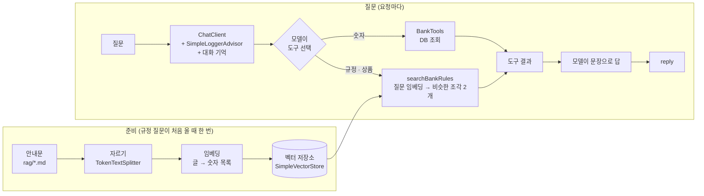

# Day 3 · 0. (선택) RAG: 은행 안내문을 찾아 답하는 AI 도우미

> 태그 `t6-rag` · 시작 코드는 `t5-actuator`<br>
> 앞 단계: [Day 1 Part C 저축 도우미](day1-idempotency-ai.md#part-c-ai-저축-도우미-tool-calling) → [Day 2 Actuator](day2-jwt-tracing-actuator.md) → **Day 3 선택 RAG** → [Day 3 React](day3-react.md)

> ⏱ 40~50분 · **선택입니다.** 건너뛰어도 Day 3 진행에 문제 없습니다. 이 절의 코드는 이후 태그에도 남아 있지만, **AI 키가 없으면 아무 일도 하지 않습니다.**

## 🎯 목표

1. AI 가 우리 은행 규정을 모르는 이유와, **RAG**(찾아서 → 붙여서 → 답하기)로 푸는 방법을 설명한다
2. RAG 를 별도 API 가 아니라 AI 저축 도우미의 **도구**로 붙인 이유를 설명한다
3. 은행 안내문(`resources/rag/*.md`)을 **자르고 → 임베딩하고 → 벡터 저장소에 넣고 → 도구로 건네는** 코드를 읽는다
4. `POST /api/ai/chat` 하나로 **숫자(DB) · 규정(안내문) · 둘 다** 묻고, 콘솔 로그와 `build/vector-store.json` 으로 **"무엇을 찾았나"** 를 들여다본다
5. 키 없이도 `RagFlowTest` 의 가짜 임베딩으로 **검색이 맞는 문서를 찾는지** 돌려 본다

## 🤔 왜 필요할까요?

Day 1 의 저축 도우미는 **숫자**(소비 합계)를 잘 말합니다. 그런데 이렇게 물으면 어떨까요?

> "휴면 계좌는 어떻게 해제해요?" · "적금 금리가 얼마예요?"

AI 는 **우리 은행의 규정을 본 적이 없습니다.** 모르면 그럴듯하게 지어냅니다 (할루시네이션). 규정은 DB 의 숫자도 아니라서 `BankTools` 로는 풀기 어렵습니다. 그래서 **안내문(글)을 찾아서 질문에 붙여 주는** 방법을 씁니다. 이것이 **RAG** 입니다. 찾아서(**R**etrieval) 붙여서(**A**ugmented) 답하기(**G**eneration)입니다.

| 방법 | 무엇을 AI 에게 주나 | 잘 맞는 일 | 은행 예 |
|---|---|---|---|
| **Tool Calling** (Day 1) | DB 의 **숫자** (서버 메서드를 호출) | 계산 · 조회 | 이번 달 식비 합계 |
| **RAG** (오늘) | **글** 조각 (찾은 문서를 AI 에게 건넴) | 규정 · 안내문 · 매뉴얼 | 휴면 해제 방법, 적금 금리 |
| **파인튜닝** | 모델 자체를 다시 학습 | 말투 · 형식을 몸에 익히기 | 상담 말투 통일 |

- 규정이 바뀌면 RAG 는 **문서만 고치면** 됩니다. 파인튜닝은 다시 학습해야 합니다.
- RAG 는 "어느 문서를 보고 답했나" 를 **보여 줄 수 있어서** 은행처럼 근거가 필요한 곳에 어울립니다.

### 🔧 RAG 를 어떻게 붙일까: 항상 vs 필요할 때

RAG 를 붙이는 방법은 크게 두 가지입니다. 오늘은 **AI 가 필요하다고 판단할 때만 검색하는 도구**로 붙입니다.

| 방식 | 동작 | 장점 | 단점 |
|---|---|---|---|
| **항상 붙이기** (`QuestionAnswerAdvisor`) | 질문마다 **먼저 검색**해서 결과를 프롬프트에 붙인다 | 구조가 단순하고 빠짐없이 붙는다 | 숫자 질문에도 검색하고(임베딩 호출 · 글자 수 낭비), 엉뚱한 글이 섞이며, DB 숫자는 따로 풀어야 한다 |
| **필요할 때 도구로** (우리 방식) | 검색을 `@Tool` 로 건네고, **AI 가 필요할 때만** 부른다 | 불필요한 검색이 없고, 한 API 가 여러 일을 한다 | AI 가 도구를 안 고를 수도 있어서 프롬프트로 방향을 잡아 줘야 한다 (모델 호출이 한 번 더 오가기도 한다) |

- 그래서 **`/api/ai/chat` 하나**가 숫자 질문(DB: `BankTools`) · 규정 질문(안내문: `searchBankRules`) · 둘 다 섞인 질문을 처리합니다. API 가 늘지 않고, 화면(React)은 바꿀 것이 없습니다.
- 어느 도구를 부를지는 AI 가 고르고, 실제 실행은 우리 서버가 합니다. Day 1 의 Tool Calling 과 **똑같은 구조**입니다.

## ⏱ 흐름 (40~50분)

| 순서 | 내용 | 시간 |
|---|---|---|
| 1 | RAG 흐름 · 임베딩 설명 | 10분 |
| 2 | 코드 읽기: 의존성 · 문서 4개 · `RagConfig` · `BankDocs` · `AiController` · 임베딩 설정 | 15분 |
| 3 | 실행 · 확인 (키 없이 / 키 있으면), 벡터 저장소 들여다보기, 체크포인트 | 15분 |
| 4 | `RagFlowTest` 돌리기, 🏁 미션 | 10분 |

시작과 건너뛰기는 이렇게 합니다.

```bash
git switch -c my-rag t6-rag          # 이 절을 하려면: t5-actuator 다음 커밋에서 내 브랜치
git switch -c my-react t6-react      # 건너뛰려면: 바로 Day 3 의 React 로
git diff t5-actuator t6-rag --stat   # 이 절에서 바뀐 파일만 보기 (15개 파일 +278줄 -9줄)
```

## 📐 흐름도



- 숫자 질문이면 왼쪽 길(`BankTools`), 규정 질문이면 오른쪽 길(`searchBankRules`), 둘 다 묻으면 **두 길을 다** 갑니다. 아무 도구도 필요 없으면 모델이 바로 답합니다.
- 임베딩도 AI 제공사를 부릅니다. 그래서 **키가 없으면 규정 검색은 안 됩니다.** (채팅 자체도 키가 없으면 안내 문장이 옵니다.)
- 임베딩 호출 횟수: 문서 4개를 넣을 때 **4번**(처음 한 번만), 그리고 검색할 때마다 질문 **1번**입니다.

## 💻 코드

### 1) 의존성 (`build.gradle` +2줄)

```groovy
implementation 'org.springframework.ai:spring-ai-starter-model-google-genai-embedding'
implementation 'org.springframework.ai:spring-ai-vector-store'
```

- 첫 줄은 **Gemini 전용 임베딩 연결**, 둘째 줄은 문서를 담는 벡터 저장소(`SimpleVectorStore`)입니다. 왜 임베딩만 따로 연결하는지는 아래 7) 에 있습니다.
- 버전은 적지 않습니다. 이미 있는 `spring-ai-bom` 이 맞춰 줍니다.
- 찾은 글을 질문에 자동으로 붙여 주는 `spring-ai-vector-store-advisor` 는 **쓰지 않습니다.** 검색을 도구로 건네기 때문입니다.
- 🚨 **Spring AI 2.0.1 의 이름입니다.** 인터넷의 1.x 예제와 이름이 다릅니다. 그대로 복사하면 못 찾는다는 오류가 납니다.

### 2) 안내문 4개 (`src/main/resources/rag/`)

| 파일 | 줄 수 | 내용 |
|---|---|---|
| `dormant.md` | 5 | 휴면 계좌: 입금 불가(409 `ACCOUNT_DORMANT`), 해제 방법 |
| `frozen.md` | 5 | 지급정지 계좌: 출금 · 이체 불가(409 `ACCOUNT_FROZEN`), 입금은 가능 |
| `savings.md` | 7 | 적금 안내(수업용 가상 상품): 금리 연 3.0%, 중도 해지 연 1.0% |
| `transfer.md` | 8 | 이체 규칙: 본인 계좌만, 잔액 부족 409, **이체 수수료는 없다** |

`dormant.md` 전체입니다. 코드에 이미 있는 규칙을 **사람이 읽는 글**로 적은 것입니다.

```markdown
# 우리WON 데모 은행 — 휴면 계좌

- 오랫동안 거래가 없는 계좌는 휴면 계좌가 된다.
- 휴면 계좌에는 입금할 수 없다 (409 ACCOUNT_DORMANT). 휴면 계좌로 이체해도 같은 이유로 거절되고, 보낸 돈은 되돌려진다.
- 휴면 해제 방법: 본인 확인을 한 뒤 계좌 상태를 "정상" 으로 바꾸면 다시 입금 · 이체를 할 수 있다.
```

### 3) 벡터 저장소 Bean (`RagConfig`, 19줄)

```java
@Configuration
public class RagConfig {

    @Bean
    VectorStore vectorStore(EmbeddingModel embeddingModel) {
        return SimpleVectorStore.builder(embeddingModel).build();
    }
}
```

- `EmbeddingModel`(글 → 숫자)은 **직접 만들지 않습니다.** 스타터가 설정(`application.yml`)을 보고 자동으로 만들어 줍니다.
- `SimpleVectorStore` 는 **메모리**에만 담습니다. 앱을 다시 켜면 비어 있습니다. 실무에서는 PGVector · Redis 같은 DB 를 씁니다. (같은 `VectorStore` 인터페이스라 Bean 한 줄만 바뀝니다.)

### 4) 문서 넣기 + 검색 도구 (`BankDocs`, 74줄)

문서를 넣는 `store()` 입니다.

```java
@Slf4j
@Component
public class BankDocs {

    private final VectorStore vectorStore;
    private final Resource[] files;
    private boolean loaded = false;

    public BankDocs(VectorStore vectorStore, @Value("classpath:rag/*.md") Resource[] files) {
        this.vectorStore = vectorStore;
        this.files = files;
    }

    public synchronized VectorStore store() {
        if (!loaded) {
            List<Document> docs = new ArrayList<>();
            for (Resource file : files) {
                docs.addAll(new TextReader(file).get());                       // ① 읽기 (metadata 의 source = 파일 이름)
            }
            List<Document> chunks = new TokenTextSplitter().apply(docs);      // ② 긴 글은 조각으로 자른다
            vectorStore.add(chunks);                                          // ③ 조각마다 임베딩해서 저장
            loaded = true;
            log.info("RAG 문서 {}개 → 조각 {}개 저장", files.length, chunks.size());
            saveToFile();
        }
        return vectorStore;
    }
```

| 단계 | 하는 일 |
|---|---|
| ① `TextReader` | 파일을 읽어 `Document` 로 만든다. 파일 이름이 `source` 에 들어간다 |
| ② `TokenTextSplitter` | 긴 글을 조각으로 자른다. 우리 안내문은 짧아서 **문서 1개 = 조각 1개**다 |
| ③ `vectorStore.add` | 조각마다 **임베딩 모델을 불러** 숫자로 바꾼 뒤 저장한다 |

- 🔑 **처음 `store()` 를 부를 때 한 번만** 넣습니다 (지연 로딩). 앱이 켜질 때 넣으면 키가 없는 순간 앱이 죽습니다. 넣다가 실패하면 `loaded` 가 `false` 로 남아 **다음 요청 때 다시 시도**합니다.
- 숫자 질문만 오면 안내문은 **한 번도 임베딩되지 않습니다.** 규정 질문이 처음 올 때 넣습니다.
- 긴 매뉴얼이라면 조각이 여러 개가 됩니다. 조각이 작을수록 "정확히 그 부분" 을 찾기 쉽습니다.

AI 에게 건네는 **검색 도구**입니다. Day 1 의 `BankTools` 메서드와 같은 모양입니다.

```java
    // 🔧 도구: 규정 · 상품 안내가 필요한 질문이면 AI 가 이 메서드를 부른다 (질문과 가장 비슷한 안내문 조각 2개)
    @Tool(description = "우리 은행의 규정 · 상품 안내문 검색 (적금 금리, 휴면 계좌 해제, 지급정지, 이체 규칙 등)")
    public List<String> searchBankRules(@ToolParam(description = "찾을 내용, 예: 휴면 계좌 해제 방법") String question) {
        log.info("AI 가 도구 호출: searchBankRules({})", question);
        return store().similaritySearch(SearchRequest.builder().query(question).topK(2).build()).stream()
                .map(d -> "[" + d.getMetadata().get(TextReader.SOURCE_METADATA) + "] " + d.getText())   // [dormant.md] 안내문 내용
                .toList();
    }
```

- `description` 이 곧 **AI 가 읽는 설명서**입니다. "규정 · 상품 안내문" 이라고 적어 두었기 때문에 AI 가 규정 질문에서 이 도구를 고릅니다.
- `topK(2)` 는 "가장 비슷한 조각 2개만" 입니다. 많이 붙일수록 AI 요금(글자 수)이 늘고 헷갈리기도 쉽습니다.
- 결과는 `"[dormant.md] 안내문 내용"` 처럼 **출처 파일 이름을 앞에 붙인 글**입니다. AI 가 이 글을 읽고 문장으로 답합니다. 테스트도 이 모양을 확인합니다.
- 로그 `AI 가 도구 호출: searchBankRules(...)` 가 찍히면 AI 가 안내문을 찾으러 간 것입니다. 인자는 AI 가 질문을 **다듬어서** 넣기도 합니다.

저장소 안을 꺼내 보는 `saveToFile()` 은 아래 [🔍 벡터 저장소 들여다보기](#-벡터-저장소-들여다보기) 에서 봅니다.

### 5) 도구로 건네기: `AiController` 의 변경

```java
public AiController(ChatClient.Builder builder, ReportService reportService, ChatMemory chatMemory,
                    @Value("classpath:prompts/savings-assistant.st") Resource savingsPrompt, BankDocs bankDocs) {
    this.chatClient = builder.defaultAdvisors(new SimpleLoggerAdvisor()).build();
    ...
    this.bankDocs = bankDocs;
}
```

```java
String reply = chatClient.prompt()
        .system(sys -> sys.text(savingsPrompt).param("today", LocalDate.now()))
        .advisors(MessageChatMemoryAdvisor.builder(chatMemory).build())
        .advisors(a -> a.param(ChatMemory.CONVERSATION_ID, String.valueOf(customerId)))
        .user(request.message())
        .tools(new BankTools(customerId, reportService), bankDocs)   // 숫자 도구 + 안내문 검색 도구
        .call().content();
```

- 바뀐 곳은 **두 군데**입니다. ① 생성자에 `BankDocs` 를 받고 `SimpleLoggerAdvisor` 를 달았고, ② `.tools(...)` 에 `bankDocs` 를 하나 더 건넸습니다. 엔드포인트 · 요청 · 응답은 그대로입니다.
- `.tools(...)` 는 객체 안의 `@Tool` 메서드를 모두 도구로 등록합니다. `bankDocs` 에는 `searchBankRules` 하나가 있습니다.
- 🔐 `BankTools` 는 여전히 **토큰 주인의 `customerId`** 로 만듭니다. 안내문은 모든 고객에게 같은 글이라 `bankDocs` 는 공유해도 됩니다.
- `SimpleLoggerAdvisor` 는 `ChatClient` 가 모델에게 보내는 **요청과 응답을 로그로** 남기는 부품입니다. 대화 기억 Advisor 와 같은 Advisor(AI 를 부르기 전후에 끼어드는 부품)입니다. `application.yml` 에서 DEBUG 로 켭니다.
- 키가 없거나 실패하면 `chat` 은 기존대로 **200 + 안내 문장**으로 답합니다 (`try/catch` 는 Day 1 그대로).

### 6) 프롬프트 한 줄 (`prompts/savings-assistant.st`)

```text
은행 규정 · 상품(적금 금리, 휴면 해제, 지급정지, 이체 규칙)을 물으면 searchBankRules 도구로 찾은 안내문만 근거로 답하고, 안내문에 없으면 모른다고 한다.
```

- 도구 설명(`@Tool`)이 "무엇을 하는 도구인가" 라면, 이 한 줄은 **"언제 쓰고 어떻게 답하라"** 입니다. "안내문만 근거로", "없으면 모른다고" 가 할루시네이션을 막는 장치입니다.
- 문구만 바뀌므로 **재컴파일 없이** 파일만 고쳐도 됩니다 (앱 재시작은 필요).

### 7) 임베딩 설정 (`application.yml`)

```yaml
spring:
  ai:
    openai:
      base-url: https://generativelanguage.googleapis.com/v1beta/openai
      api-key: ${GEMINI_API_KEY}              # 🚨 키는 환경변수에서만 읽는다
      chat:
        model:  ${AI_MODEL:gemini-3.5-flash-lite}
    google:
      genai:
        embedding:
          api-key: ${GEMINI_API_KEY}
          text:
            options:
              model: ${AI_EMBEDDING_MODEL:gemini-embedding-001}
```

```yaml
# 맨 아래: RAG 임베딩을 누가 만들지 고른다 (채팅 AI 는 위 설정 그대로, 임베딩만 해당)
spring.ai.model.embedding: google-genai
spring.ai.model.embedding.text: google-genai
#   OpenAI 키(openai · openrouter 프로필) → 위 두 줄을 주석으로 막고 아래 두 줄의 주석을 푼다
#spring.ai.model.embedding: openai
#spring.ai.model.embedding.text: openai
```

- `t6-rag` 부터 `application.yml` 이 **프로필 없이도 Gemini 를 기본**으로 씁니다. 실행은 `GEMINI_API_KEY=... ./gradlew bootRun` 입니다.
- **채팅**은 Gemini 의 "OpenAI 호환" 주소(`spring.ai.openai.*`)로, **임베딩**은 Gemini 전용 연결(`spring.ai.google.genai.embedding.*`)로 갑니다. 키는 같은 `GEMINI_API_KEY` 입니다.
- 맨 아래 두 줄이 "임베딩을 어느 연결이 만들지" 를 고릅니다. OpenAI 키를 쓰면 `openai` 두 줄로 바꿉니다 (주석만 서로 바꿉니다). 이때 임베딩 모델 이름은 `spring.ai.openai.embedding.options.model` 에서 정합니다.
- 모델 이름은 수업 당일 제공사 사이트에서 확인합니다. 채팅 모델(`AI_MODEL`)과 임베딩 모델은 **다른 모델**입니다.

> 🚨 **왜 임베딩만 Gemini 전용 연결일까요?** Gemini 의 "OpenAI 호환" 주소로 임베딩을 요청하면 응답에 `index` 필드가 빠져 있고, Spring AI 2.0.1 이 `` `index` is not set `` 오류를 내서 검색이 실패합니다 (503). 이것은 Spring AI 2.0.1 의 알려진 이슈([spring-ai#7019](https://github.com/spring-projects/spring-ai/issues/7019))이고, 2.0.2 에서 고쳐질 예정으로 보입니다. 고쳐진 버전이 나오면 임베딩도 호환 주소로 합칠 수 있을지 확인해 보세요. 그때까지 임베딩은 이 연결을 씁니다.

## 🔍 벡터 저장소 들여다보기

벡터 저장소는 메모리에만 있어서 보이지 않습니다. 그래서 `BankDocs` 가 문서를 넣은 직후 **전부 파일로 꺼내 둡니다**.

```java
    // 🔍 저장소 안을 들여다보기: 메모리에만 있는 내용을 build/vector-store.json 으로 꺼내 둔다 (조각 글 · 출처 파일 · 숫자 벡터)
    //    실패해도 RAG 는 그대로 쓴다 (보기용일 뿐)
    private void saveToFile() {
        if (vectorStore instanceof SimpleVectorStore simple) {
            File file = new File("build/vector-store.json");
            try {
                simple.save(file);
                log.info("벡터 저장소 내용을 파일로 저장: {}", file.getAbsolutePath());
            } catch (Exception e) {
                log.warn("벡터 저장소 파일 저장 실패 (RAG 는 계속 쓴다): {}", e.getMessage());
            }
        }
    }
```

규정 질문을 한 번 보낸 뒤 서버 로그의 `벡터 저장소 내용을 파일로 저장: …/build/vector-store.json` 경로를 IntelliJ 에서 엽니다. (`build/` 는 `.gitignore` 대상이라 IntelliJ 가 회색으로 보여 줍니다. 파일은 있습니다.) 조각 하나는 이런 모양입니다.

```json
{
  "8f586ad2-f6ef-43a5-ad65-3c7c29dad735" : {
    "id" : "8f586ad2-f6ef-43a5-ad65-3c7c29dad735",
    "text" : "# 우리WON 데모 은행 — 휴면 계좌\n\n- 오랫동안 거래가 없는 계좌는 ...",
    "metadata" : {
      "charset" : "UTF-8",
      "chunk_index" : 0,
      "total_chunks" : 1,
      "source" : "dormant.md"
    },
    "embedding" : [ 0.0123, -0.0456, 0.0789, ... ]
  }
}
```

| 필드 | 뜻 |
|---|---|
| `id` | 조각 하나의 번호 (자동으로 붙는다) |
| `text` | 조각의 **글**. 검색 결과로 AI 에게 가는 내용이다 |
| `metadata.source` | 출처 파일 이름. `searchBankRules` 결과의 `[dormant.md]` 가 여기서 온다 |
| `metadata.chunk_index` · `total_chunks` | 한 문서를 자른 조각 중 몇 번째 / 전체 몇 개 (우리 안내문은 0 / 1) |
| `embedding` | 글을 바꾼 **숫자 목록**. 진짜 임베딩은 **수천 개**(`gemini-embedding-001` 은 기본 3072개)라 파일이 길다 |

- 확인할 것: ① 조각이 **4개**(파일마다 1개)인가, ② `source` 가 파일 이름과 같은가, ③ `embedding` 의 숫자가 실제로 들어 있는가.
- 질문이 오면 질문도 같은 방법으로 숫자 목록이 되고, 이 `embedding` 들과 **가장 가까운 2개**가 검색 결과입니다.
- 파일은 **보기용**입니다. 앱은 이 파일을 다시 읽지 않고, 저장에 실패해도 경고만 찍고 RAG 는 그대로 동작합니다. 재시작하면 문서를 다시 넣고 파일도 다시 만들어집니다.

콘솔에서는 두 종류의 로그를 봅니다.

| 로그 | 알 수 있는 것 |
|---|---|
| `AI 가 도구 호출: searchBankRules(휴면 계좌 해제 방법)` | AI 가 안내문 검색을 **골랐다**. 괄호 안은 AI 가 다듬어 넣은 검색어 |
| `RAG 문서 4개 → 조각 4개 저장` | 처음 한 번 문서를 임베딩해서 넣었다 |
| `SimpleLoggerAdvisor` 의 `DEBUG` 로그 (요청 · 응답) | 모델에게 **실제로 간 요청**(질문 · 시스템 프롬프트 · 도구 목록)과 돌아온 응답 |

`SimpleLoggerAdvisor` 로그는 한 줄이 길어서, 검색해서 볼 만한 것만 짚습니다.

- 요청에 **도구 6개**가 보입니다: `myAccounts` · `monthlySummary` · `savingBalanceSum` · `normalAccountNos` · `spendingByCategory` · `searchBankRules`. 앞의 5개는 `BankTools`, 마지막이 안내문 검색입니다. AI 는 이 목록과 설명을 보고 고릅니다.
- 도구를 부른 뒤에는 모델에게 **도구 결과(안내문 글)가 붙은 두 번째 요청**이 갑니다. 그 응답이 최종 문장입니다. 로그에 요청 · 응답이 여러 번 찍히는 이유입니다.

## 🪵 실행 · 확인

앱은 `GEMINI_API_KEY=... ./gradlew bootRun` 으로 띄웁니다 (프로필 필요 없음). `api.http` 맨 위의 로그인으로 토큰을 받은 뒤 (Day 2) 끝부분의 RAG 요청 3개를 차례로 보냅니다. 세 개 모두 같은 `POST /api/ai/chat` 이고 `message` 만 다릅니다.

### 1. 키 없이 (누구나 가능)

키 없이도 앱은 뜹니다. 어떤 질문을 보내도 AI 를 부르지 못해서 Day 1 과 같은 안내 문장이 옵니다.

```http
### ① 규정 질문 → 안내문 검색 도구
POST {{host}}/api/ai/chat
Authorization: Bearer {{token}}
Content-Type: application/json

{"message":"휴면 계좌는 어떻게 풀어?"}
```

→ **200** `{"reply":"지금은 AI 도우미를 쓸 수 없습니다. 잠시 후 다시 시도해 주세요."}`

- 서버 로그에는 `AI 도우미 실패:` WARN 이 찍힙니다. 키가 없으면 검색 도구까지 가지 못하므로 `searchBankRules` 로그는 없습니다.
- 키 없이 할 수 있는 확인은 `RagFlowTest`(아래 🧪)입니다. 가짜 임베딩이라 키도 네트워크도 필요 없습니다.

### 2. 키가 있으면

```bash
GEMINI_API_KEY=... ./gradlew bootRun
```

- 채팅 모델이나 임베딩 모델 이름이 바뀌었으면 `AI_MODEL` · `AI_EMBEDDING_MODEL` 환경변수로 덮어씁니다.
- OpenAI 키를 쓰면 `--spring.profiles.active=openai` 로 채팅을 바꾸고, `application.yml` 맨 아래의 임베딩 두 줄을 `openai` 로 바꿉니다 (위 7).

`api.http` 의 세 요청과 기대 결과입니다.

| 요청 (`message`) | 기대하는 서버 로그 | 기대하는 답 |
|---|---|---|
| ① 휴면 계좌는 어떻게 풀어? | `searchBankRules(...)` **1줄** (처음이면 `RAG 문서 4개 → 조각 4개 저장` 도) | 본인 확인 후 계좌 상태를 정상으로 바꾼다는 안내 |
| ② 적금 금리가 얼마고, 내 적금 잔액은 얼마야? | `searchBankRules(...)` + 적금 잔액 도구(`savingBalanceSum` 등) **둘 다** | 금리 연 3.0% (안내문) + 내 적금 잔액 (DB) |
| ③ 요즘 어떤 주식을 사면 좋을까요? | 도구 호출이 없거나, 있어도 관련 없는 글 | 은행과 관계없다며 **정중히 거절** (또는 "안내문에 없다") |

- ① 은 안내문만, ② 는 **DB 숫자와 안내문**을 한 답에 섞습니다. 한 API 로 둘 다 되는 것이 도구 방식의 장점입니다.
- ③ 은 "모른다고 하는지" 를 확인하는 요청입니다. 검색은 관련 없는 글도 가장 가까운 것을 가져오기 때문에, 막아 주는 것은 검색이 아니라 **프롬프트 지시**입니다.
- 답 문장은 모델마다 다릅니다. 로그로 **어느 도구가 불렸는지** 를 확인하세요.

### ✍️ 바로 해보기

1. ① 을 보내고 콘솔에서 `AI 가 도구 호출: searchBankRules(...)` 를 찾습니다. 괄호 안의 검색어가 내 질문과 같은지 다른지 봅니다.
2. 같은 질문을 한 번 더 보냅니다. `RAG 문서 4개 → 조각 4개 저장` 이 **다시 찍히는지** 봅니다. (두 번째부터는 이미 들어 있습니다.)
3. `build/vector-store.json` 을 열어 조각 4개와 `source` 를 확인합니다.
4. "이번 달 식비 합계 알려줘" 를 보냅니다. `searchBankRules` 가 **불리지 않고** `spendingByCategory` 만 찍히는지 봅니다.

## 🔢 임베딩이 뭐예요?

**임베딩 = 글을 숫자 목록(벡터)으로 바꾸는 것**입니다. 뜻이 비슷한 글은 **가까운 숫자**가 됩니다.

| 글 | 임베딩 (설명용 가짜 숫자) |
|---|---|
| "휴면 계좌 해제" | `[0.9, 0.1, 0.0]` |
| "휴면 풀기" | `[0.8, 0.2, 0.0]` (가깝다) |
| "적금 금리" | `[0.0, 0.1, 0.9]` (멀다) |

- 질문도 같은 방법으로 숫자로 바꾸고, **가장 가까운 조각**을 찾습니다 (유사도 검색). 단어가 달라도 뜻이 비슷하면 찾아집니다. ("해제" 와 "풀기")
- 진짜 임베딩은 숫자가 수천 개이고 AI 모델이 만듭니다. 그래서 **임베딩도 AI 를 부르고 키가 필요**합니다. `vector-store.json` 의 `embedding` 이 바로 이것입니다.
- `RagFlowTest` 의 **가짜 임베딩**은 단어가 몇 번 나오는지 **세어서** 숫자로 만듭니다. 뜻은 모르지만 "같은 단어가 많이 겹치면 가깝다" 는 아이디어는 똑같이 보여 줍니다.

## 🧪 테스트: `RagFlowTest` (77줄, 테스트 2개)

키와 네트워크 없이 검색 도구가 제대로 문서를 고르는지 확인합니다. 진짜 임베딩 모델 대신 **가짜 `EmbeddingModel`** 을 `@Primary` 로 끼웁니다.

```java
@TestConfiguration
static class FakeEmbedding {
    // 단어가 몇 번 나오는지 세어 벡터로 만든다. 같은 단어가 많이 겹치면 가깝다
    static final List<String> WORDS = List.of("휴면", "지급정지", "적금", "금리", "이체", "입금", "출금", "해제");

    @Bean
    @Primary
    EmbeddingModel fakeEmbeddingModel() { ... }

    static float[] vector(String text) {
        float[] v = new float[WORDS.size() + 1];
        for (int i = 0; i < WORDS.size(); i++) {
            v[i] = text.split(WORDS.get(i), -1).length - 1;
        }
        v[WORDS.size()] = 0.1f;     // 모든 칸이 0 이면 비교할 수 없어서 작은 값 하나
        return v;
    }
}
```

```java
@Autowired
BankDocs bankDocs;

@Test
@DisplayName("'휴면 계좌 해제' 를 검색하면 휴면 안내문이 1등")
void searchDormant() {
    List<String> found = bankDocs.searchBankRules("휴면 계좌 해제는 어떻게 해요?");
    assertThat(found.get(0)).startsWith("[dormant.md]");
}
```

- 두 번째 테스트는 "적금 금리가 얼마예요?" → `[savings.md]` 가 1등입니다.
- `MockMvc` 도 로그인도 없습니다. **검색 도구 메서드를 직접 부르기** 때문입니다. AI 가 도구를 고르는 부분(모델)은 키가 필요하므로 이 테스트의 범위가 아닙니다. 테스트는 "도구가 맞는 글을 돌려주는가" 만 봅니다.
- 이 테스트도 문서를 넣을 때 `build/vector-store.json` 을 만듭니다 (가짜 임베딩이라 숫자가 9개뿐인 작은 파일). 진짜 키로 앱을 띄우면 같은 파일이 진짜 임베딩으로 덮어씌워집니다.
- 태그별 전체 테스트 수: `t5` 31 → `t6-rag` **33** → `t6-react` 40 (태그마다 1개는 건너뜁니다).

```bash
./gradlew test --tests '*RagFlowTest'
```

## 🧩 체크포인트

### a. 어느 안내문을 근거로 답할까

채팅에 "휴면 풀기" 라고만 물으면, 서버 로그에 무엇이 찍히고 어느 파일의 글이 근거가 될까요? 먼저 예상하고, 키가 있으면 확인합니다.

<details>
<summary>정답 보기</summary>

`AI 가 도구 호출: searchBankRules(...)` 가 찍히고, 근거는 `dormant.md` 입니다. "풀기" 는 "해제" 와 **뜻이 비슷하고**, 뜻이 비슷하면 임베딩이 가깝기 때문입니다. 괄호 안의 검색어는 AI 가 "휴면 계좌 해제 방법" 처럼 **다듬어서** 넣을 수 있습니다. (키가 없으면 예상만 합니다. 테스트의 가짜 임베딩은 단어 세기라서 "풀기" 는 모르고 "휴면" 으로만 찾습니다.)

</details>

### b. 안내문에 없는 질문

`"요즘 어떤 주식을 사면 좋을까요?"` 를 보내면 어떻게 답할까요? 검색 도구는 불릴까요? (키 필요)

<details>
<summary>정답 보기</summary>

프롬프트 지시("은행 · 소비 · 저축과 관계없는 질문은 정중히 거절", "안내문에 없으면 모른다고") 대로 **거절하거나 "안내문에 없어 답할 수 없다"** 는 뜻으로 답합니다. 표현은 모델마다 다르고, 검색 도구를 부를지도 AI 가 정합니다. 불러도 검색은 **가장 덜 먼 조각 2개를 가져옵니다.** 관련 없는 글이어도 가져오기 때문에, 막아 주는 것은 검색이 아니라 **프롬프트 지시**입니다. 그래서 `api.http` 의 ③ 처럼 "모른다고 답하는지" 를 꼭 확인합니다.

</details>

### c. 문서를 고치면 답도 바뀐다

1. `transfer.md` 의 `이체 수수료는 없다.` 를 `이체 수수료는 500원이다.` 로 바꾸고 앱을 다시 시작합니다.
2. 채팅에 "이체 수수료 얼마예요?" 를 보냅니다. (키 필요)
3. `build/vector-store.json` 에서 `transfer.md` 조각의 `text` 도 바뀌었는지 봅니다.
4. 확인한 뒤 **원래대로 되돌립니다.**

<details>
<summary>정답 보기</summary>

답이 "500원" 으로 바뀌고 JSON 의 `text` 도 바뀝니다. 코드도 모델도 그대로이고 **문서만** 고쳤습니다. 이것이 RAG 가 파인튜닝보다 가볍게 규정 변경을 따라가는 이유입니다. 되돌리는 것을 잊지 마세요. 실제 이체 코드에는 수수료가 없습니다 (문서와 코드가 어긋나면 안 됩니다).

</details>

### d. 언제 문서를 넣을까

앱을 껐다 켠 뒤 "이번 달 식비 합계" → "휴면 계좌는 어떻게 풀어?" 순서로 물으면, `RAG 문서 4개 → 조각 4개 저장` 은 **언제** 찍힐까요?

<details>
<summary>정답 보기</summary>

**두 번째 질문 때** 찍힙니다. 문서는 `searchBankRules` 가 처음 불릴 때 넣고(지연 로딩), 숫자 질문은 `BankTools` 만 부르기 때문입니다. 그 직후 `벡터 저장소 내용을 파일로 저장` 로그도 함께 찍힙니다. `SimpleVectorStore` 는 메모리 저장소라서 재시작하면 비고, 다시 쓸 때 또 임베딩합니다 (임베딩 호출 4번). 문서가 많은 서비스는 매번 다시 하지 않도록 PGVector 같은 DB 에 둡니다.

</details>

## 🏁 미션: 안내문 하나 더 넣기

⏱ 10분. 키 없이도 마지막 단계까지 할 수 있습니다.

1. `src/main/resources/rag/password-lock.md` 를 만듭니다 (수업용 가상 규칙).

   ```markdown
   # 우리WON 데모 은행 — 비밀번호 잠금 (수업용 가상 규칙)

   - 비밀번호를 5번 틀리면 로그인이 잠긴다.
   - 잠금 해제는 고객센터에서 본인 확인 뒤에 한다.
   ```

2. (키 있을 때) 앱을 다시 시작하고 채팅에 "비밀번호 5번 틀렸어요" 를 보냅니다. 로그는 `RAG 문서 5개 → 조각 5개 저장` 이 되고, `build/vector-store.json` 에 `"source" : "password-lock.md"` 조각이 생겼는지, 답이 안내문 내용(고객센터 본인 확인)과 맞는지 확인합니다.
3. `RagFlowTest` 의 `WORDS` 에 `"비밀번호"`, `"잠금"` 을 더하고, "비밀번호 잠금 해제는 어떻게 해요?" 가 `[password-lock.md]` 를 1등으로 찾는 테스트를 1개 추가합니다. `./gradlew test` 가 통과해야 합니다.

<details>
<summary>정답 보기</summary>

`WORDS` 에 단어를 더합니다.

```java
static final List<String> WORDS = List.of("휴면", "지급정지", "적금", "금리", "이체", "입금", "출금", "해제", "비밀번호", "잠금");
```

테스트를 추가합니다.

```java
@Test
@DisplayName("'비밀번호 잠금' 을 검색하면 비밀번호 안내문이 1등")
void searchPassword() {
    List<String> found = bankDocs.searchBankRules("비밀번호 잠금 해제는 어떻게 해요?");
    assertThat(found.get(0)).startsWith("[password-lock.md]");
}
```

- 단어를 더하지 않으면 가짜 임베딩이 "비밀번호" 와 "잠금" 을 **세지 못해서**, 질문에서 센 단어가 "해제" 하나뿐입니다. `dormant.md` · `frozen.md` 에도 "해제" 가 있어서 1등이 갈립니다.
- 단어를 더하면 질문과 `password-lock.md` 가 `비밀번호` · `잠금` · `해제` 를 함께 가져 가장 가까워집니다. 진짜 임베딩은 단어 목록 없이 **뜻**으로 찾기 때문에 이 작업이 필요 없습니다.
- 안내문은 파일만 넣으면 `BankDocs` 가 `rag/*.md` 를 모두 읽으므로 **코드를 고칠 필요가 없습니다.** AI 에게 건네는 도구도 그대로입니다.
- `RagFlowTest` 는 이제 3개이고, 전체는 34개가 됩니다 (`t6-rag` 기준).

</details>

## ⚡ 5분 퀴즈

1. RAG 의 R · A · G 는 각각 무엇이고, 이 코드에서 어느 부분인가요?
2. 임베딩이란 무엇이고, 왜 키가 필요한가요?
3. 검색을 `QuestionAnswerAdvisor` 로 항상 붙이지 않고 **도구**로 건넨 이유는?
4. AI 키가 없어도 앱이 뜨고, 요청에는 안내가 오는 이유는?
5. `SimpleVectorStore` 의 한계는 무엇인가요?
6. 벡터 저장소 안이 궁금하면 어디를 보나요?

<details>
<summary>정답 보기</summary>

1. **R**etrieval(찾기) = `searchBankRules` 안의 `similaritySearch`, **A**ugmented(보강) = 찾은 안내문이 도구 결과로 모델에게 건네져 근거가 되는 것, **G**eneration(생성) = 모델이 그 글로 문장을 만드는 것.
2. 글을 **숫자 목록(벡터)** 으로 바꾼 것입니다. 뜻이 비슷하면 숫자도 가깝습니다. 바꾸는 일을 AI 임베딩 모델이 하기 때문에 제공사를 부르고, 그래서 키가 필요합니다.
3. 숫자(DB) · 규정(안내문) · 둘 다 섞인 질문을 **`/api/ai/chat` 하나**로 처리하고, 숫자 질문에는 불필요한 검색(임베딩 호출 · 글자 수)을 하지 않기 위해서입니다. 대신 AI 가 도구를 안 고를 수 있어서 프롬프트로 방향을 잡습니다.
4. `BankDocs` 가 앱이 켜질 때가 아니라 **처음 쓸 때** 문서를 넣고(지연 로딩), `chat` 이 `try/catch` 로 실패를 안내 문장으로 바꾸기 때문입니다.
5. **메모리**에만 있어서 재시작하면 사라지고(다시 임베딩), 문서가 많아지면 메모리를 많이 씁니다. 여러 서버가 함께 쓸 수도 없습니다. 실무는 PGVector · Redis 같은 저장소를 씁니다.
6. `build/vector-store.json` (조각 글 · `source` · 숫자 벡터)과, 콘솔의 `AI 가 도구 호출: searchBankRules(...)` · `SimpleLoggerAdvisor` DEBUG 로그입니다.

</details>

## 🎤 면접 질문

**Q1. RAG 는 파인튜닝, Tool Calling 과 무엇이 다른가요? 우리는 어떻게 붙였나요?**

<details>
<summary>답변 예시</summary>

"RAG 는 질문과 비슷한 문서를 먼저 찾아서 AI 가 그 글을 근거로 답하게 하는 방법입니다. Tool Calling 은 DB 의 숫자처럼 서버가 계산한 값을 가져오는 데 쓰고, RAG 는 규정이나 안내문 같은 글을 가져오는 데 씁니다. 파인튜닝은 모델 자체를 다시 학습시켜서 비용이 크고 규정이 바뀔 때마다 다시 해야 합니다. 저희는 문서 검색을 Tool Calling 의 도구 하나로 붙였습니다. 그래서 AI 가 질문을 보고 숫자면 DB 도구를, 규정이면 안내문 검색 도구를, 둘 다면 둘 다 불러서 한 API 로 답합니다. 안내문이 바뀌어도 문서만 고치면 되고, 금액 계산은 서버가 합니다."

</details>

**Q2. RAG 가 할루시네이션을 줄이는 원리와 한계는 무엇인가요?**

<details>
<summary>답변 예시</summary>

"모델이 기억에 의존해 지어내는 대신 찾아 온 문서를 근거로 답하게 하고, 시스템 프롬프트로 '안내문만 근거로 답하고 없으면 모른다고 한다' 고 제한해서 줄입니다. 다만 한계가 있습니다. 검색이 엉뚱한 조각을 가져오면 틀린 근거로 답하고, 관련 없는 질문에도 가장 가까운 조각을 가져오기 때문에 모른다고 답하는 것은 결국 프롬프트 지시에 달려 있어 모델이 어길 수 있습니다. 도구 방식이라면 AI 가 검색을 아예 안 부를 수도 있습니다. 그래서 로그로 도구가 불렸는지와 무엇을 찾았는지 확인하고, 벡터 저장소를 파일로 꺼내 조각을 점검하며, 문서와 실제 규칙이 어긋나지 않게 관리하고, 금액 같은 숫자는 RAG 가 아니라 서버 계산으로 처리합니다."

</details>

## ✅ 정리 체크리스트

- [ ] AI 가 우리 은행 규정을 모르는 이유와, Tool Calling(숫자) · RAG(글) · 파인튜닝의 차이를 말할 수 있다
- [ ] 문서 → 자르기 → 임베딩 → 벡터 저장소, 질문 → 임베딩 → 비슷한 조각 → 도구 결과 → 답의 흐름을 그릴 수 있다
- [ ] 검색을 "항상 붙이기" 가 아니라 "필요할 때 도구로" 건넸고, 그래서 `/api/ai/chat` 하나가 숫자 · 규정 · 둘 다를 처리하는 것을 설명할 수 있다
- [ ] `searchBankRules` 의 `@Tool` 설명 · 프롬프트 한 줄 · `.tools(..., bankDocs)` 가 각각 무슨 역할인지 안다
- [ ] 콘솔의 `AI 가 도구 호출: searchBankRules(...)` 와 `build/vector-store.json` 으로 무엇을 찾았는지 확인할 수 있다
- [ ] 키 없이 `chat` 이 안내 문장으로 답하고 앱은 정상으로 뜨는 이유(지연 로딩 + `try/catch`)를 안다
- [ ] 임베딩만 Gemini 전용 연결을 쓰는 이유(`index` is not set, Spring AI 2.0.1 이슈)를 안다
- [ ] `SimpleVectorStore` 는 메모리라 재시작하면 다시 임베딩하고, 실무에서는 DB 에 둔다는 것을 안다
- [ ] `RagFlowTest` 가 가짜 임베딩으로 키 없이 "검색 도구가 맞는 문서를 찾는지" 확인하는 것을 설명할 수 있다

다음은 [Day 3 React](day3-react.md) 의 1절 입금 · 이체 API 입니다.
