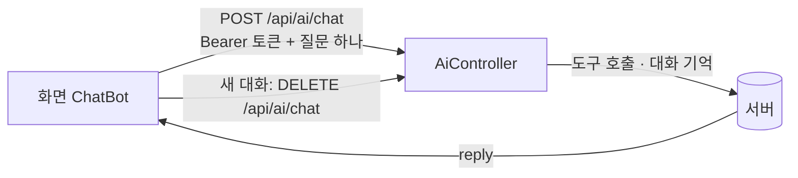

# Day 3. 화면 붙이기: 입금 · 이체 API, CORS, React

> 태그 `t6-react` · 시작 코드는 `t5-actuator`<br>
> 앞 단계: [Day 1 멱등성 · Spring AI](day1-idempotency-ai.md) → [Day 2 JWT · 요청 추적 · Actuator](day2-jwt-tracing-actuator.md) → **Day 3**

> 📝 각 절 끝의 🧩 체크포인트와 마지막의 🏁 미션 · ⚡ 퀴즈로 이해했는지 확인합니다 (하루 20~30분)

> 🧩 **# 0. (선택) RAG: 은행 안내문으로 답하는 AI**<br>
> ⏱ 40~50분 · 자료: [day3-rag-optional.md](day3-rag-optional.md) · 태그 `t6-rag`<br>
> 하려면 `git switch -c my-rag t6-rag`. **건너뛰면** `t5-actuator` 에서 바로 1절로 (또는 `t6-react` 로) 갑니다. 건너뛰어도 Day 3 진행에는 문제가 없습니다.

## 🎯 오늘의 목표

1. React 가 부르는 **입금 · 이체 API** 를 만들고, 한 묶음(`@Transactional`)으로 처리되는 것을 확인한다
2. 브라우저의 **CORS** 를 서버에서 허락하고, Security 에도 켜야 하는 이유를 설명한다
3. React 가 **회원가입 · 로그인 → 계좌 → 거래내역 → 입금 · 이체** 를 진짜 서버 데이터로 그리는 것을 본다
4. 화면의 **문의 번호** 로 서버 로그에서 그 요청만 찾아낸다
5. Day 1 에서 만든 **AI 저축 도우미** 를 화면의 채팅창으로 붙이고, 질문 하나만 보내도 대화가 이어지는 이유를 설명한다
6. 마지막으로 서버를 **Gradle 로 빌드**해서 jar 하나로 만들고, `java -jar` 로 실행한다

## 🤔 왜 필요할까요?

React 화면은 이미 있습니다. 그런데 화면이 부르는 주소 두 개를 서버가 아직 모릅니다.

| React 가 부르는 요청 | 서버 상태 (t5) |
|---|---|
| `POST /api/accounts/{계좌번호}/deposits` | 없음 |
| `POST /api/transfers` | 없음 |
| 브라우저(`localhost:5173`) → 서버(`localhost:8080`) | 다른 주소라 브라우저가 막음 |

```bash
git switch -c my-t5 t5-actuator    # 오늘 시작 지점에서 내 브랜치 만들기
git diff t5-actuator t6-react --stat -- src    # 오늘 서버에 바뀐 파일만 보기
```

---

# 1. 입금 · 이체 API

### 💡 개념

> 💡 **트랜잭션(`@Transactional`)**<br>
> 여러 DB 작업을 **한 묶음**으로 만듭니다. 전부 성공하면 commit, 중간에 `RuntimeException` 이 나면 **전부 rollback** 입니다. 이체는 "출금 + 입금 + 거래내역 2건" 이 한 묶음이어야 돈이 중간에 사라지지 않습니다.

오늘 새로 생긴 파일입니다.

| 파일 | 줄 수 | 하는 일 |
|---|---|---|
| `controller/TransferController.java` | 27 | `POST /api/transfers` |
| `dto/DepositRequest.java` | 17 | 입금 요청 상자 `{amount, memo}` |
| `dto/TransferRequest.java` | 20 | 이체 요청 상자 `{fromAccountNo, toAccountNo, amount, memo}` |
| `exception/AccountDormantException.java` | 8 | 휴면 계좌 입금 예외 |
| `test/.../TransferFlowTest.java` | 113 | 입금 · 이체 흐름 테스트 7개 |

기존 파일에는 `AccountController`(입금 주소 12줄), `AccountService`(33줄), `Transaction`(13줄), `Account`(예외 교체), `GlobalExceptionHandler`(24줄)만 더했습니다.

### ❌ 요청 상자: 검증은 컨트롤러 앞에서

`DepositRequest`(`amount`, `memo`)와 `TransferRequest`(`fromAccountNo`, `toAccountNo`, `amount`, `memo`)는 `record` 입니다. `amount` 에는 `@NotNull @Positive @Digits`, 계좌번호에는 `@NotBlank`, `memo` 에는 `@Size(max = 100)` 이 붙어 있어서, 컨트롤러의 `@Valid` 와 함께 쓰면 금액이 비었거나 0 이하거나 소수 셋째 자리가 있을 때, 메모가 100자를 넘을 때 **서비스에 오기 전에 400** 으로 막힙니다. 보내는 사람은 body 가 아니라 **토큰**으로 확인합니다.

```java
public record DepositRequest(
        @NotNull(message = "입금 금액을 입력하세요")
        @Positive(message = "입금 금액은 0보다 커야 합니다")
        @Digits(integer = 17, fraction = 2, message = "입금 금액은 소수 둘째 자리까지 입력하세요")   // DB 칸 DECIMAL(19,2) 과 같은 모양
        BigDecimal amount,
        @Size(max = 100, message = "메모는 100자까지 입력하세요")
        String memo) { }
```

- `@Digits(integer = 17, fraction = 2)` : 정수 17자리, 소수 2자리까지. DB 의 금액 칸 `DECIMAL(19,2)` 과 같은 모양입니다. `1.234` 는 여기서 400 으로 막혀서, DB 에 들어갈 때 조용히 잘리는 일이 없습니다.
- `message` : 화면에 그대로 보일 문장입니다. 아래 예외 표에서 이 문장이 어떻게 응답에 실리는지 봅니다.
- `TransferRequest` 도 같은 모양이고 `fromAccountNo` · `toAccountNo` 에 `@NotBlank` 가 더 붙습니다.

### ✅ 컨트롤러: 입금은 AccountController, 이체는 TransferController

```java
@PostMapping("/{accountNo}/deposits")        // AccountController, 기본 주소 /api/accounts
@ResponseStatus(HttpStatus.CREATED)
public TransactionResponse deposit(@AuthenticationPrincipal Jwt jwt,
                                   @PathVariable("accountNo") String accountNo,
                                   @Valid @RequestBody DepositRequest request) {
    checkMine(jwt, accountNo);                       // Day 2 의 확인 장치. 남의 계좌에 입금하면 403
    return TransactionResponse.from(accountService.deposit(accountNo, request));
}

@PostMapping                                 // TransferController, 기본 주소 /api/transfers
@ResponseStatus(HttpStatus.CREATED)
public TransactionResponse transfer(@AuthenticationPrincipal Jwt jwt, @Valid @RequestBody TransferRequest request) {
    return TransactionResponse.from(accountService.transfer(Integer.valueOf(jwt.getSubject()), request));
}
```

- 기존 `TransactionController` 의 기본 주소가 `/transactions` 라서 `/api/transfers` 는 작은 컨트롤러를 따로 만들었습니다.
- `jwt.getSubject()` 는 로그인 때 토큰에 넣은 **고객번호**입니다.
- 입금도 **내 계좌에만** 됩니다. Day 2 의 `checkMine` 을 맨 앞에서 부르기 때문에, `yeonji` 토큰으로 `woori` 계좌에 입금하면 **403** 입니다. (이체는 보내는 계좌만 내 것이면 되고, 받는 계좌는 누구 것이든 됩니다.)
- 둘 다 성공하면 **201 + 거래 1건**을 돌려줍니다. 이체는 **출금 거래**를 돌려줍니다.

### ✅ 서비스: 잠그고 → 바꾸고 → 기록하기

```java
@Transactional
public Transaction deposit(String accountNo, DepositRequest request) {
    Account account = lockAccount(accountNo);       // SELECT ... FOR UPDATE
    account.deposit(request.amount());              // 휴면이면 AccountDormantException
    return transactionRepository.save(Transaction.of(account, "입금", request.amount(), request.memo(), null));
}
```

이체는 조금 깁니다. 위에서부터 읽어 보세요.

```java
@Transactional
public Transaction transfer(Integer customerId, TransferRequest request) {
    String fromNo = request.fromAccountNo();
    String toNo = request.toAccountNo();
    // ⓪ 같은 계좌로는 보낼 수 없다
    if (fromNo.equals(toNo)) {
        throw new InvalidAccountRequestException("같은 계좌로는 이체할 수 없습니다.");   // 400
    }
    // ① 두 계좌를 항상 계좌번호가 작은 쪽부터 잠근다
    Account from, to;
    if (fromNo.compareTo(toNo) < 0) { from = lockAccount(fromNo); to = lockAccount(toNo); }
    else                            { to = lockAccount(toNo);     from = lockAccount(fromNo); }

    // ② 내 계좌에서만 보낼 수 있다
    if (!customerId.equals(from.getCustomerId())) {
        throw new ResponseStatusException(HttpStatus.FORBIDDEN, "본인 계좌에서만 이체할 수 있습니다.");
    }
    // ③ 돈을 옮기고 거래내역 2건을 남긴다
    from.withdraw(request.amount());
    to.deposit(request.amount());
    Transaction out = transactionRepository.save(Transaction.of(from, "출금", request.amount(), request.memo(), to.getAccountNo()));
    transactionRepository.save(Transaction.of(to, "입금", request.amount(), request.memo(), from.getAccountNo()));
    return out;
}
```

| 번호 | 왜 이렇게 했나 |
|---|---|
| ⓪ 같은 계좌 | 같은 계좌를 두 번 잠그면 의미가 없고 돈도 움직일 이유가 없다. 잠그기 **전에** 400 으로 돌려보낸다 |
| ① 잠금 순서 | A→B 와 B→A 이체가 동시에 와도 **둘 다 작은 번호 계좌를 먼저** 잠가서, 서로 상대가 쥔 계좌를 기다리는 데드락이 생기지 않는다. `if` 와 `else` 는 잠그는 **순서**만 다르고, 어느 쪽이든 `from` 은 보내는 계좌, `to` 는 받는 계좌다 ([reference/threads.md](reference/threads.md) 9절) |
| ② 소유자 확인 | 잠근 뒤에 확인한다. 실패하면 예외가 나서 아무것도 바뀌지 않는다 |
| ③ 한 메서드 안 | `withdraw` 는 되고 `deposit` 에서 휴면 예외가 나면 **출금까지 rollback** 된다 |

> 💡 `lockAccount()` 는 `AccountRepository.findByAccountNoForUpdate` 를 부릅니다. `@Lock(PESSIMISTIC_WRITE)` 가 붙어 있어 `SELECT ... FOR UPDATE` 가 나가고, **트랜잭션 안에서만** 동작합니다. 그래서 두 메서드 모두 `@Transactional` 입니다.

### ✅ 예외 → 상태코드

| 상황 | 던져지는 곳 | 응답 |
|---|---|---|
| 남의 계좌에서 이체 | `ResponseStatusException(FORBIDDEN)` | **403** `{"code":"FORBIDDEN", ...}` |
| 남의 계좌에 입금 | `checkMine` → `ResponseStatusException(FORBIDDEN)` | **403** `본인 계좌만 사용할 수 있습니다.` |
| 같은 계좌로 이체 | `InvalidAccountRequestException` | **400** `INVALID_ACCOUNT_REQUEST` `같은 계좌로는 이체할 수 없습니다.` |
| 휴면 계좌에 입금 · 이체 받는 쪽이 휴면 | `AccountDormantException` | **409** `ACCOUNT_DORMANT` |
| 잔액 부족 | `InsufficientBalanceException` | **409** `INSUFFICIENT_BALANCE` |
| 지급정지 계좌에서 출금 | `AccountFrozenException` (기존) | **409** `ACCOUNT_FROZEN` |
| 없는 계좌 | `AccountNotFoundException` (기존) | **404** `ACCOUNT_NOT_FOUND` |
| 금액이 0 이하 · 비어 있음 | `@Valid` | **400** `BAD_REQUEST` + DTO 의 `message` (예: `입금 금액은 0보다 커야 합니다`) |
| 소수 셋째 자리 이상 (`1.234`) | `@Valid` (`@Digits`) | **400** `BAD_REQUEST` `이체 금액은 소수 둘째 자리까지 입력하세요` |
| 메모 100자 초과 | `@Valid` (`@Size`) | **400** `BAD_REQUEST` `메모는 100자까지 입력하세요` |

- `@Valid` 에 걸린 400 은 `GlobalExceptionHandler` 의 `MethodArgumentNotValidException` 핸들러가 만듭니다. 첫 번째 틀린 칸의 **DTO `message` 를 그대로** `{"code":"BAD_REQUEST","message":"..."}` 에 실어 보냅니다. 이 핸들러가 없던 때는 `Invalid request content.` 라는 영어 문장이 나갔습니다. 이제는 화면에 **한글 안내가 그대로 보입니다.** (`TransferForm` 의 `MESSAGES` 에 없는 `code` 는 서버의 `message` 를 그대로 보여 줍니다.)
- 403 은 새 핸들러 없이 나옵니다. 기존의 맨 마지막 그물(`@ExceptionHandler(Exception.class)`)이 "스프링이 상태코드를 이미 정해 둔 예외"를 그 코드로 돌려주기 때문입니다.
- 휴면 입금은 원래 `Account.deposit()` 이 이름 없는 `RuntimeException` 을 던졌습니다. 이름 있는 `AccountDormantException` 으로 바꿔야 핸들러가 **409 + 코드** 로 구분할 수 있습니다.
- `404` 는 두 계좌를 잠그는 단계에서 나므로, 받는 계좌가 없으면 소유자 확인보다 **먼저** 404 입니다.

### ✅ 거래 기록: `Transaction.of`

```java
public static Transaction of(Account account, String txType, BigDecimal amount, String memo, String counterparty) {
    ...
    tx.balanceAfter = account.getBalance();             // 잔액이 바뀐 "뒤"에 만든다
    tx.category = counterparty != null ? "이체" : null;    // 상대 계좌가 있으면 이체
    tx.txDatetime = LocalDateTime.now();
```

- 기존 `withdrawal()` 은 그대로 두고, 입금 · 이체 출금 · 이체 입금이 함께 쓰는 공장 메서드 하나만 더했습니다.
- 순서가 중요합니다. `withdraw()` / `deposit()` 으로 잔액을 **먼저** 바꾸고 `of()` 를 불러야 `balanceAfter` 가 맞습니다.

### 🚨 일부러 하지 않은 것

| 안 한 것 | 지금 코드는 |
|---|---|
| 수수료 | 없음. 보낸 금액 = 받은 금액 |
| `Transfer`(이체) 표 | 없음. 이체 1건 = 거래 2건(출금 · 입금)으로만 남는다 |
| `Idempotency-Key` 처리 | React 가 헤더를 보내지만 **서버는 읽지 않고 무시**한다 |

**같은 이체 요청을 두 번 보내면 두 번 이체됩니다.** [Day 1](day1-idempotency-ai.md) 에서 "POST 는 멱등이 아니다" 를 `api.http` 로 확인한 것과 같은 현상입니다. 키를 서버에 저장해서 막는 방법은 이 과정의 코드에는 들어 있지 않고, 개념과 `ALTER TABLE ... UNIQUE` 실습만 Day 1 에서 다뤘습니다.

### 🪵 확인하기

`src/api.http` 의 "입금 · 이체" 구역을 위에서부터 실행합니다 (yeonji 로 로그인한 토큰 사용).

| 요청 | 기대 결과 |
|---|---|
| 입금 10,000원 → `1002-345-112233` | 201, `txType: 입금`, `balanceAfter: 1109500` |
| 이체 5,000원 `1002-345-112233` → `1002-555-667788` | 201, `txType: 출금`, `counterparty: 1002-555-667788` |
| woori 계좌에서 이체 (yeonji 토큰) | 403 |
| 휴면 계좌 `1002-345-998877` 에 입금 | 409 `ACCOUNT_DORMANT` |
| 같은 계좌로 이체 | 400 `INVALID_ACCOUNT_REQUEST` |
| woori 계좌 `1002-555-667788` 에 입금 (yeonji 토큰) | 403 |

여기에 `TransferFlowTest` 는 금액 `1.234` 를 보내면 **400** 과 `이체 금액은 소수 둘째 자리까지 입력하세요` 가 오는지도 확인합니다. 모두 7개입니다.

```bash
./gradlew test --tests '*TransferFlowTest'
```

- 클래스에 `@Transactional` 이 있어서 각 테스트가 끝나면 변경이 되돌려집니다. 그래서 테스트끼리 잔액을 건드리지 않습니다.
- `@BeforeEach` 에서 `yeonji` 로 로그인해 토큰을 받고, 요청마다 `Authorization: Bearer ...` 를 붙입니다.

### ✍️ 바로 해보기

1. `1002-345-678901`(지급정지)에서 `1002-555-667788` 로 1,000원을 이체해 보세요. 상태코드와 `code` 는?
2. 이체 중간에 휴면 예외가 나면 출금이 정말 되돌려질까요? `1002-345-112233` → `1002-345-998877`(휴면) 로 1,000원을 보낸 뒤 `GET /api/accounts` 로 잔액을 확인해 보세요.

<details>
<summary>정답 보기</summary>

1. **409 `ACCOUNT_FROZEN`**. `from.withdraw()` 에서 `AccountFrozenException` 이 나고, 기존 핸들러가 409 로 바꿉니다. 이 계좌는 React 이체 화면에서 에러를 확인할 때도 씁니다 (4-6).
2. **409 `ACCOUNT_DORMANT`** 이고 `1002-345-112233` 의 잔액은 **그대로**입니다. `withdraw` 까지 실행됐지만 `deposit` 에서 `RuntimeException` 이 나서 `@Transactional` 이 전부 rollback 했기 때문입니다. 실행 중 콘솔에 `JpaTransactionManager` 의 rollback 로그가 찍힙니다.

</details>

---

# 2. CORS: 브라우저 출입 명부

### 💡 개념

> 💡 **CORS**<br>
> `localhost:5173`(React)에서 연 화면이 `localhost:8080`(서버)을 부르면, 브라우저는 주소(포트)가 다르다며 **서버에게 먼저 허락을 구합니다.** 서버가 명부에 적어 주지 않으면 브라우저가 응답을 버립니다.

| | `api.http` · curl | 브라우저의 React |
|---|---|---|
| 서버 응답 | 200 | 서버는 200 을 줬지만 **화면에는 CORS 에러** |

검사는 **브라우저만** 합니다. 그래서 "api.http 에서는 되는데 화면에서만 안 돼요" 가 생깁니다. `POST` + JSON, 그리고 `Authorization` 헤더가 붙은 요청은 본 요청 전에 `OPTIONS` **사전 확인(preflight)** 을 먼저 보냅니다.

### ✅ 고치기 ①: 명부 만들기 (WebConfig, 22줄)

```java
@Configuration
public class WebConfig implements WebMvcConfigurer {
    @Override
    public void addCorsMappings(CorsRegistry registry) {
        registry.addMapping("/api/**")
                .allowedOrigins("http://localhost:5173")     // "*" 로 모두에게 열지 않는다
                .allowedMethods("GET", "POST", "PUT", "PATCH", "DELETE")
                .allowedHeaders("*")
                .exposedHeaders("X-Request-Id", "Location");  // JS 가 읽어도 되는 응답 헤더
    }
}
```

| 줄 | 뜻 |
|---|---|
| `allowedOrigins` | 손님 주소. **포트까지 한 글자라도 다르면** 다른 손님 |
| `allowedHeaders("*")` | React 가 보내는 `Authorization`, `Idempotency-Key`, `Content-Type` 을 모두 허락 |
| `exposedHeaders` | 이게 없으면 서버가 `X-Request-Id` 를 보내도 JS 에서는 `null`. 문의 번호(4-6)가 여기에 달려 있다 |

### ✅ 고치기 ②: Security 에도 켜기 (1줄)

```java
// SecurityConfig.filterChain
http
    .cors(Customizer.withDefaults())     // 이 줄이 없으면 WebConfig 의 CORS 설정이 무시된다
    .csrf(AbstractHttpConfigurer::disable)
    ...
```

Spring Security 는 컨트롤러보다 **앞**에서 요청을 검사합니다. 사전 확인 `OPTIONS` 에는 토큰이 없으니, `.cors(...)` 가 없으면 Security 가 **401** 로 돌려보내고 `WebConfig` 까지 오지도 못합니다. `withDefaults()` 는 `WebMvcConfigurer` 에 등록한 CORS 설정을 Security 가 쓰게 해 줍니다.

### 🪵 확인하기

```bash
# 사전 확인(preflight): 200 과 Access-Control-Allow-Origin: http://localhost:5173 이 보이면 성공
curl -i -X OPTIONS http://localhost:8080/api/transfers \
  -H "Origin: http://localhost:5173" \
  -H "Access-Control-Request-Method: POST" \
  -H "Access-Control-Request-Headers: authorization,content-type,idempotency-key"

# 허용하지 않은 주소는 거절된다 (403)
curl -i -X OPTIONS http://localhost:8080/api/accounts \
  -H "Origin: http://evil.example" -H "Access-Control-Request-Method: POST"
```

### 🏦 은행에서는

"일단 `*` 로 다 열자" 는 가장 먼저 지적받는 설정입니다. 아무 사이트나 우리 API 를 부를 수 있게 되기 때문에 허용 주소는 **필요한 만큼만, 정확하게** 적습니다.

### ✍️ 바로 해보기

1. `.cors(Customizer.withDefaults())` 한 줄을 지우고 위 preflight `curl` 을 다시 실행하면 어떤 상태코드가 나올까요?
2. `exposedHeaders` 에서 `X-Request-Id` 를 빼면 화면의 어떤 기능이 깨질까요?

<details>
<summary>정답 보기</summary>

1. **401**. 토큰이 없는 `OPTIONS` 를 Security 가 먼저 막습니다. (확인한 뒤에는 줄을 되돌려 놓으세요.)
2. 에러 화면의 **문의 번호**가 나오지 않습니다. `res.headers.get("X-Request-Id")` 가 `null` 이 되기 때문입니다. Network 탭에는 헤더가 보이는데 코드에서만 `null` 인 것이 특징입니다.

</details>

### 🧩 체크포인트

브라우저가 **본 요청 전에** 무엇을 보내는지 눈으로 봅니다.

1. 서버와 React 를 띄우고 브라우저에서 F12 → **Network** 탭을 엽니다.
2. 로그인합니다. `/api/auth/login` 요청이 몇 번, 어떤 순서로 보일까요? 먼저 예상해 보세요.
3. `GET /api/accounts` 앞에도 같은 일이 있을까요?

<details>
<summary>정답 보기</summary>

2. 같은 주소로 `OPTIONS /api/auth/login` 이 **먼저**, 그다음 `POST /api/auth/login` 이 갑니다. 앞의 것이 사전 확인(preflight)입니다. (`me` · `accounts` · `transactions` 도 같은 모양입니다.)
3. 있습니다. `GET /api/accounts` 앞에도 `OPTIONS` 가 있습니다. `Authorization` 헤더가 붙은 요청이라서 브라우저가 먼저 허락을 구합니다.

`api.http` 나 curl 에는 이 `OPTIONS` 가 없습니다. 검사는 브라우저만 하기 때문입니다.

</details>

---

# 3. 페이지 응답 JSON 고정하기

거래내역은 `GET /api/accounts/{계좌번호}/transactions?page=0&size=20` 으로 **한 쪽씩** 받습니다. 서버는 `Page<TransactionResponse>` 를 돌려주는데, `Page` 객체를 JSON 으로 만드는 모양은 라이브러리 구현에 기대고 있어서 버전이 바뀌면 달라질 수 있습니다. `WebConfig` 의 이 한 줄이 모양을 약속으로 못 박습니다.

```java
@EnableSpringDataWebSupport(pageSerializationMode = PageSerializationMode.VIA_DTO)
```

```json
{
  "content": [ { "txId": 9, "txType": "입금", "amount": 10000, ... } ],
  "page": { "size": 20, "number": 0, "totalElements": 8, "totalPages": 1 }
}
```

- 거래 목록은 `content` 안에 있습니다. React 가 `data.content` 를 쓰는 이유입니다.
- 쪽 정보(`size`, `number`, `totalElements`, `totalPages`)는 `page` 안에 있습니다.
- 정렬은 서버가 **최신순으로 고정**합니다. 손님이 보낸 `sort` 는 쓰지 않습니다.

---

# 4. React 연결

### 4-1. 실행하기

터미널 두 개를 엽니다.

```bash
# 터미널 1: 서버 (프로필 없이, H2 메모리 DB)
./gradlew bootRun

# 터미널 2: 화면
cd frontend
npm ci          # package-lock.json 에 적힌 버전 그대로 설치 (처음 한 번)
npm run dev     # http://localhost:5173
```

> 🚨 주소는 반드시 `http://localhost:5173` 입니다. 서버 CORS 가 이 주소만 허락합니다. 다른 포트로 뜨면 5173 을 쓰는 다른 프로그램을 먼저 끄세요.

데모 계정은 `yeonji / 1234`(계좌 3개), `woori / 1234`(계좌 1개) 입니다. 새 아이디는 로그인 화면의 **회원가입** 으로 만듭니다 (4-3).

### 4-2. `api/bank.js`: 서버 호출은 한 문으로

모든 호출이 `request()` 하나를 지납니다. 토큰과 에러 처리를 한 곳에서만 고치면 됩니다.

```javascript
const BASE = import.meta.env.VITE_API_BASE ?? "http://localhost:8080/api";
let accessToken = null;                       // 메모리 변수. 새로고침하면 사라진다
// request() 안: Authorization: `Bearer ${accessToken}` 를 토큰이 있을 때 항상 붙인다
//               401 이면 자동 로그아웃, 그 밖의 !res.ok 는 toError(res) 를 던진다
```

에러는 서버의 `{code, message}` 와 응답 헤더를 한꺼번에 담은 `Error` 로 바꿉니다.

| 필드 | 값 | 어디서 |
|---|---|---|
| `err.message` | 서버가 준 문장 | 응답 body 의 `message` |
| `err.code` | `ACCOUNT_FROZEN` 같은 이름 | 응답 body 의 `code`. 서버에 연결 못 하면 `NETWORK` |
| `err.status` | 409 등 | 응답 상태코드 |
| `err.requestId` | 요청 번호 | 응답 헤더 `X-Request-Id` (= traceId) |

### 4-3. 로그인: `LoginPage` + `AuthContext`

흐름은 이렇습니다.

```
LoginPage 에서 제출 → login() → POST /api/auth/login → { accessToken, expiresIn, name }
                    → setAccessToken(토큰)       (이후 모든 요청에 Bearer 가 붙는다)
                    → GET /api/me → { name, grade } → setUser(...)
App.jsx: user 가 null 이면 <LoginPage />, 있으면 <BankHome />
```

- **`AuthContext`**: "지금 누가 로그인했나(`user`)" 는 앱 전체가 공유하는 값이라 Context 에 담았습니다. 어디서든 `useAuth()` 로 `{ user, login, signup, logout }` 을 꺼냅니다. Context 객체와 `useAuth()` 는 `hooks/useAuth.js` 에, Provider 컴포넌트는 `contexts/AuthContext.jsx` 에 있습니다. (컴포넌트와 같은 파일에 두면 lint 규칙에 걸려서 둘로 나눴습니다.)
- `/api/me` 를 못 받으면 토큰을 다시 지우고 에러를 던집니다. 로그인 반쯤 된 상태를 남기지 않습니다.
- 로그인 실패는 서버가 `401 LOGIN_FAILED` 와 "아이디 또는 비밀번호가 올바르지 않습니다." 를 주고, `LoginPage` 가 그 문장을 그대로 보여 줍니다. 아이디가 틀린지 비밀번호가 틀린지는 알려 주지 않습니다.
- 토큰은 `localStorage` 가 아니라 **메모리 변수**에만 있습니다. 새로고침하면 다시 로그인합니다.

#### 회원가입: `SignupPage`

로그인 화면 아래의 "처음이신가요? **회원가입**" 버튼을 누르면 `SignupPage`(아이디 · 비밀번호 4자 이상 · 이름, **가입하기** / **로그인으로**)가 나옵니다. Day 2 의 `POST /api/auth/signup` 을 화면에 붙인 것입니다.

```jsx
// App.jsx — 라우터 없이 state 하나로 두 화면을 바꾼다
const { user } = useAuth();                      // null 이면 로그인 전
const [signingUp, setSigningUp] = useState(false);   // 로그인 전 화면 중 어느 쪽? (로그인 / 회원가입)
if (!user) {
  return signingUp
    ? <SignupPage onBack={() => setSigningUp(false)} />
    : <LoginPage onSignup={() => setSigningUp(true)} />;
}
return <BankHome />;
```

```javascript
// AuthContext.jsx — 가입이 끝나면 같은 아이디 · 비밀번호로 바로 로그인한다 (가입 응답에는 토큰이 없다)
async function signup(loginId, password, name) {
  await signupApi(loginId, password, name);
  await login(loginId, password);
}
```

- **라우터(react-router)를 쓰지 않습니다.** 화면이 둘뿐이라 `useState(signingUp)` 하나로 "로그인 / 회원가입" 을 바꿉니다. 로그인하면 `user` 가 생겨서 `BankHome` 이 나옵니다.
- **`signup` = 가입 → 같은 아이디로 로그인** 입니다. 서버의 가입 응답(`{customerId, loginId, name, accountNo}`)에는 토큰이 없어서, 화면이 곧바로 `login()` 을 이어서 부릅니다. 가입이 끝나면 홈에 **0원 입출금 계좌 하나**가 보입니다.
- 가입에 성공하면 `SignupPage` 가 `onBack()` 도 불러 `signingUp` 을 `false` 로 되돌립니다. 그래야 나중에 로그아웃했을 때 회원가입이 아니라 **로그인 화면**이 나옵니다. **로그인으로** 버튼도 같은 `onBack` 입니다.
- 실패하면 `catch (err)` 에서 `setErrorMessage(err.message)` 로 서버 문장을 그대로 보여 줍니다. 이미 있는 아이디면 **409** 와 `이미 있는 아이디입니다.` 가 화면에 뜹니다. (`toError` 가 서버의 `message` 를 `err.message` 에 담아 던지기 때문입니다.)
- **화면 검사는 편의, 진짜 검사는 서버**입니다. 화면은 비밀번호가 4자 미만이면 **가입하기** 를 잠가 두지만(`canSubmit`), 서버도 같은 규칙(`@Size(min = 4)`)으로 한 번 더 막습니다. 화면을 건너뛰고 직접 요청해도 **400** 입니다.

### 4-4. 계좌와 거래내역: `useFetch`

```jsx
const { data: accounts, loading, error, reload } = useFetch(fetchAccounts);   // GET /api/accounts
...
const { data } = useFetch(() => fetchTransactions(accountNo), [accountNo, refreshKey]);
const transactions = data.content;        // 3절의 페이지 응답
```

- `useFetch` 는 `data` · `loading` · `error` · `reload` 를 만들어 주는 훅입니다. 두 번째 인자의 값이 바뀌면 다시 불러옵니다.
- `GET /api/accounts` 는 토큰 주인의 계좌만 줍니다. `woori` 로 로그인하면 계좌 1개만 보입니다.
- 서버 응답에는 `accountId` 가 없어서 `key` 는 `accountNo` 를 씁니다.

### 4-5. 이체 폼과 입금 버튼

```javascript
// bank.js — 이체는 Header 에 번호표, Body 에 이체 내용
request("/transfers", { method: "POST", headers: { "Idempotency-Key": idempotencyKey },
                        body: JSON.stringify({ fromAccountNo, toAccountNo, amount, memo }) });
request(`/accounts/${accountNo}/deposits`, { method: "POST", body: JSON.stringify({ amount }) });   // 입금
```

- 요청 한 장은 **Header**(봉투 겉면: 토큰, 번호표)와 **Body**(속지: 이체 내용)로 나뉩니다.
- 이체 폼은 폼을 열 때 `crypto.randomUUID()` 로 번호표를 만들어 보냅니다. **서버가 아직 안 읽으므로** 지금은 중복을 막지 못합니다.
- 대신 화면에는 **전송 중에는 버튼을 잠그는** `sending` 상태가 있어 연타는 막습니다. 새로고침이나 네트워크 재시도까지 막으려면 서버 쪽 처리가 필요합니다.
- 이체나 입금이 성공하면 화면에서 잔액을 계산하지 않고 `reload()` 로 **서버 값을 다시 받아** 그립니다. 화면 계산과 진짜 잔액이 어긋나지 않게 하기 위해서입니다.
- 입금 버튼은 해당 계좌에 10,000원을 입금합니다. 휴면 계좌에서는 409 가 와서 계좌 목록 아래에 에러가 나옵니다.
- **최근 거래**는 "보내는 계좌" 로 고른 계좌 하나의 거래만 보여 줍니다. 그래서 입금이 성공하면 `setFromAccountNo(accountNo)` 로 그 계좌를 골라, 방금 한 입금이 목록 맨 위에 보이게 합니다.
- **AI 카테고리 분류** 패널(`components/AiCategory.jsx`)은 Day 1 에 만든 `POST /api/ai/category` 를 부릅니다. 서버 코드는 바꾸지 않았고, 화면은 메모만 보내고 `{ memo, category }` 를 받아 보여 줍니다. AI 키는 서버에만 있고 화면에는 없습니다. 키 없이 띄운 서버는 `기타` 로 답합니다.

### 4-6. 에러 화면: 문의 번호로 서버 로그 찾기

이체 화면의 **보내는 계좌**에서 `1002-345-678901`(지급정지)을 고르고 이체해 봅니다.

```
(화면)  지급정지 계좌라 출금할 수 없습니다.
        문의 번호: 5f0c7a92b3d84e16a9c2d07e41b8f365
```

1. 서버가 `409 ACCOUNT_FROZEN` 과 함께 응답 헤더 `X-Request-Id: <traceId>` 를 돌려줍니다 (Day 2 의 `RequestIdFilter`).
2. CORS 의 `exposedHeaders` 덕분에 JS 가 그 헤더를 읽습니다 (2절).
3. 화면의 문의 번호를 복사해서 **서버 콘솔에서 검색**합니다. 로그 줄의 `[traceId-spanId]` 자리에 같은 번호가 있는 줄이 그 요청의 로그입니다.
4. 화면 문구는 `code` 로 고릅니다. `code` 는 프로그램이 읽는 이름이라 문구를 바꾸기 쉽습니다. 목록에 없는 `code`(예: `ACCOUNT_DORMANT`)는 서버의 `message` 를 그대로 보여 줍니다.
5. 검증에 걸린 400 도 같은 길을 탑니다. 같은 계좌로 이체하거나 금액에 `1.234` 를 넣으면 `INVALID_ACCOUNT_REQUEST` · `BAD_REQUEST` 가 오는데, 둘 다 `MESSAGES` 에 없어서 서버의 `message`(`같은 계좌로는 이체할 수 없습니다.`, `이체 금액은 소수 둘째 자리까지 입력하세요`)가 **그대로 화면에** 보입니다.

> 서버를 끄고 이체하면 문의 번호가 **없습니다.** 응답 자체가 없어서 헤더도 없기 때문입니다. 이때 `code` 는 `NETWORK` 이고 "서버에 연결할 수 없습니다" 가 나옵니다.

### ✍️ 바로 해보기

1. `woori` 로 로그인해서 `1002-345-112233`(김연지 계좌)으로 10,000원을 이체해 보세요. 성공할까요? 그 뒤 `yeonji` 로 로그인하면 거래내역이 보일까요?
2. 이체 폼의 금액 검사(`잔액이 부족합니다`)를 거치지 않으려면 어떻게 해야 하며, 그래도 서버가 막을까요?

<details>
<summary>정답 보기</summary>

1. 성공합니다(201). 이체는 **보내는 계좌**가 내 것인지만 검사하고, 받는 계좌는 누구 것이든 상관없습니다. `yeonji` 의 `1002-345-112233` 에는 입금 거래가 하나 더 생기고 잔액이 늘어납니다.
2. `api.http` 나 개발자도구로 직접 요청을 보내면 화면 검사를 거치지 않습니다. 잔액보다 큰 금액이면 서버가 **409 `INSUFFICIENT_BALANCE`** 로 막습니다. 화면 검사는 편의이고, 진짜 규칙은 서버가 지킵니다.

</details>

### 🧩 체크포인트

React 를 띄워 놓고 다섯 가지를 해 봅니다. 먼저 예상한 뒤 확인하세요.

1. 로그인한 뒤 **새로고침(F5)** 을 하면 어떻게 될까요?
2. 이체 폼의 **메모에 101자**를 넣고 이체하면 화면에 무엇이 보일까요?
3. 이체 금액 칸에 `1.5` 를 치면 칸에는 무엇이 남을까요? 그렇다면 소수 셋째 자리 검사(400)는 어디서 볼 수 있을까요?
4. 같은 입금 요청(10,000원)을 `api.http` 에서 **두 번** 보내면 거래와 잔액은 어떻게 될까요?
5. 로그인 화면에서 **회원가입**으로 새 아이디(예: `minsu` / `abcd`)를 만들면 홈에 무엇이 보일까요? 같은 아이디로 **다시** 가입하면 화면에 무엇이 나올까요?

<details>
<summary>정답 보기</summary>

1. **로그인 화면**으로 돌아갑니다. 토큰을 변수(메모리)에만 두기 때문입니다 (`bank.js` 의 `let accessToken`). `localStorage` 에 두지 않는 이유는 XSS 로 자바스크립트가 읽어 갈 수 있기 때문입니다.
2. `메모는 100자까지 입력하세요` 와 `문의 번호: …` 가 나옵니다. 서버 DTO 의 `message` 가 그대로 옵니다.
3. 칸에는 **`15`** 가 남습니다. 화면이 숫자 말고는 지우기 때문입니다. 화면 검사는 편의일 뿐이고, 서버의 `@Digits` 가 진짜 규칙입니다. 서버 검사는 `api.http` 로 `1.234` 를 보내야 볼 수 있습니다 (`1.5` 는 소수 한 자리라 통과합니다).

```http
POST {{host}}/api/accounts/1002-345-112233/deposits
Authorization: Bearer {{token}}
Content-Type: application/json

{"amount":1.234}
```

→ **400** `입금 금액은 소수 둘째 자리까지 입력하세요`
4. 거래가 **2건** 생기고 잔액은 **+20,000** 입니다. POST 는 멱등이 아닙니다. 화면이 보내는 `Idempotency-Key` 도 서버가 읽지 않습니다 (Day 1 멱등성).
5. 가입하면 바로 로그인되어 홈에 **0원 입출금 계좌 하나**가 보입니다. (가입 때 서버가 같은 `@Transactional` 안에서 만들어 줍니다.) 같은 아이디로 다시 가입하면 가입 화면에 **`이미 있는 아이디입니다.`** (409) 가 나옵니다. 가입하기 버튼은 비밀번호를 4자 이상 쳐야 켜집니다.

</details>

---

# 5. AI 저축 도우미 채팅창

> 태그 `t6-react` · 화면 오른쪽 아래의 💬 버튼. **서버는 Day 1 에서 이미 만들었고, 오늘은 화면만 붙입니다.**

Day 1 에서 만든 `POST /api/ai/chat`(Tool Calling · 프롬프트 파일 · 대화 기억)을 React 에서 부릅니다. 도구가 무엇이고 숫자를 왜 서버가 만드는지는 [Day 1 Part C](day1-idempotency-ai.md#part-c-ai-저축-도우미-tool-calling) 를 보세요. 오늘 서버 코드는 바꾸지 않았습니다. (Day 2 에서 이미 요청마다 **토큰 주인**의 대화로 바뀌어 있습니다.)



| 파일 | 하는 일 |
|---|---|
| `components/ChatBot.jsx` | 오른쪽 아래에 붙어 다니는(sticky) "💬 저축 도우미" 버튼 → 눌러서 여는 채팅창. 빠른 질문 칩 4개, **새 대화** 버튼 |
| `api/bank.js` | `chat(message)` 는 `POST /ai/chat`, `clearChat()` 은 `DELETE /ai/chat`. 둘 다 `request()` 를 지나서 토큰이 자동으로 붙는다 |
| `App.css` | `.chatbot` 스타일 (+106줄) |
| `BankHome.jsx` | `<ChatBot />` 한 줄 추가 |

```javascript
// bank.js: 질문 한 줄만 보낸다. 서버가 { reply } 를 돌려준다
export const chat = (message) =>
  request("/ai/chat", { method: "POST", body: JSON.stringify({ message }) });
export const clearChat = () => request("/ai/chat", { method: "DELETE" });   // 204
```

- 🙋 **화면은 질문 하나만 보냅니다.** 이전 대화를 화면이 다시 보내지 않습니다. 서버가 `customerId` 별로 대화를 기억하기 때문에 "그 중에 제일 많이 쓴 건?" 이 이어집니다. 화면의 말풍선 목록(`messages`)은 보여 주기 위한 것일 뿐이라, 새로고침하면 말풍선은 사라져도 서버의 기억은 남아 있습니다.
- 🧹 **새 대화** 버튼은 `clearChat()` 으로 `DELETE /api/ai/chat` 을 부르고 말풍선을 비웁니다. 서버는 **내 대화 기억만** 지웁니다 (204).
- 💡 **빠른 질문 칩**("지난달 소비 리포트" 등)을 누르면 같은 `chat()` 으로 그 문장을 보냅니다. AI 응답은 몇 초 걸려서, 기다리는 동안 "생각 중..." 이 보이고 보내기 버튼은 잠깁니다.
- 🔑 AI 키는 서버에만 있고 화면에는 없습니다. 키 없이 띄운 서버는 "지금은 AI 도우미를 쓸 수 없습니다. 잠시 후 다시 시도해 주세요." 라고 답하고, 화면은 이 `reply` 를 그대로 말풍선에 보여 줍니다.
- 🪵 질문하면 서버 콘솔에 `AI 가 도구 호출: spendingByCategory(2026-09)` 가 찍힙니다. 화면의 답과 이 로그, 그리고 `GET /api/reports/spending` 의 숫자를 나란히 놓고 비교해 보세요.

> 💡 **은행 규정도 이 채팅창이 답합니다.** `t6-rag` 부터 같은 `/api/ai/chat` 이 `searchBankRules` 도구로 은행 안내문(적금 금리 · 휴면 해제 · 지급정지 · 이체 규칙)을 찾아 봅니다. 빠른 질문 칩 **"휴면 계좌는 어떻게 풀어?"** 를 눌러 보세요. 숫자 질문이면 DB 도구, 규정 질문이면 안내문 도구를 AI 가 고릅니다. 화면 코드는 그대로이고, 서버 콘솔에는 `AI 가 도구 호출: searchBankRules(...)` 와 `SimpleLoggerAdvisor` 의 요청 · 응답 DEBUG 로그가 찍힙니다. 자세한 내용은 [Day 3 선택 RAG](day3-rag-optional.md) 입니다.

---

# 🏁 오늘의 미션

## 버그 리포트 한 장 쓰기

⏱ 10~15분. 문의가 들어왔다고 생각하고, **원인을 추적해서 표 한 줄로** 정리합니다.

1. `yeonji` 로 로그인하고, 이체 폼의 **보내는 계좌**를 `1002-345-678901`(지급정지)로 골라 이체해 에러를 만듭니다.
2. 화면의 에러 문구와 **문의 번호**를 복사합니다.
3. 서버 콘솔에서 그 문의 번호로 검색해 그 요청의 로그 줄을 찾습니다.
4. 아래 표를 한 줄로 채웁니다.

| 화면 문구 | 문의 번호 | 서버 로그에서 그 번호로 찾은 줄 | 상태코드 · code | 원인 | 어디서 막혔나 |
|---|---|---|---|---|---|
| ? | ? | ? | ? | ? | ? |

<details>
<summary>정답 보기</summary>

| 화면 문구 | 문의 번호 | 서버 로그에서 그 번호로 찾은 줄 | 상태코드 · code | 원인 | 어디서 막혔나 |
|---|---|---|---|---|---|
| `지급정지 계좌라 출금할 수 없습니다.` | (화면에 나온 번호) | 그 번호가 붙은 줄들. 예외는 `AccountService.transfer` → `Account.withdraw` 에서 `AccountFrozenException` | **409** `ACCOUNT_FROZEN` | 지급정지 상태 | 도메인(엔티티) 규칙 |

문의 번호는 응답 헤더 `X-Request-Id` (= traceId) 이고, CORS 의 `exposedHeaders` 덕분에 화면의 JS 가 읽을 수 있습니다. 출금 규칙은 컨트롤러가 아니라 **엔티티 `Account.withdraw`** 가 지킵니다.

</details>

---

# ⚡ 5분 퀴즈

1. CORS 를 검사하는 것은 서버일까요, 브라우저일까요?
2. preflight(`OPTIONS`)는 무엇이고, 어떤 요청 앞에 붙나요?
3. 화면의 입력 검사와 서버의 검사 중 진짜 규칙은 어느 쪽인가요?
4. 토큰을 `localStorage` 대신 메모리 변수에 두는 이유와, 그 대가는?
5. 이체가 한 묶음(`@Transactional`)이어야 하는 이유는?

<details>
<summary>정답 보기</summary>

1. **브라우저**입니다. 서버는 200 을 줬는데 화면에서만 막힐 수 있습니다.
2. 본 요청 전에 "이 주소에서 이 요청을 보내도 되나요?" 하고 서버의 허락을 구하는 `OPTIONS` 요청입니다. `POST` + JSON 이나 `Authorization` 헤더가 붙은 요청 앞에 붙습니다.
3. **서버**의 검사입니다. 화면 검사는 편의이고, `api.http` 로 직접 보내면 화면을 거치지 않습니다.
4. `localStorage` 는 XSS 로 읽힐 수 있어서 메모리에 둡니다. 대가는 **새로고침하면 로그아웃**(다시 로그인)입니다.
5. 출금 · 입금 · 거래내역 2건이 **전부 성공하거나 전부 취소**되어야 돈이 중간에 사라지지 않기 때문입니다.

</details>

---

# 6. 마지막: Gradle 로 빌드하기

### 💡 개념

지금까지 쓴 `./gradlew bootRun` 은 **개발용 실행**입니다. 소스 코드가 있는 컴퓨터에서 그때그때 컴파일해서 띄웁니다.

실제 서버에 올릴 때는 프로그램을 **jar 파일 하나**로 포장하고, 그 파일만 들고 가서 `java -jar` 로 실행합니다. 서버에는 IntelliJ 도, 소스 코드도 필요 없고 **Java 21 만** 있으면 됩니다.

> 💡 **도시락** : `bootRun` 은 주방에서 바로 만들어 먹는 것, `build` 는 반찬(우리 코드)과 밥(라이브러리)을 도시락 하나에 담는 것입니다. 도시락은 어디서든 열어서 먹을 수 있습니다.

### ✅ 빌드 한 줄

```bash
./gradlew build            # Windows CMD 는 gradlew.bat build (Git Bash 는 그대로)
```

IntelliJ 라면 오른쪽 **Gradle 탭(코끼리) → Tasks → build → build** 를 더블클릭해도 같습니다.

콘솔에 이런 순서로 찍힙니다 (1~2분).

| 순서 | 작업 | 하는 일 |
|---|---|---|
| 1 | `compileJava` · `processResources` | 우리 코드를 컴파일하고, `application.yml` · `data.sql` · 프롬프트 파일을 복사 |
| 2 | `bootJar` | 우리 코드 + 라이브러리를 **실행 가능한 jar 하나**로 포장 |
| 3 | `compileTestJava` · `test` | 테스트 40개 실행 |
| 4 | `build` | 모두 통과하면 `BUILD SUCCESSFUL` |

### ✅ 결과물: `build/libs/`

| 파일 | 크기 | 무엇 |
|---|---|---|
| `wonit-0.0.1-SNAPSHOT.jar` | 약 160MB | **이것을 씁니다.** 혼자 실행되는 jar |
| `wonit-0.0.1-SNAPSHOT-plain.jar` | 약 90KB | 우리 클래스만. 라이브러리가 없어서 혼자서는 안 뜬다 |

- 이름은 `settings.gradle` 의 `rootProject.name = 'wonit'` + `build.gradle` 의 `version = '0.0.1-SNAPSHOT'` 입니다.
- 160MB 안에는 우리 코드(`BOOT-INF/classes`)와 라이브러리 jar 200개(`BOOT-INF/lib`)가 함께 들어 있습니다. **톰캣도 안에 들어 있어서** 따로 설치할 필요가 없습니다. 가장 큰 것은 AI 라이브러리(`openai-java-core`, 약 53MB)입니다.

```bash
jar tf build/libs/wonit-0.0.1-SNAPSHOT.jar | grep "BOOT-INF/lib/" | head    # 안에 든 라이브러리 보기 (jar 는 JDK 에 들어 있는 도구)
```

### ✅ 실행하기

`bootRun` 으로 띄운 서버가 있으면 먼저 끄고 실행합니다 (8080 이 겹친다).

```bash
java -jar build/libs/wonit-0.0.1-SNAPSHOT.jar

# 키 · 포트 바꾸기 (설정 파일을 고치지 않고 실행할 때 정한다)
GEMINI_API_KEY=... java -jar build/libs/wonit-0.0.1-SNAPSHOT.jar --server.port=9090
```

- `t6-rag` 부터 `application.yml` 이 Gemini 를 기본으로 쓰므로 **프로필 없이** 키만 환경변수로 넣으면 됩니다. 다른 제공사나 MySQL 은 이전처럼 `--spring.profiles.active=...` 로 고릅니다.

- `Started WonitApplication in …초` 가 보이면 뜬 것입니다. `http://localhost:8080/actuator/health` → `UP`
- AI 키 같은 비밀 값은 지금까지처럼 **환경변수**로 넣습니다. jar 안에는 비밀 값이 없습니다.
- 화면(`localhost:5173`)도 그대로 붙습니다. 서버가 jar 로 떴을 뿐, 주소는 같기 때문입니다.

### 🚨 테스트가 하나라도 실패하면

```
AuthFlowTest > 회원가입 → 201 … FAILED
40 tests completed, 1 failed
BUILD FAILED
```

- **`build/libs` 에 jar 가 있어도 쓰지 않습니다.** 포장(`bootJar`)이 테스트보다 먼저 돌아서 파일은 생기지만, 검사를 통과하지 못한 도시락입니다.
- 어느 테스트가 왜 실패했는지는 `build/reports/tests/test/index.html` 을 브라우저로 열어 봅니다.
- `./gradlew build -x test` 는 테스트를 건너뛰고 포장만 합니다. 빠르지만 **검사 없이 내보내는 것**이라 급할 때만 씁니다.
- 이상하면 `./gradlew clean build` : `build` 폴더를 지우고 처음부터 다시 만듭니다.

> 화면(React)은 Gradle 빌드에 들어가지 않습니다. 화면은 `cd frontend && npm run build` 로 따로 만들고, 결과는 `frontend/dist` (HTML · JS 파일)에 생깁니다. 둘을 실제 서버에 함께 올리는 방법은 이 과정에서 다루지 않습니다.

### ✍️ 바로 해보기

1. `./gradlew build` → `BUILD SUCCESSFUL` 을 보고, `build/libs` 의 두 파일 크기를 비교합니다.
2. `bootRun` 서버를 끄고 `java -jar build/libs/wonit-0.0.1-SNAPSHOT.jar` 로 띄운 뒤, 화면(`localhost:5173`)에서 `yeonji` / `1234` 로그인이 되는지 봅니다.
3. `AuthFlowTest` 의 `status().isCreated()` 하나를 `status().isOk()` 로 바꾸고 다시 `./gradlew build` → `BUILD FAILED` 와 테스트 보고서를 확인합니다. **끝나면 되돌립니다.**

### 🧩 체크포인트

1. jar 는 160MB 인데 plain jar 는 90KB 입니다. 무엇이 다를까요?
2. `BUILD FAILED` 가 났는데 `build/libs` 에 jar 가 있습니다. 이 jar 를 서버에 올려도 될까요?
3. 같은 jar 로 개발 서버는 H2, 운영 서버는 MySQL 을 쓰려면 무엇을 바꿔 실행하나요?

<details>
<summary>정답 보기</summary>

1. 큰 jar 에는 **라이브러리 200개와 내장 톰캣**이 함께 들어 있어서 `java -jar` 만으로 뜹니다. plain jar 는 우리 클래스만 있습니다.
2. **안 됩니다.** 포장이 테스트보다 먼저 돌아서 파일은 생기지만, 테스트를 통과하지 못한 코드입니다.
3. jar 는 그대로 두고 **실행 옵션만** 바꿉니다: `--spring.profiles.active=mysql` + `DB_URL` · `DB_USERNAME` · `DB_PASSWORD` 환경변수 (Day 2 의 🐬 MySQL 절).

</details>

---

# 7. 3일 정리

| 날 | 태그 | 한 일 | 핵심 개념 |
|---|---|---|---|
| Day 1 | `t1-idempotency` `t2-ai` | `api.http` 로 멱등성 확인, Spring AI 로 메모 → 카테고리 | 멱등성, 외부 API 실패 대비 |
| Day 2 | `t3-jwt` `t4-tracing` `t5-actuator` | 로그인 · 토큰 · 내 계좌만, traceId, health · metrics | JWT, 요청 추적, Actuator |
| Day 3 (선택) | `t6-rag` | RAG: 은행 안내문 검색을 AI 저축 도우미의 도구로 (`/api/ai/chat` 하나) | 임베딩, 벡터 저장소, 찾은 글을 프롬프트에 붙이기 |
| Day 3 | `t6-react` | 입금 · 이체 API, CORS, React 연결, AI 저축 도우미 채팅창 | 트랜잭션, 락 순서, CORS, 화면 ↔ 서버 연결 |

### ✅ 체크리스트

- [ ] 입금 · 이체가 `@Transactional` 한 묶음이라 중간 실패 시 전부 되돌려지는 것을 설명할 수 있다
- [ ] 두 계좌를 **계좌번호 순서로** 잠그는 이유(데드락)를 말할 수 있다
- [ ] 남의 계좌에서 이체하거나 남의 계좌에 입금하면 **403**, 같은 계좌 이체 · 소수 셋째 자리 · 메모 100자 초과는 **400**, 휴면 입금 · 잔액 부족은 **409** 인 것을 안다
- [ ] CORS 는 브라우저만 검사하고, Security 에도 `.cors(...)` 가 필요한 이유를 안다
- [ ] 문의 번호 = 응답 헤더 `X-Request-Id` = traceId 이고 `exposedHeaders` 가 필요한 이유를 안다
- [ ] 채팅창이 질문 하나만 보내도 대화가 이어지는 이유(서버가 고객별로 기억)와, 새 대화 버튼이 `DELETE /api/ai/chat` 인 것을 안다
- [ ] 서버가 `Idempotency-Key` 를 아직 읽지 않아서 같은 이체를 두 번 보내면 두 번 처리된다는 것을 안다
- [ ] `./gradlew build` 로 jar 를 만들고 `java -jar` 로 실행할 수 있다. 테스트가 실패하면(`BUILD FAILED`) 그 jar 는 쓰지 않는다

---

# 🎤 면접에서는 이렇게 묻습니다

> 답변은 **"한 문장 정의 → 우리 프로젝트에서는 → 왜"** 순서로 30초 안에 말해 봅니다.

**Q1. 이체를 `@Transactional` 로 묶는 이유와, 데드락을 어떻게 피했나요?**
<details>
<summary>모범 답안</summary>

> 이체는 출금, 입금, 거래내역 두 건이 모두 성공하거나 모두 취소되어야 해서 하나의 트랜잭션으로 묶었습니다. 실제로 받는 계좌가 휴면이면 입금에서 예외가 나고, 앞서 한 출금까지 rollback 되는 것을 확인했습니다. 또 A→B 와 B→A 이체가 동시에 오면 서로 상대 계좌를 기다리는 데드락이 생길 수 있어서, 두 계좌를 항상 계좌번호 순서로 `SELECT ... FOR UPDATE` 로 잠그게 했습니다.

</details>

**Q2. CORS 가 무엇이고, Spring Security 를 쓰면 무엇을 더 해야 하나요?**
<details>
<summary>모범 답안</summary>

> 브라우저가 다른 출처(주소 · 포트)로 요청을 보낼 때 서버의 허락을 확인하는 규칙입니다. React(5173)가 Spring(8080)을 부를 때 막혀서 `WebConfig` 에 우리 프론트 주소만 허용했고, `*` 로 전부 열지는 않았습니다. Security 를 쓰면 토큰이 없는 사전 확인(`OPTIONS`)이 컨트롤러에 닿기 전에 401 로 막히므로, `SecurityFilterChain` 에도 `.cors(Customizer.withDefaults())` 를 켜야 했습니다.

</details>

**Q3. 사용자가 "이체가 안 됐어요" 라고 문의하면 어떻게 원인을 찾나요?**
<details>
<summary>모범 답안</summary>

> 서버가 요청마다 traceId 를 만들어 로그에 찍고, 같은 번호를 응답 헤더 `X-Request-Id` 로 돌려줍니다. React 는 에러가 나면 이 값을 화면에 문의 번호로 보여 주는데, 브라우저 JS 가 읽으려면 CORS 의 `exposedHeaders` 에 허용해 두어야 합니다. 문의 번호로 서버 로그를 검색하면 그 요청의 흐름만 볼 수 있습니다. 저는 지급정지 계좌 이체의 409 에러로 이 과정을 직접 해 봤습니다.

</details>
